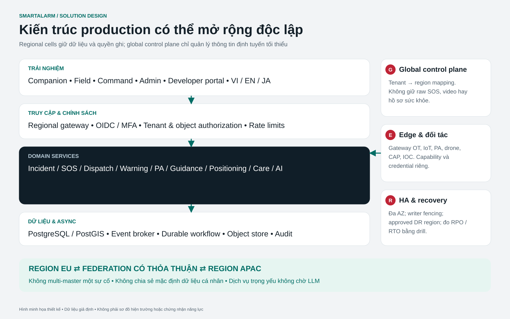
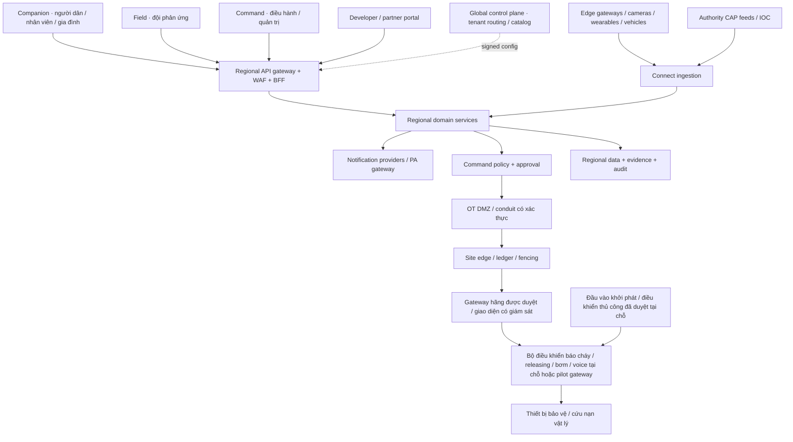

# SmartAlarm — Basic Design / Kiến trúc tổng thể production

**Baseline 1.0 · 23/10/2026 · thiết kế, chưa triển khai.** Kiến trúc đầy đủ cho sản phẩm quốc tế đa ngành; không phải kiến trúc demo. Người dùng xác nhận phát triển đầy đủ một lần, thiết kế sâu và lâu dài. Việc chia workstream/quality gate phục vụ quản lý triển khai, không loại bỏ tính năng khỏi baseline. Prototype chỉ là phương tiện review giao diện, không phải sản phẩm backend hoặc bằng chứng đạt SLO.

## 1. Nguyên tắc và quyết định kiến trúc

1. Domain services độc lập, giao tiếp qua API có version và event; không query chéo database.
2. Tenant, region, authorization, provenance và idempotency là invariant, không thêm sau.
3. Tách control plane khỏi regional data plane; regional cell tự vận hành khi control plane gián đoạn.
4. Một incident có một home region và một writer được fence; không multi-master sửa cùng incident.
5. Critical path không phụ thuộc AI sinh nội dung, search, BI hoặc global control plane.
6. Event delivery at-least-once + consumer idempotency; không hứa exactly-once xuyên Internet/provider/thiết bị.
7. Edge giữ chức năng an toàn cục bộ độc lập; cloud không thay thế vòng điều khiển bảo vệ được chứng nhận.
8. AI là nguồn evidence/suggestion; automation theo rule đã phê duyệt và có giới hạn.
9. Ba locale phát hành: vi-VN, en, ja-JP; thiết kế key-based để thêm ngôn ngữ mà không đổi business schema.
10. Full functionality không đồng nghĩa bật mọi capability cho mọi tenant. Feature entitlement và safety policy quyết định quyền sử dụng, có audit.
11. Chữa cháy và cứu nạn vật lý thuộc thiết kế đầy đủ. Bảo vệ tự động tại chỗ giữ tính độc lập; SmartAlarm điều phối và chỉ yêu cầu capability được duyệt qua bộ điều khiển được duyệt. Không có LLM trong vòng điều khiển chấp hành.
12. Quan sát, yêu cầu được cấp quyền, controller chấp nhận và kết quả vật lý đã xác minh là các trạng thái khác nhau. Gateway chỉ giám sát không được nâng thành actuator bằng entitlement hoặc thuộc tính giao thức có thể ghi.

## 2. System context

Channels: web Command/Administration/Developer portal responsive; native iOS/Android Companion và Field; optional kiosk/wallboard theo scope. Native mobile được ưu tiên cho background capabilities, secure storage và notification integration; hệ điều hành có thể hạn chế background delivery nên không coi app là kênh duy nhất.

Chuỗi controller/thiết bị tại chỗ không đi qua cloud hoặc site edge. Đầu sprinkler wet-pipe tác động nhiệt không được kích hoạt riêng lẻ bằng lệnh phần mềm chung; hệ controlled-release cần releasing controller và cause-and-effect riêng đã duyệt. Giao diện vật lý có thể chỉ cho quan sát. [Catalog thiết bị vật lý](Physical-Device-Catalog.md), [catalog cứu nạn/IoT](Rescue-IoT-Device-Catalog.md) và [thiết kế tiêu chuẩn/triển khai](External-Integration-Standards-Deployment.md) cung cấp chứng cứ nguồn chính thức có ngày, giới hạn cụ thể của ứng viên và gate mua sắm/nghiệm thu. Các ứng viên đã nghiên cứu chưa phải tích hợp đã triển khai.

## 3. Service boundaries và ownership

| Service | Trách nhiệm / dữ liệu sở hữu | API chính / event xuất | Dependency hợp lệ |
|---|---|---|---|
| Identity & membership | Tenant membership, roles, site scopes, consent identities | memberships, sessions; membership.revoked | OIDC provider; policy store |
| Tenant & policy | Region assignment, entitlements, configuration version | tenants, policies; policy.published | Global routing metadata |
| Location & mapping | Site graph, geofences, plan revisions, shelters | locations, plans; plan.published | Regional object store |
| Device registry | Identity/cert binding, capability, firmware, maintenance | devices; device.health.changed | PKI, connector registry |
| Integration runtime | Adapter execution, mapping, source receipt, DLQ | events ingest; signal.accepted | Device/policy caches, broker |
| Detection & correlation | Rule versions, candidate groupings, model metadata | candidates; incident.candidate | Signal stream, location snapshot |
| Incident | Incident aggregate, source references, state and version | incidents; incident.created/updated | Local policy cache, outbox |
| Assistance & accountability | SOS, person observations, check-in sessions | sos, safety-reports; sos.created | Incident references, consent |
| Workflow orchestration | Durable deadlines, escalation, human approvals | workflows; escalation.due | Service APIs with idempotency |
| Dispatch | Units, skills, shifts, offers, tasks, handover | tasks; task.assigned/completed | Incident projection, team roster |
| Warning & content | Warning version, translated content, audience approval | warnings; warning.approved | Approved content, audience snapshot |
| Delivery | Channel attempts, provider feedback, fallback, receipts | deliveries; delivery.status.changed | Provider adapters, recipient snapshot |
| Collaboration | Groups, memberships, restricted incident chat | conversations; message.created | IAM/consent, attachment service |
| Command & mission | Equipment commands, interlocks, approvals, mission state | commands, missions; command.result | Capability registry, edge adapter |
| Evidence/media | Upload session, hash, scan status, retention, stream auth | evidence; evidence.available | Object store, antivirus, media gateway |
| Audit & privacy | Audit ledger, legal hold, data requests, access logs | audits, privacy-requests | Events, policy, secure export |
| Analytics & reporting | Read models, metrics, deidentified warehouse | reports; report.ready | CDC/event sink, no source writes |
| Platform operations | SLOs, restore tests, region health, support access | operational endpoints | Metrics, traces, config metadata |
| Physical integration | Binding site/controller/point có version, quality observation, chứng cứ capability và nghiệm thu tương thích | physical-bindings, physical-points; physical.point.observed / physical.binding.accepted | Registry, adapter hãng đã duyệt, location revision; không sở hữu logic bảo vệ tại chỗ |
| Physical readiness | Hồ sơ impairment, quyền test, kiểm tra khôi phục và chứng cứ nghiệm thu | impairments, physical-test-runs, compatibility-assessments; physical.impairment.changed / physical.test.completed | Tham chiếu physical binding, đội bảo trì, evidence service |
| Rescue equipment operations | Phạm vi nhiệm vụ thiết bị, phân công operator đủ năng lực, giới hạn payload/route, bàn giao và kết quả | rescue-equipment-missions; rescue.equipment_mission.updated | Dispatch, equipment capability, workflow pilot/vendor-console; không suy diễn API lái |

Service sở hữu schema và migrations của mình. Production có database logical riêng theo service; có thể dùng managed cluster chung theo workload nhưng credentials và schema boundary không chia sẻ. Incident và SOS là aggregate độc lập; liên kết eventual nhất quán qua event, không distributed DB transaction. Workflow saga quản lý thất bại và bù trừ, không rollback dấu vết thực tế đã gửi.

Command & mission giữ aggregate lệnh vật lý có thẩm quyền cùng approval/ledger; Physical integration sở hữu ngữ nghĩa point và transport binding, không quyết định lệnh. Physical readiness sở hữu trạng thái impairment/test; trạng thái controller tại chỗ vẫn là nguồn cho mode thiết bị và interlock thật. Sai khác tạo conflict tường minh, không bị cloud ghi đè. Rescue equipment operations sở hữu nhiệm vụ thiết bị liên kết Dispatch task và Command flight mission khi phù hợp, tránh hai nơi phân công độc lập. Kỹ sư PCCC/integrator hãng tại site duyệt cause-and-effect; incident commander không tự có quyền reset/inhibit vì đang sở hữu incident.

## 4. Regional cell và multi-region

Một cell gồm API ingress, compute đa AZ, event broker, workflow workers, transactional DB, cache, object store, search và observability. Mỗi tenant pin vào home_region; deployments lớn có dedicated cell hoặc dedicated database. Global directory chỉ chứa opaque tenant ID, region routing, service entitlement và health tổng hợp. Credential secrets, camera media, tọa độ cá nhân và SOS không đi vào global metadata.

Trong region: API stateless active-active đa AZ; broker replication đa AZ; PostgreSQL HA với synchronous durability theo mục tiêu đã đo; workers scale theo partition/queue lag. Giữa region: incident ownership single-writer, asynchronous replication theo policy residency. Khi disaster: fence old writer (epoch/lease), promote DR destination được chấp thuận, tăng epoch, định tuyến client, replay outbox và reconcile receipts. Không auto-failover sang nước không được phép. RTO/RPO là mục tiêu thiết kế cần chứng minh bằng drill, không suy ra từ việc có replica.

Global control plane hỏng: cell dùng signed cached policy có TTL phù hợp, vẫn tiếp nhận và xử lý cho tenant hiện hữu; không onboard/migrate tenant hoặc cấp quyền mới khi không xác thực được. Identity revocation feed có bound và emergency local denylist; auth outage policy fail-closed cho privileged actions, existing restricted sessions xử lý theo policy được duyệt.

DR region không tự chuyển quyền vận hành thiết bị site. Cặp edge/controller đã duyệt gắn tenant, site, home region, capability revision và command writer epoch; region mới phải reconcile intent còn mở và qua policy chuyển giao của site trước khi ghi từ xa trở lại. Bảo vệ tự động tại chỗ tiếp tục khi cloud không có quyền lệnh. Thay edge phải khôi phục ledger bền vững và binding revision đã xác minh; không replay yêu cầu vật lý chưa rõ kết quả hoặc đã hết hạn.

## 5. Luồng dữ liệu và lớp tích hợp

Edge → mTLS MQTT/HTTPS → adapter → canonical CloudEvent → durable ingest → broker → correlation → incident/SOS → workflow → warning/dispatch/command → delivery/edge → receipts → projections/UI. Websocket/SSE chỉ cập nhật view; reconnect bằng sequence cursor và GET snapshot, không coi mất socket là mất incident. Large media upload trực tiếp qua signed URL, scan trước khi available; event chỉ mang reference/hash.

Adapter framework có manifest gồm kind/version/vendor/protocol, supported schema, capabilities, auth modes, direction, rate, health, retry class và safety class. Một adapter telemetry không được nâng thành command bằng config không review. Contract test suite gồm valid/invalid/duplicate/stale/out-of-order/revoked/cross-tenant/oversize/backpressure/reconnect. Connector certification là quy trình nội bộ có chứng cứ test, không phải chứng nhận của cơ quan tiêu chuẩn.

Các profile tích hợp: MQTT 5 cho transport IoT; HTTPS CloudEvents cho events; CAP 1.2 cho public warning; SensorThings cho mô hình quan sát khi đối tác hỗ trợ; ONVIF/RTSP qua vendor-specific media gateway; BACnet/Modbus qua gateway vùng OT, không expose bus OT trực tiếp ra Internet; MAVLink/vendor SDK qua drone gateway và local pilot. Chọn protocol không có nghĩa mọi thiết bị tự tương thích: phải map semantics, unit, status, auth và capability.

Thu nhận vật lý chuẩn hóa point observation với raw address, source/receive time, quality, engineering unit/scaling, controller identity và mapping revision. Conduit đọc và ghi có quyền riêng. Ví dụ catalog có Siemens US BACnet chỉ giám sát, đường trạng thái bổ trợ NOTIFIER/BACpac, map Tornatech theo model và tủ releasing Potter tại chỗ: không loại nào là API chữa cháy phổ quát. Robot hoặc payload drone chưa có giao diện điều khiển công khai đã xác minh dùng task giao cho operator đủ năng lực tại console hãng. Mất link là UNKNOWN/STALE, không chứng minh bơm dừng hoặc vùng an toàn.

## 6. Dữ liệu, consistency và recovery

Transactional state dùng PostgreSQL/PostGIS. Kafka-compatible broker quản lý stream durable và consumer offsets. Temporal hoặc workflow engine tương đương quản lý human steps/timers; lựa chọn này cần benchmark và license/deployment review, không khóa domain vào SDK trong mọi module. Redis phục vụ cache/rate limit, không là source of truth cho SOS/deadline. Object store S3-compatible cho media và export. Search engine cho investigative search; analytics warehouse riêng, không query trực tiếp OLTP khi incident burst.

Outbox ghi trong transaction cùng aggregate; publisher có retry và event ID ổn định. Consumer inbox unique (consumer,event_id) + mutation transaction; external side effect dùng effect key lưu trước/receipt reconcile. Không có exactly-once side effect với provider không hỗ trợ idempotency; phải hiện unknown và dedupe theo provider message ID khi có. Entity projection lưu source_version, bỏ stale updates; không dùng latest-arrival làm latest-observation.

Physical integration lưu point observation bất biến và binding controller/zone/capability có version; projection phân biệt alarm, supervisory, trouble, test và communication quality. Command & mission lưu effect intent trước khi gửi, giữ riêng chứng cứ SENT/ACCEPTED/EXECUTING/COMPLETED_VERIFIED/UNKNOWN. Mất ACK sau gửi cần reconciliation, không tự retry actuation không idempotent. Physical readiness lưu impairment/restoration và chứng cứ FAT/SAT liên kết đúng hardware, firmware, license, config. Restore áp dụng lại impairment, capability hết hạn và revocation trước khi cho ghi.

## 7. Security & trust boundaries

Internet → WAF/API gateway → service identity network; device network/OT → DMZ edge gateway; third-party adapter sandbox → canonical ingestion; authenticated user → object-level authorization; tenant → partner agreement; region → approved transfer. OIDC/OAuth2, PKCE cho native/browser, short-lived access tokens, rotated refresh tokens, MFA cho quyền nhạy cảm. Workload identity và mTLS service-to-service; vault cho secrets; KMS/envelope encryption, keys theo region và tùy tier tenant. RLS là defense-in-depth, không thay policy enforcement ở service.

Threat model trọng tâm: forged device alerts, tenant ID spoof, broken object authorization, malicious callback/SSRF, replay commands, compromised adapter, poisoned AI evidence, leaked location, notification flooding, account takeover, malicious file uploads, support overreach. Controls cụ thể nằm trong Detail Design và Acceptance Matrix. Prompt hay metadata từ đối tác chỉ là data; không cho phép tác động rule/policy/code của hệ thống.

Ranh giới OT bổ sung site DMZ, conduit đã duyệt, allowlist ghi theo capability, adapter cách ly và giao diện có giám sát khi được phép. Không relay đa dụng nào bỏ qua bộ điều khiển báo cháy, releasing, bơm hoặc voice alarm tại chỗ. Điều khiển thủ công và interlock bảo vệ giữ thẩm quyền theo tài liệu; cloud deny chỉ chặn yêu cầu của cloud, không inhibit bảo vệ tự động tại chỗ. Đánh giá point map giả, credential gateway bị lấy, lạm dụng reset/inhibit, trộn test/actual, feedback cũ và firmware/config độc hại. Dùng đánh giá rủi ro IEC 62443 theo site; giao thức hoặc TLS không tự chứng nhận security level.

## 8. Capacity model và scale triggers

Profile tham chiếu regional production: 100 tenants, 1,000 sites, 100,000 devices, 1,000,000 registered users; không phải cam kết một node xử lý được. Heartbeat 60 s → khoảng 1,667 message/s; không gửi mọi heartbeat vào Incident service. Telemetry được phân luồng/batch; critical events profile 100/s steady, 1,000/s burst 60 s. Một warning 100,000 recipients × 2 channels = 200,000 delivery jobs; nếu nhà cung cấp thực tế cho 1,000/s thì dispatch tối thiểu khoảng 200 s, chưa gồm latency, vì vậy không cam kết broadcast tới tất cả trong 5 s. NFR 5 s chỉ là tạo job, không end-device delivery.

Storage ví dụ: 100 critical event/s × 2 KB × 86,400 ≈ 17.3 GB/ngày raw metadata; replicas/indexes/audit tăng thêm cần đo. Video: 1 Mbps × 10,000 cameras continuous ≈ 108 TB/ngày; thiết kế ưu tiên event clips và retention theo tenant, không đưa video liên tục lên cloud mặc định. Clips 15 s × 2 Mbps ≈ 3.75 MB/clip, 100,000 clips/ngày ≈ 375 GB/ngày trước replica. Capacity sheet phải thay bằng thông số thật của site/vendor.

Scale theo CPU cùng p95 latency, broker lag, workflow task latency, DB lock/IO, provider quota; partition key tenant+incident để giữ thứ tự aggregate và tránh tenant khổng lồ chỉ có một partition. Regional shards theo tenant/site group, hot tenant có dedicated cell. Delivery fair scheduling theo tenant và priority; emergency reserve không phải unlimited capacity. Load shedding giảm telemetry không critical, giữ SOS/command receipts và phát degradation event khi reserve cạn.

Capacity vật lý theo site: lưu số point, update/event rate, polling minimum, giới hạn subscription gateway, retention edge, tài nguyên dự phòng khẩn và giới hạn lệnh controller. Tránh flood tủ khi rediscovery/recovery. Latency lệnh vật lý và deadline feedback theo tiêu chí capability/site đã duyệt; target tạo job cloud không hứa bơm chạy, waterflow, hiệu quả chữa cháy hoặc vùng phủ âm thanh. Lỗi point từng phần phải hiện theo vùng, không bị che bằng health tổng hợp gateway.

## 9. Deployment & release

Production deploy container trên Kubernetes/managed orchestration tương đương, IaC, immutable images, signed artifacts, SBOM, dependency scanning, secret scanning, migration review. Network policy deny-by-default. Môi trường dev/test/staging/production có account/network/credentials/provider sandbox riêng; exercise mode cũng tách topic + recipient + device namespace.

Release theo expand → migrate → switch → contract; rollback binary không rollback destructive DB migration. Canary theo tenant/site thử nghiệm; schema minor additive; event major dual-publish/consume trong cửa sổ chuyển đổi, không silently reinterpret field. Consumer lag và DLQ là release gates. Mobile hỗ trợ minimum supported API version với grace period và không block cached emergency guidance khi update app.

Gate release vật lý: RFI/khảo sát site → binding point/zone/cause-and-effect được duyệt → FAT → SAT sau lắp → bàn giao có ký. Chốt manufacturer, regional model, firmware, gateway, license, point map và chứng chỉ; đổi firmware/mapping mở lại test nghiệm thu liên quan. Test hardware cần kế hoạch impairment/test/restoration có quyền; exercise mode phần mềm đơn thuần không cách ly output vật lý. Triển khai write capability từ xa ở trạng thái disabled đến khi nghiệm thu đúng cấu hình. Bảo vệ tại chỗ hiện hữu tiếp tục khi rollout cloud; rollback phần mềm không hứa đảo tác động vật lý.

## 10. Observability và vận hành 24/7

Trace end-to-end bằng trace_id, correlation_id, causation_id và event_id; metric labels hạn chế cardinality, không chứa user/lat/lon. SLO burn-rate alerts, synthetic SOS với test tenant tách thật, provider health, certificate expiry, clock skew, stale plan, uncovered shift, unacknowledged incident và orphan workflow. Log redact secret/PII và định tuyến cùng residency.

Runbooks: ingestion lag, provider outage, regional loss, database failover, compromised device, adapter quarantine, widespread false positives, missed escalation, stale location, data leak, failed deletion, lost drone link. Mỗi runbook có owner, detection, containment, recovery, verification và communication; mô tả chi tiết trong Detail Design. Restore drill ít nhất hàng quý theo đề xuất và sau thay đổi topology; diễn tập site theo thỏa thuận vận hành.

Observability vật lý thêm age/quality theo point, alarm/supervisory/trouble, mode controller, impairment đang mở, khôi phục quá hạn, sai khác lệnh/feedback và kết quả vật lý chưa xác minh. Runbook bao gồm mất cloud, mất edge, gateway hỏng một phần, map sai vùng, lỗi nguồn, lệnh lặp, mất feedback và khoảng trống vùng phủ voice. FMEA/test lỗi phải chứng minh vận hành độc lập tại chỗ và trạng thái UNKNOWN trung thực. Lịch kiểm tra và biện pháp bù trừ do tiêu chuẩn áp dụng, hãng và thẩm quyền site quy định, không do phần mềm cloud tự đặt.

## 11. UI information architecture

### V2: vùng trình bày theo quyết định

Renderer minh họa v2 tách `prototype-v2.js` (công dân, cứu hộ, chỉ huy, chăm sóc, loa), `enterprise-v2.js` (124 màn còn lại) và `visuals-v2.js` (sơ đồ). Đây là module trình bày, không phải service điều khiển. Không đưa browser vào OT trust boundary; khả năng vẽ bơm/van không cấp capability ghi. Tất cả mã màn vẫn đối chiếu Screen-Registry.

| Nhóm quyết định | Thành phần chủ đạo / ranh giới |
|---|---|
| C35–C39, R05, O35/O36 | Sơ đồ và mốc gắn phiên bản tuyến, floor, nguồn vị trí và trạng thái hướng; lớp route hợp lệ tách lớp nền khảo sát. |
| C05–C10, R01–R04, O08/O09 | Loại trợ giúp → vị trí báo → kiểm tra → chuỗi tiếp nhận; owner, ACK và đến nơi tách biệt. |
| P01–P09, F01–F20 | Phủ loa / mimic hệ nước, hồ sơ capability, cổng duyệt và readback; ưu tiên tại chỗ luôn nằm ngoài quyền suy diễn của UI. |
| T04, D02/D03, L02/L03, Q06/Q07 | Ma trận quyền, request/response, bản dịch song song, claim/evidence; không ép tất cả thành thẻ hoặc bản đồ. |

Runtime production cần một snapshot trình bày nhất quán gồm dữ liệu nguồn + revision + observed time + quality + scope. Bộ chọn trạng thái UI phải thu hồi đồng thời route overlay, chỉ dẫn chữ và speech khi snapshot không còn đủ điều kiện. Thời gian render/tải lại không làm mới tuổi quan sát. Nguồn không có heading không được tạo heading từ hướng màn hình hoặc QR chỉ định vị.

Inspector dành reviewer giữ rule kỹ thuật, FR/WF và trường gốc ngoài luồng khẩn. Progressive disclosure không được giấu bất định có thể thay đổi quyết định. Bản chữ tương đương, sound policy kín đáo và focus management là khả năng dùng chung, không gắn riêng một loại sơ đồ. Các module hiện tại là bản mẫu; chưa thay thế cơ chế snapshot, định tuyến được kiểm chứng hoặc bộ điều khiển âm thanh production.

Companion ưu tiên một việc tại một thời điểm: nhận biết → chọn hành động → receipt → theo dõi. Field ưu tiên glove-friendly targets, offline evidence, assignment ownership. Command cung cấp incident workspace với map/floor, queue, people, timeline, dispatch và delivery; không dùng dashboard để thay workflow. Administration chia site ops / integration / tenant / platform để tránh quyền quá rộng. Developer portal có schema, API clients, conformance tests và version lifecycle. Global operations không hiển thị PII của tenant.

Thiết kế shell: sidebar có scope region/site; header có incident context, language và freshness; hành động nguy hiểm có target+effect+expiry rõ. Màu đỏ cho critical/action khẩn, không tô mọi chức năng. Trắng/ngà lạnh cho workspace, graphite cho command canvas, teal cho trạng thái có bằng chứng tốt; amber cho unknown/stale. Chế độ dark không thay severity semantics.

Physical operations bổ sung F01–F20 vào bộ thiết kế phối hợp 233 màn và WF-28–WF-33 vào baseline 33 workflow: onboarding point/zone, giám sát, actuation có quyền và reconcile UNKNOWN, impairment/test/restoration, tương thích FAT/SAT và nhiệm vụ thiết bị cứu nạn. UI hiển thị provenance capability, target/zone revision, mode controller, quality feedback và thẩm quyền tại chỗ trước hành động. Không ghi ACCEPTED là thành công vật lý hoặc hiện lệnh robot/drone chưa hỗ trợ chỉ vì đã có mission. FR-PHY-01–FR-PHY-16 quy định yêu cầu chức năng liên quan.

## 12. ADR trọng yếu

| ADR | Quyết định | Lý do / trade-off |
|---|---|---|
| 001 | Domain services ngay từ đầu | Đáp ứng hướng phát triển đầy đủ; chấp nhận chi phí SRE/contract testing cao hơn modular monolith |
| 002 | Regional single-writer incident | Tránh split-brain trong dispatch/command; federation dùng bản chia sẻ read-only |
| 003 | Broker + outbox/inbox | Recoverable at-least-once, không dùng distributed transaction với provider |
| 004 | Workflow engine durable | Timers và human steps survive restart; cần vận hành thêm stateful platform |
| 005 | Native mobile hai role experiences | Background/offline và ergonomics; có thể share codebase nhưng không trộn quyền |
| 006 | CAP boundary, CloudEvents internal | CAP cho public advisories; event nội bộ giữ schema mở rộng và provenance |
| 007 | AI outside safety decision authority | Confidence không đủ để kết luận; human/site-approved automation giữ quyền quyết định |
| 008 | I18n vi/en/ja first-class | Translations versioned; không nối chuỗi; alert publication kiểm tra locale completeness |
| 009 | Bảo vệ tự động tại chỗ độc lập | Lỗi cloud/edge không ngắt chuỗi; tích hợp là bổ trợ trừ khi được đánh giá/phê duyệt cụ thể |
| 010 | Chấp nhận capability vật lý theo cấu hình chính xác | Ghi giao thức và chứng chỉ linh kiện không xác lập quyền actuation; FAT/SAT gắn với tổ hợp được duyệt |
| 011 | Kết quả vật lý UNKNOWN cần reconciliation | Ngăn lặp xả/chuyển động và thành công giả; chấp nhận xác minh thủ công khi thiếu feedback |
| 012 | Impairment và test là aggregate vận hành | Ngăn nhầm test/actual và mất bảo vệ âm thầm; khôi phục cần chứng cứ site |

## 13. Nguồn tiêu chuẩn và cách áp dụng

Đã tra cứu ngày 23/10/2026. Đây là tham chiếu thiết kế, không phải tuyên bố sản phẩm đã được chứng nhận.

- [OASIS CAP 1.2](https://docs.oasis-open.org/emergency/cap/v1.2/CAP-v1.2.html): trao đổi cảnh báo all-hazard; giữ identifiers, updates, cancellations, areas và expiration.
- [CloudEvents](https://cloudevents.io/): envelope sự kiện chung; schema dữ liệu nghiệp vụ do SmartAlarm version riêng.
- [MQTT 5](https://docs.oasis-open.org/mqtt/mqtt/v5.0/mqtt-v5.0.html): pub/sub cho IoT; QoS transport không thay business dedupe.
- [OGC SensorThings](https://www.ogc.org/standards/sensorthings/): profile tương tác sensor được hỗ trợ theo adapter.
- [MAVLink Command Protocol](https://mavlink.io/en/services/command.html): ACK có thể chỉ nghĩa accepted, không chứng minh hành động vật lý hoàn tất; capability flight stack quyết định.
- [WCAG 2.2](https://www.w3.org/TR/WCAG22/): mục tiêu AA cho web; keyboard, contrast, focus, target sizing và accessible errors.
- [Material Design](https://m3.material.io/) và [Apple HIG Accessibility](https://developer.apple.com/design/human-interface-guidelines/accessibility): tài liệu tham khảo giao diện native; các trang đòi JavaScript chưa được đọc đầy đủ, không dựa vào chúng để tuyên bố tuân thủ chi tiết.

## Phụ lục bắt buộc trong cùng baseline

[Loa cứu hộ và voice navigation](Voice-Rescue-Design.md) bổ sung WF-21–22. [Định vị, tối ưu, AI và hồ sơ hỗ trợ](Positioning-AI-Care-Design.md) bổ sung WF-23–27. Hai tài liệu này là thành phần của full design, không phải tính năng tùy chọn cho giai đoạn sau. [Đặc tả màn hình](Screen-Specifications.md) cung cấp FR theo từng screen ID.
