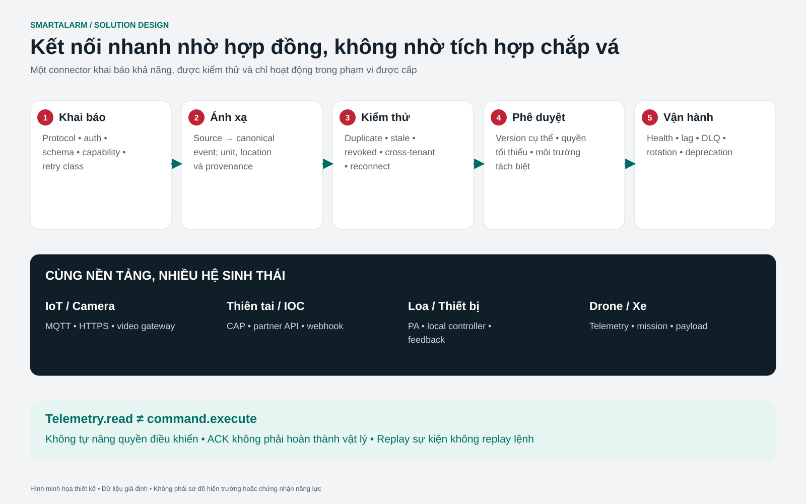
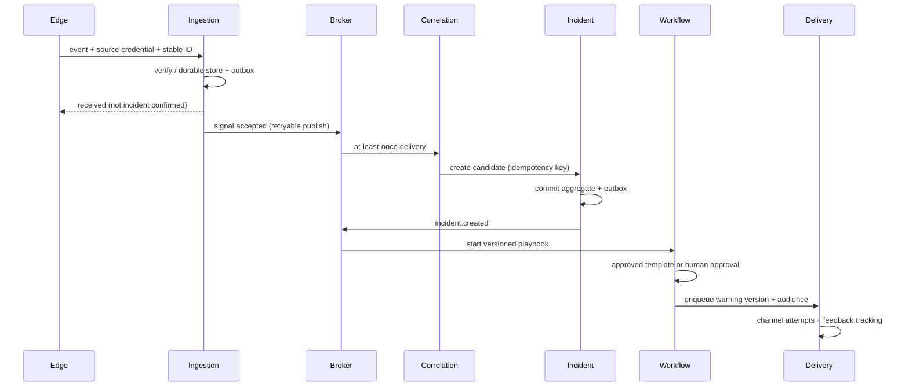

# SmartAlarm — Detail Design / Thiết kế kỹ thuật chi tiết




Version 1.0 · baseline thiết kế kiến trúc production, chưa triển khai · 23/10/2026. Tài liệu kết hợp API-Contract.json, Event-Schemas.json, Screen-Specifications.md và Acceptance-Matrix.csv. API contract đính kèm là baseline core có cấu trúc máy đọc; các integration vendor cần binding specification riêng khi có thiết bị thực tế.

## 1. Domain data model

ID dùng UUIDv7 hoặc UUID tương đương có uniqueness; external IDs chỉ trong namespace nguồn. Tất cả bảng tenant data có tenant_id, region_id, created_at UTC, updated_at và version bigint. Internal foreign keys composite tenant_id+id khi cùng DB; reference cross-service dùng ID và snapshot version, không foreign key xuyên database.

| Entity | Trường chính và constraint | Retention đề xuất / owner |
|---|---|---|
| Tenant | id, home_region, status, policy_version, default_locale; region immutable qua normal API | Hết hợp đồng + policy / Tenant |
| Membership | tenant,user,role,site_scope,valid_from,valid_until,revoked_at; unique tenant,user,role,scope | Audit giữ lịch sử / IAM |
| Location | id,parent_id,type,name_i18n,geometry,timezone,version; parent cùng tenant; cycle forbidden | Version lưu lâu dài / Location |
| PlanRevision | plan_id,revision,asset_id,scale,exit_graph,reviewer,published_at; unique plan,revision | Theo incident reference / Location |
| Device | id,external_id,connector_id,location_id,cert_thumbprint,capabilities,health; unique tenant,connector,external_id | Đời thiết bị + audit / Registry |
| Signal | id,source,event_id,type,observed_at,received_at,schema_version,payload_ref,location_snapshot,mode | 30 ngày hot + archive policy / Ingestion |
| Incident | id,hazard,severity,state,home_region,writer_epoch,owner,location_ref,version,opened_at,closed_at | 365 ngày mặc định đề xuất / Incident |
| IncidentSignal | incident_id,signal_id,relation,actor,reason; unique incident,signal | Theo incident / Incident |
| SOS | id,client_request_id,person_ref,incident_ref,category,state,location_report,sharing_policy,version | 365 ngày, precise location tách / Assistance |
| PersonObservation | id,person_ref,incident_ref,status,reporter_type,observed_at,received_at,location_ref | Append-only; precise location 30 ngày / Assistance |
| Task | id,incident_ref,unit_ref,state,offer_deadline,version,assignment_epoch,completed_at | 365 ngày / Dispatch |
| WarningVersion | warning_id,version,content_i18n,area,audience_snapshot,expiry,status,approvals | 365 ngày / Warning |
| DeliveryAttempt | id,warning_ref,recipient_ref,channel,attempt_no,provider_id,state,receipt_at; effect_key unique | 90 ngày metadata / Delivery |
| Command | id,target,capability,params_digest,nonce,expires_at,approval,state,device_receipt,writer_epoch | 365 ngày / Command |
| Mission | id,drone_ref,incident_ref,pilot_ref,plan_version,clearance_ref,state,flight_log_ref | 365 ngày policy / Command |
| Evidence | id,tenant,object_key,sha256,mime,size,scan_state,classification,hold_id | 90 ngày, legal hold override / Evidence |
| Consent | subject,purpose,recipient_scope,fields,policy_version,granted_at,revoked_at | Version history / Privacy |
| AuditEntry | id,actor,action,object_ref,object_version,reason,trace_id,at,digest,previous_digest | 365+ theo policy / Audit |
| Outbox / Inbox | outbox: event_id,payload,attempt,next_attempt; inbox: consumer,event_id,processed_at | Replay horizon + margin / từng service |
| PhysicalBindingRevision | binding_id,revision,controller_id,regional_model,firmware,gateway_model,gateway_firmware,license_ref,point_map_digest,zone_revision,cause_effect_revision,status,acceptance_ref; unique tenant,binding_id,revision | Lịch sử cấu hình có tham chiếu; policy được duyệt / Physical integration |
| PhysicalPoint | id,binding_id,binding_revision,controller_id,zone_id,raw_address,semantic,access_mode,unit,scale,offset,byte_order,word_order,enum_map,stale_after,feedback_for; unique tenant,binding_id,binding_revision,raw_address | Đời binding + tham chiếu incident/test / Physical integration |
| PhysicalObservation | id,binding_id,point_id,binding_revision,source_event_id,observed_at,received_at,value,quality,controller_mode,maintenance_state,raw_evidence_ref; append-only | Đề xuất 30 ngày hot; archive theo policy incident/test / Physical integration |
| PhysicalCapability | id,binding_id,revision,operation,parameter_schema,allowed_targets,authorization_policy,local_interlocks,command_ttl,retry_class,feedback_point_ids,completion_criterion,unknown_outcome_policy,approval_evidence_ref | Lịch sử phê duyệt có version / Command |
| PhysicalCommandDetail | command_id,binding_revision,capability_revision,zone_revision,cause_effect_revision,expected_point_versions,feedback_deadline,physical_state,evidence_refs; one-to-one Command | Kế thừa retention Command / Command |
| Impairment | id,scope_refs,functions_affected,reason,owner,planned_until,notifications,compensatory_plan_ref,status,restoration_evidence_refs,version | Policy kiểm tra site; áp dụng legal hold / Physical readiness |
| PhysicalTestRun | id,binding_revision,test_plan_ref,mode,authorization_ref,impairment_ref,operator,witness,started_at,ended_at,result,evidence_refs | Policy kiểm tra/nghiệm thu site / Physical readiness |
| CompatibilityAssessment | id,binding_revision,hardware_serials,firmware_versions,license_refs,certificate_refs,fat_run_refs,sat_run_refs,open_defects,signoffs,status | Vòng đời cấu hình và policy site / Physical readiness |
| RescueEquipmentMission | id,incident_ref,dispatch_task_ref,equipment_ref,operator_ref,capability_revision,mission_scope,local_console_required,flight_mission_ref,state,limitations,result_evidence_refs | Đề xuất 365 ngày; evidence nhạy cảm riêng / Rescue equipment operations |

Giá trị retention là default đề xuất phục vụ design, không kết luận pháp lý. Legal hold ngăn purge các object liên quan. Deletion có tombstone tham chiếu để không phá audit, không giữ PII ngoài mục đích. Search/index/backup phải có deletion propagation và expiration strategy; không chỉ xóa OLTP.

### Indexes và concurrency

Signal unique(tenant_id,source,event_id); index(tenant_id,observed_at DESC), partition theo received_at tháng. Incident index(tenant_id,state,severity,opened_at DESC), spatial index geometry; partial index active. SOS unique(tenant_id,client_request_id), index(tenant_id,incident_ref,state). Task update dùng `WHERE version=:expected AND assignment_epoch=:epoch`; affected_rows=0 trả 409. Delivery unique(effect_key); provider callback unique(provider,event_id). Outbox index(status,next_attempt_at) và leasing worker tránh xử lý concurrent cùng row.

RLS dùng tenant context được bind từ verified principal trong transaction, không từ header tin cậy trực tiếp. Connection pool reset context bắt buộc. Tenant ID trong URL không đủ authorization. Region routing kiểm tra membership directory và signed region mapping; request sai region nhận redirect metadata an toàn hoặc 409 REGION_MISMATCH.

### Bất biến lưu trữ và revision vật lý

Mỗi entity vật lý cũng có tenant_id, region_id, created_at, updated_at và version chung ở trên. Dùng composite reference trong cùng service; reference xuyên service giữ accepted snapshot digest. Dedupe PhysicalObservation là unique(tenant_id,binding_id,source_event_id,point_id) khi có source event ID ổn định; nếu không, adapter tạo receipt ID ổn định và ghi rõ không chứng minh được dedupe cấp nguồn. Index observation theo tenant_id,point_id,observed_at và partition theo received_at. Latest view của point dùng source sequence/time và quality, không chỉ thứ tự đến.

Binding revision bất biến sau nghiệm thu. Activation chỉ đổi active revision nguyên tử sau compatibility acceptance và readiness check; command approval còn mở gắn revision gốc và mất quyền dispatch khi không còn khớp active binding. physical_state không được thành COMPLETED_VERIFIED nếu thiếu tiêu chí evidence đã khai báo. Khôi phục impairment và bật lại capability là hai transaction khác nhau; xóa alarm dashboard không khôi phục thiết bị hoặc cấp quyền ghi. Snapshot reconciliation so maintenance_state phần mềm với mode controller và báo conflict.

## 2. API conventions

Base `/v1`; JSON UTF-8, RFC3339 timestamps, cursor pagination. Authorization Bearer + verified tenant context; optional X-Tenant-ID chỉ là selector, server đối chiếu token membership. `Idempotency-Key` bắt buộc cho POST tạo SOS, warning send, dispatch offer, commands; scope principal+tenant+route+key, request body hash. Cùng key khác payload → 409 IDEMPOTENCY_MISMATCH; cùng key cùng payload → response cũ. Receipt chỉ sau durable commit. Key retention 7 ngày đề xuất cho human mutation; source event dedupe theo archive replay horizon 90 ngày tối thiểu đề xuất, replay cũ qua controlled path. Expiry của command không phụ thuộc dedupe retention.

`If-Match` version/ETag cho updates; 412 VERSION_MISMATCH hoặc domain 409 theo API schema. Error envelope: code, message_key, params, trace_id, retryable, field_errors; không expose stack. 400 malformed, 401 authentication, 403 permission, 404 inaccessible/not found, 409 domain conflict, 412 precondition, 413 payload, 422 validation, 429 quota, 503 unavailable. GET retries bounded; mutation retry chỉ với idempotency key.

| API | Quyền | Request/response và side effect |
|---|---|---|
| POST /events | event.ingest + source binding | CloudEvent; 202 durable receipt, không incident success |
| GET /incidents | incident.read scope | Filters severity/state/site/from; cursor result |
| POST /incidents | incident.create | hazard,severity,location,signal_refs; 201 aggregate + outbox |
| POST /incidents/{id}/transitions | incident.transition | expected version,to,reason; validate state guard |
| POST /sos | sos.create | client_request_id,category,location,note; 201 server receipt |
| POST /sos/{id}/updates | sos.self_update hoặc sos.manage | append note/location/cancellation request; không delete |
| POST /safety-reports | safety.self_report | incident_ref,status,sharing preference; save observation + fan-out event |
| POST /tasks | task.assign | unit,incident,scope,deadline; offer + workflow timer |
| POST /tasks/{id}/accept | task.accept + assigned unit | expected version; atomic owner confirmation |
| POST /warnings | warning.author | localized content,audience,expires; create draft version |
| POST /warnings/{id}/approvals | warning.approve | version,digest,decision,reason; separate actor guard |
| POST /warnings/{id}/send | warning.send | approved version; effect key, immutable audience snapshot |
| GET /deliveries | delivery.read | warning,channel,state; không trả private address nếu thiếu scope |
| POST /commands | command.request | capability,target,parameters,expiry; 202 requested, chưa actuation |
| POST /commands/{id}/approve | command.approve | digest,version; publish intent sau interlock checks |
| POST /connectors/{id}/tests | connector.test | fixture_set,manifest_version; sandbox results |
| POST /connectors/{id}/replay | connector.replay | event IDs,reason; forbid command replay |
| POST /evidence/upload-sessions | evidence.write | mime,size,classification; short-lived scoped URL |
| POST /privacy-requests | privacy.self_request | type,scope; identity verification workflow |
| GET /stream | authenticated subscriptions | event cursor + projection changes; no mutation through socket |
| POST /physical-bindings | physical.binding.author | controller_id,regional_model,firmware,gateway,point_map,zone_revision,cause_effect_revision; tạo candidate revision bất biến |
| POST /physical-bindings/{id}/validate | physical.binding.test | revision,fixture_set; kiểm schema/point/capability, không actuation thật |
| POST /physical-bindings/{id}/activate | physical.binding.activate | expected_version,revision,acceptance_ref; từ chối thiếu signoff hoặc readiness không phù hợp |
| GET /physical-points | physical.point.read | controller,zone,binding_revision,quality; point projection theo scope |
| GET /physical-points/{id}/observations | physical.point.read | from,to,cursor; value, unit, source/receive time, quality và revision |
| POST /physical-commands | physical.command.request | capability_id,target,binding_revision,zone_revision,cause_effect_revision,parameters,expires_at; tạo Command + PhysicalCommandDetail, chưa actuation |
| POST /physical-commands/{id}/approvals | physical.command.approve | expected_version,digest,decision; actor khác khi policy yêu cầu, guard tại chỗ vẫn áp dụng |
| POST /physical-commands/{id}/reconciliations | physical.command.reconcile | expected_version,observations,evidence_refs,reason; không tự resend; giữ lịch sử UNKNOWN |
| POST /impairments | physical.impairment.manage | scope,functions_affected,reason,owner,planned_until,compensatory_plan_ref; tạo impairment theo dõi được |
| POST /impairments/{id}/restoration-checks | physical.impairment.restore | expected_version,checklist,evidence_refs,witness; xác minh trước đóng; không ngầm gửi lệnh |
| POST /physical-test-runs | physical.test.execute | binding_revision,test_plan_ref,mode,authorization_ref,impairment_ref; vòng đời test được duyệt |
| POST /physical-test-runs/{id}/evidence | physical.test.record | expected_version,step_id,expected,observed,evidence_refs; append evidence |
| POST /compatibility-assessments | physical.compatibility.author | binding_revision,hardware,firmware,licenses,certificates,fat_run_refs,sat_run_refs; tạo hồ sơ review |
| POST /compatibility-assessments/{id}/acceptance | physical.compatibility.accept | expected_version,decision,signoffs,open_defects; từ chối lỗi nghiêm trọng chưa xử lý |
| POST /rescue-equipment-missions | rescue.equipment.assign | incident_ref,dispatch_task_ref,equipment_ref,operator_ref,mission_scope,capability_revision; workflow operator đủ năng lực, không chuyển động |

Mọi physical POST mutation cần Idempotency-Key; update phù hợp cũng cần expected_version/If-Match. Route `/commands` hiện hữu vẫn là giao diện lệnh chung; `/physical-commands` là facade chuyên biệt trên cùng aggregate Command, không phải queue actuator thứ hai. Capability chưa rõ/chưa duyệt trả 422 CAPABILITY_NOT_APPROVED; lệch revision trả 409 BINDING_REVISION_MISMATCH; impairment/local inhibit đang hiệu lực trả 409 PHYSICAL_INTERLOCK hoặc IMPAIRMENT_ACTIVE; tiền đề cũ trả 409 PHYSICAL_STATE_STALE. Reconciliation không được kết luận kết quả thiếu evidence. Quyền theo site/controller/capability, không mặc định toàn tenant.

## 3. Canonical event envelope và semantics

```json
{
  "specversion": "1.0",
  "id": "019a0000-0000-7000-8000-000000000041",
  "source": "urn:smartalarm:connector:gw-12",
  "type": "com.smartalarm.signal.fire.observed.v1",
  "subject": "devices/cam-a05-03",
  "time": "2026-10-23T08:40:12Z",
  "datacontenttype": "application/json",
  "tenantid": "tenant-northstar",
  "regionid": "eu-cell-1",
  "mode": "actual",
  "data": {
    "schema_version": "1.0.0",
    "observed_at": "2026-10-23T08:40:11Z",
    "hazard": "fire.possible_flame",
    "location": {"id":"zone-a05-03","method":"registry","version":12},
    "confidence": 0.82,
    "model_version": "flame-v3",
    "evidence_refs": ["evidence-31"]
  }
}
```

tenantid được gateway xác nhận theo credential, không lấy payload làm nguồn sự thật. source là identity namespace đã đăng ký. Schema event có additional-property policy theo version; invalid fields quarantine kèm reason. Confidence từ detector không map trực tiếp sang severity, severity dựa policy và impact. observed_at có thể trễ/sai clock; received_at server luôn có; skew flag lưu riêng. Location geometry theo GeoJSON longitude,latitude; CAP inbound đổi từ lat,lon explicit và có test polygon.

Topics đề xuất: `sa.<region>.<mode>.signals.v1`, `incidents.v1`, `assistance.v1`, `dispatch.v1`, `warnings.v1`, `delivery.v1`, `commands.v1`, `audit.v1`, `deadletters.v1`. Không tạo topic cho mỗi user. Broker ACL service-specific, mode actual/exercise isolation. Partition key aggregate ID kèm tenant; telemetry key device ID. DLQ không chứa secret; có encrypted payload reference, reason và replay policy.

### Hợp đồng event vật lý

Dùng cùng CloudEvents envelope, source binding đã xác minh và cách ly actual/exercise. Type đề xuất là `com.smartalarm.physical.point.observed.v1`, `com.smartalarm.physical.command.state_changed.v1`, `com.smartalarm.physical.impairment.changed.v1`, `com.smartalarm.physical.test.completed.v1`, `com.smartalarm.physical.binding.accepted.v1`, `com.smartalarm.rescue.equipment_mission.updated.v1`. Event data gồm schema_version, aggregate_id, aggregate_version, binding_revision khi liên quan, source provenance và evidence reference. Ví dụ point payload chuẩn dưới đây là fixture thiết kế, không phải observation thật:

```json
{
  "schema_version": "1.0.0",
  "aggregate_id": "point-example",
  "aggregate_version": 1,
  "tenant_id": "tenant-example",
  "site_id": "site-example",
  "controller_id": "controller-example",
  "binding_id": "binding-example",
  "binding_revision": 1,
  "point_id": "point-example",
  "zone_id": "zone-example",
  "semantic": "pump_running",
  "value": true,
  "unit": "boolean",
  "observed_at": "2026-10-23T08:40:11Z",
  "received_at": "2026-10-23T08:40:12Z",
  "quality": "GOOD",
  "controller_mode": "AUTO",
  "maintenance_state": "IN_SERVICE",
  "cause_effect_revision": 1,
  "source_event_id": "source-example-1",
  "raw_evidence_ref": "evidence-example"
}
```

`pump_running` không phải `waterflow_confirmed` và cả hai không có nghĩa đám cháy đã tắt. Unit/scaling do point contract đã nghiệm thu quy định; thiếu sensor giữ UNKNOWN. Command event mang command_id, capability_revision, previous_state, state, controller_receipt_ref, feedback_observation_ids, unknown_reason và source/receive time khi phù hợp. Impairment event mang scope/functions và trạng thái khôi phục; test event mang authorization/evidence reference; mission event mang operator và mode giao diện hỗ trợ. Không phát raw medical notes trong equipment event.

## 4. Sequence: signal → incident → warning



Nếu Incident API timeout sau commit, caller retry cùng key và nhận incident cũ. Nếu broker down, outbox tồn tại; ingestion vẫn có giới hạn durable capacity và trạng thái degraded, không ACK nếu chưa commit. Nếu correlation lỗi, queue lag alert và operator có raw signal triage; không chặn manual SOS.

Với báo cháy vật lý, nguồn là controller/gateway tại chỗ đã duyệt và giữ phân biệt alarm/supervisory/trouble. Chữa cháy tự động tại chỗ chạy trên đầu vào và cause-and-effect riêng được duyệt; chuỗi cloud này chỉ tạo incident và workflow phản ứng. Đóng incident không silence/reset tủ, dừng bơm PCCC, đóng van hoặc hủy bảo vệ tại chỗ. Các thao tác đó cần capability và thẩm quyền site riêng.

## 5. Sequence: offline SOS và reconciliation

Client tạo UUID request, lưu encrypted local outbox và hiển thị “chưa gửi”. Khi online, POST cùng request ID; server commit rồi trả receipt. Nếu response mất, client retry, server trả SOS ID cũ. Client mới hiển thị received; human ACK đến bằng event riêng. Offline location update luôn có observed_at; server giữ lịch sử, không ghi đè vị trí mới hơn chỉ vì đến muộn. Cancel trong lúc offline là queued request, không hứa dừng dispatch. Thiết bị mất hoặc account revoked thì app purge secure cache theo policy khi có thể, không hứa remote wipe khi thiết bị luôn offline.

## 6. Workflow và deadlines

Workflow ID = tenant:aggregate:playbook_version. Timers chạy server-side; cron polling client không dùng làm safety mechanism. Mỗi bước có input schema, activity idempotency key, deadline, retry policy, compensation policy và manual fallback. Retry dùng exponential backoff+jitter, max attempts/time; business rejection không retry. Escalation step key workflow+step+recipient giúp không gửi lặp vô hạn. Warning expiry hủy jobs chưa gửi; job đã gửi cần cancel/update message, không thu hồi bằng cách xóa DB.

| Tình huống | Timer baseline đề xuất | Hết hạn |
|---|---|---|
| P1 incident chưa operator ACK | 60 s | Shift supervisor, sau đó regional backup ở 120 s |
| Task offer chưa nhận | 60 s | Expire offer, dispatcher chọn unit khác |
| Possible fall check-in | 30 s cấu hình | Tạo care request, không kết luận chẩn đoán |
| Physical command | TTL 30 s hoặc capability-specific | Expire trước dispatch; sau dispatch reconcile unknown |
| Webhook delivery | Backoff trong tối đa 24 h hoặc event expiry ngắn hơn | DLQ + owner alert |

Đây là default sản phẩm cần site validation; policy có min/max và approver, không cho admin đổi timeout tùy tiện trong incident mà không ghi version.

Workflow vật lý baseline 1.0 gồm WF-28 onboarding point/zone; WF-29 giám sát vật lý; WF-30 actuation có quyền, feedback và reconcile UNKNOWN; WF-31 impairment/test/restoration; WF-32 tương thích FAT/SAT; WF-33 nhiệm vụ thiết bị cứu nạn. Human deadline và command TTL là cấu hình capability/site có approver. Không timeout phần mềm phổ quát nào cấp quyền xả, reset, silence hoặc tự dừng bơm. Default command 30 s ở trên chỉ là đề xuất, phải override hoặc từ chối khi không phù hợp thiết kế thiết bị đã duyệt.

## 7. Correlation algorithm và hazard expansion

Exact dedupe trước fuzzy correlation. Candidate query theo tenant, mode, hazard compatibility, location graph và event window; score tính từ time distance, same zone, source diversity, semantic match. Score chỉ là suggestion trừ rule automation đã approved. Rule input gồm source confidence/quality, không count hai camera cùng model như hai bằng chứng độc lập tuyệt đối. Khi nhiều incident candidate, operator chọn; khi source correction, append correction event thay vì sửa event gốc.

Hazard registry gồm key, localized labels, severity policy, required fields, playbook binding, sensitivity, default audience, detector schema, retention class. Thêm “gas leak”, “industrial spill”, “lone worker”, “missing person”, “infrastructure outage” bằng registry/schema/plugin sau domain review; không sửa enum cứng trong mọi service. Category mới không tự có command quyền vật lý.

## 8. Command safety protocol

Request có command_id, device_id, capability, canonical params digest, tenant, writer_epoch, nonce, issued_at, expires_at, requester, approval evidence. Approval ký digest nên sửa params hủy approval. Gateway kiểm tra credential, epoch, TTL, capability, zone, local interlocks và used nonce. Non-idempotent capability trả retry_class=manual_reconcile; không tự gửi lại khi ACK mất. Local controller result ghi source time và observed physical state nếu có. Success chỉ khi capability-specific completion criterion đạt; accepted/executing/unknown phải hiện riêng trên UI.

HA command workers có distributed fencing; failover không reissue expired command. Local safety interlock có quyền từ chối dù cloud approved. Emergency stop chỉ hiển thị khi thiết bị hỗ trợ đúng semantics; stop request receipt không chứng minh thiết bị dừng. Drone gateway có flight stack capability negotiation, altitude frame, link health, pilot override và lost-link policy; video streaming tách command channel. Không dùng MAVLink command cancel làm bảo đảm phổ quát khi flight stack không hỗ trợ.

### Chuỗi thực thi lệnh vật lý

Cloud policy/approval → conduit OT DMZ có xác thực → site edge command ledger bền vững/fencing → gateway hãng được duyệt → controller tại chỗ → thiết bị vật lý → feedback độc lập khi có. Chuỗi bảo vệ và điều khiển thủ công tại chỗ không phụ thuộc đường cloud này. Access profile adapter là observe-only trừ khi model/firmware/license chính xác và phê duyệt site xác lập write capability cụ thể; quảng bá BACnet WriteProperty đơn thuần chưa đủ. Dùng giới hạn trong [Catalog thiết bị vật lý](Physical-Device-Catalog.md) và [Catalog cứu nạn/IoT](Rescue-IoT-Device-Catalog.md).

Trạng thái vật lý gồm DRAFT, PENDING_APPROVAL, AUTHORIZED, SENT, ACCEPTED, EXECUTING, COMPLETED_VERIFIED, REJECTED, EXPIRED, FAILED, UNKNOWN, RECONCILED. Chỉ map Command `succeeded` hiện hữu khi tiêu chí hoàn thành vật lý đã được xác minh; giữ physical_state chi tiết trong PhysicalCommandDetail. Approval gắn target, capability revision, point/zone/cause-and-effect revision, parameter digest, TTL và writer epoch. Edge kiểm freshness, local mode, impairment, operation cho phép và feedback availability trước gửi; controller tại chỗ giữ interlock cuối cùng. Sau gửi, timeout là UNKNOWN trừ khi evidence đáng tin chứng minh thất bại. Reconciliation append evidence/lý do, không replay lệnh âm thầm.

Đầu sprinkler wet-pipe tác động nhiệt không phải actuator có địa chỉ chung. Tổ hợp controlled-release giữ releasing logic tại chỗ được duyệt; cấm relay bypass đa dụng, trigger từ AI confidence hoặc cause-and-effect do LLM tạo. I/O có giám sát được phép tuân theo thiết kế điện, supervision và feedback chính xác. `release_output_active`, vị trí van, bơm chạy, áp suất và waterflow là observation khác nhau. Thiết bị cứu nạn chỉ hỗ trợ console thủ công nhận mission assignment, không nhận API drive/aim/discharge bịa ra. Giao diện remote emergency-stop chưa xác minh không được hiển thị như bảo đảm dừng vật lý.

## 9. Localization vi / en / ja

UI key dạng `incident.status.active`; resource bundles versioned, ICU MessageFormat cho plural/select, không nối fragments. Locale user ưu tiên explicit choice → profile → OS supported locale → tenant default → English reviewed. Language selection không đổi region hoặc authorization. Font stack: system UI + Noto Sans khi deploy font bundle, Japanese dùng Noto Sans JP/system CJK; no forced uppercase cho tiếng Nhật; line height tối thiểu 1.5 body, text expansion 40% để test. Dates/numbers/unit hiển thị theo locale nhưng có timezone bên cạnh khi command/incident cross-country.

Content template là entity có `template_id`, `version`, `locale`, `text`, `variables_schema`, `reviewer`, `approved_at`, `voice_asset_ref`. Warning approval tham chiếu exact locale versions. Thiếu bản dịch đã duyệt: hiển thị fallback language rõ và yêu cầu publisher xác nhận policy; không tạo bản dịch AI rồi tự phát. Không block toàn bộ P1 nếu emergency fallback template đã preapproved. Original message/user chat giữ nguyên ngôn ngữ; translation hỗ trợ được gắn machine translated và không thay original evidence. TTS voice được chọn theo locale, transcript luôn có; nếu TTS lỗi vẫn đọc text được. Bản dịch critical phải được người bản ngữ/domain reviewer kiểm tra trước release.

Thuật ngữ vật lý phải phân biệt nhất quán “yêu cầu được cấp quyền”, “controller chấp nhận”, “kết quả vật lý đã xác minh”, “kết quả chưa rõ”, “test”, “suy giảm chức năng” và “đã khôi phục” trong vi/en/ja. Giữ nhãn point hãng cùng ngữ nghĩa bản địa hóa đã duyệt. Dịch không đổi ngữ nghĩa register, cực tính điều khiển, đơn vị parameter hoặc thẩm quyền. Hỗ trợ TTS/ngôn ngữ loa theo model; dùng bản thu được duyệt khi payload đã nghiên cứu chưa xác minh locale hoặc API.

## 10. Evidence, chat và privacy

Upload policy baseline 20 MB/file cho ảnh/tài liệu/clip ngắn; MIME sniffing + extension allowlist + antivirus + decompression limits; quarantine trước scan. Signed upload URL scope object key và expiry ngắn; download URL kiểm tra policy và TTL, không public bucket. Video session token incident-scoped, audit access, region-resident relay. Webhook payload không gửi raw medical notes mặc định. Chat retention theo incident/social class, abuse report/restricted thread, attachment policy chung. Safety fan-out snapshot gồm group membership version nhưng recheck revocation lúc send.

Precise location được field-level protected; generalized site status cho family default. Retention purge gồm DB, object store, search index, caches và export links; backup có expiry và restore reapply tombstones. Legal hold và data subject deletion conflict chuyển privacy review; không silently ignore request. Audit hash chain/tamper-evident storage hỗ trợ phát hiện sửa đổi, không tuyên bố tuyệt đối không thể sửa khi toàn bộ authority bị compromise.

Hồ sơ FAT/SAT có serial/firmware/license/config chính xác, trạng thái point kỳ vọng/thực tế, timestamp, người chứng kiến, quyền test đã duyệt, sai lệch và khôi phục có ký. Lưu raw capture riêng cùng hash và quyền; redact secret nhưng giữ source reference truy vết được. Brochure hoặc chứng chỉ linh kiện không được đặt field_accepted. Nghiệm thu gắn binding lắp đặt cụ thể và phạm vi duyệt; thay firmware, point map hoặc cause-and-effect mở lại review liên quan.

## 11. Frontend runtime và state design

### Hợp đồng trình bày v2 và kiểm thử chuyển trạng thái

`getContent()` chọn renderer theo nhóm; `SAEnterprise.render(s,c)` chọn composition theo screen ID; `SAVisual.scene()` vẽ sơ đồ với ngôn ngữ và trạng thái. Không dùng thuộc tính `type` chung để quyết định mọi bố cục. `data-go` chỉ điều hướng, `data-demo` chỉ tương tác minh họa; không diễn giải hai loại event này thành success của API hoặc actuator. Giữ `Screen-Registry.json` và FR hiện có là hợp đồng nguồn.

Production phải áp dụng quy tắc dưới đây trước render và trước speech; đây là quy tắc kỹ thuật cần triển khai, không phải API schema mới:

| Đầu vào / chuyển trạng thái | Kết quả bắt buộc và assertion |
|---|---|
| Heading unknown, floor known | Giữ mặt bằng/mốc hợp lệ; bỏ mũi tên tương đối và câu “rẽ trái/phải”. QR xác nhận vị trí không tự xác nhận hướng. |
| Floor unknown / route withdrawn / evidence stale | Hủy speech đang phát và hàng đợi; bỏ route overlay và chỉ dẫn cũ trong cùng cập nhật; giữ cảnh báo, nhập vị trí, trợ giúp. Không cho back/history khôi phục tuyến cũ. |
| Snapshot mới đến muộn hơn revision đã thu hồi | Bỏ cập nhật cũ theo revision; không dùng thời điểm HTTP response để kết luận tuyến mới. |
| SOS local pending → durable receipt → human ACK | Chỉ tiến trạng thái khi có bằng chứng đúng request ID; không lấy click hoặc chuyển hash làm biên nhận. |
| Command accepted, readback absent | F11/F12 vẫn UNKNOWN; nút retry vật lý không xuất hiện. Chỉ ra bằng chứng thiếu và quy trình đối soát. |
| Vào C27 / đổi ngôn ngữ / rời hướng dẫn | Hủy âm cũ; C27 giữ im lặng khi quay lại, tải lại, đổi trạng thái hoặc có notification mới. |

Test component kiểm tra chữ và thuộc tính accessibility cùng SVG, không chỉ snapshot ảnh. Test tích hợp mô phỏng đổi revision khi speech đang phát, mất mạng giữa gửi/receipt, ACK trễ và local override. Test E2E đo focus, target, reflow, bàn phím và văn bản thay bản đồ ở VI/EN/JA. Bản mẫu hiện có speech ví dụ cố định, local state và dữ liệu minh họa; không có cơ chế production chứng minh các assertions trên.


Server state cache keyed tenant+region+user scope+resource; workspace switch purge hoặc partition hoàn toàn. Client store chỉ giữ draft/UI preferences, không dùng làm nguồn incident truth. Server-rendered shell hoặc static app + BFF được chọn theo deployment; CSP chặt, no tokens in localStorage, secure cookie cho web/session BFF. Native secure keystore cho tokens, encrypted offline database. Websocket sequence gap → snapshot refresh; stale banner hiển thị age. Command buttons disabled khi capability/location/policy stale vượt ngưỡng, có reason và manual channel.

Form pattern: label luôn hiển thị; required/error theo field; submit state pending; receipt sau server ACK; conflict hiển thị server version và draft, không tự ghi đè. List pattern: filters shareable nhưng không PII trong URL; accessible table, keyboard focus, selectable row có context. Map luôn có list alternative; floor controls hỗ trợ keyboard; no safety information solely via color. SOS action không phụ thuộc gesture giữ nút duy nhất; explicit button + confirmation có fast path theo accessibility/site policy.

F01–F20 nâng bộ màn hình phối hợp lên 233 màn. View vật lý gồm inventory point/zone, quality/freshness, chứng cứ capability đã nghiệm thu, review target, approval, timeline receipt/feedback riêng, reconcile UNKNOWN, impairment/test/restoration, nghiệm thu FAT/SAT và phân công thiết bị cứu nạn. FR-PHY-01–FR-PHY-16 quy định các hành vi này. Không bật action từ projection cũ; server/edge kiểm lại. Action local-only hoặc chưa hỗ trợ hiện lý do và workflow thủ công có quyền. Không AI response nào được submit actuator command hoặc đổi cấu hình controller.

## 12. Test architecture

Unit test state guards/rules/unit conversion. Contract tests OpenAPI/events/adapters. Integration tests outbox/inbox, workflow restart, DB tenant isolation, provider callbacks và replay. E2E tests theo actor và vi/en/ja, offline/reconnect, accessibility, role changes. Performance tests steady/burst/fan-out, soak, noisy neighbor, media overload. Chaos tests broker fail, DB failover, workflow worker kill, provider timeouts, region partition, clock skew. Security tests BOLA, source spoof, SSRF URL validation, upload malware fixtures, replay nonce, key revocation, support break-glass. Hardware-in-loop tests riêng cho từng actuator/drone vendor trong môi trường được phép.

Test data synthetic, deterministic clock cho deadlines, mock provider thể hiện accepted/delivered/unknown separately. Passing prototype navigation không bằng passing production E2E. Acceptance matrix có actor, trigger, expected evidence và architecture owner để QA độc lập thiết kế test, không chỉ mirror implementation.

Nghiệm thu vật lý thêm FAT đúng cấu hình và SAT sau lắp. Test từng mapping point/zone và capability được bật, negative authorization chéo tenant/site/zone, sai revision, approval hết hạn, event lặp, thiếu feedback và accepted nhưng chưa hoàn thành. Ngắt cloud, tắt nguồn edge, restart gateway, cách ly một nhóm point, làm lệch clock và khôi phục link; xác minh bảo vệ tự động tại chỗ tiếp tục và intent cũ không gây actuation. Test hardware theo impairment plan đã duyệt với nhân sự đủ năng lực tại chỗ; simulator pass không cấp quyền xả thật. FMEA gán owner site và quyết định residual risk cho tác động sai vùng, mất feedback, lỗi nguồn cấp, relay lỗi, nhầm test/actual và gateway bị xâm nhập. Gate test/quản trị chi tiết nằm trong [Tiêu chuẩn và triển khai](External-Integration-Standards-Deployment.md).

## 13. Runbooks trọng yếu

| Failure | Detection | Containment / recovery | Verify |
|---|---|---|---|
| Ingestion lag | oldest event age + p95 | Reserve SOS lane; scale consumers; quarantine faulty source | No lost receipts, replay preserved IDs |
| Provider outage | failed/unknown attempts + callback age | Circuit break; alternate channel; operator visibility | Human ACK tracked separately; no duplicate flood |
| DB primary loss | health + write errors | Fence; promote verified replica; refresh service connections | Committed SOS present; no dual writer |
| Region unavailable | multi-vantage synthetic | Approved DR routing; epoch increase; outbox reconcile | Residency unchanged or explicitly approved; RPO/RTO measured |
| False detector storm | incident rate + operator feedback | Disable specific rule/model deployment; retain raw signals | Manual SOS unaffected; rollback version audited |
| Lost drone link | telemetry age | Expose unknown; local pilot/lost-link procedure | Receipt and physical state reconciled; no blind command replay |
| Compromised device | abnormal source behavior | Revoke cert; quarantine; rotate binding; coverage warning | Denied traffic; replacement device validated |
| Translation error | report/locale review | Withdraw affected template version; reviewed correction | Version lineage and recipients of correction visible |
| Mất cloud hoặc edge tại site | heartbeat/quality age, quan sát tủ tại chỗ | Đánh dấu remote integration unavailable; giữ bảo vệ tại chỗ; buffer/reconcile observation hỗ trợ | Chuỗi tự động độc lập đã xác minh; không replay lệnh ghi cũ |
| Sai vùng hoặc binding revision | point walkdown, digest mismatch | Dừng remote capability liên quan; giữ local operation; sửa/nghiệm thu lại mapping | Test point-to-point và negative chéo vùng có ký |
| Kết quả vật lý chưa rõ | accepted/sent thiếu feedback bắt buộc | UNKNOWN; người đủ năng lực xác minh tại chỗ; phản ứng thay thế; không retry mù | Reconciliation gắn evidence, không sửa lịch sử lệnh |
| Impairment hoặc test quá thời gian | planned_until, lệch mode controller | Báo người phụ trách site; theo compensatory plan và quy trình khôi phục đã duyệt | Trạng thái restored tại chỗ, witness và signoff trước đóng |
| Link/console thiết bị cứu nạn unavailable | Operator báo, tuổi telemetry được hỗ trợ | Operator theo lost-link/stop procedure hãng; mission hiện unknown/unavailable | Ghi trạng thái vật lý tại chỗ và handback operator |

## 14. Delivery decomposition cho full build

Các workstream đồng thời thuộc cùng phạm vi đầy đủ: platform/IAM/regions; event/connectors/devices; incident/workflow/dispatch; Companion/Field; Command/admin; content/i18n; media/privacy/audit; observability/DR/security; hardware integration. Thứ tự dependency: contracts/domain invariants → platform foundations → vertical flows → complete role surfaces → integrations + resilience → independent acceptance. Không bỏ UI quản trị hoặc trạng thái lỗi vì chúng ít xuất hiện trong demo.

Definition of Ready: approved actor/permissions, state transitions, API/event schema, error cases, translated copy, test fixtures. Definition of Done: code + migrations + contract tests + UI three locales + accessible errors + dashboards/runbook + rollback + security/tenant tests + reviewer signoff. Production go-live cần domain/site authority validation; tài liệu này là bản sâu để review, chưa phải chữ ký nghiệm thu.


Workstream full build nay bao gồm rõ physical point/zone integration, OT DMZ/site edge, gateway hãng được duyệt, capability/feedback contract, quản trị impairment/test, FAT/SAT và vận hành thiết bị cứu nạn. Definition of Ready cho physical write cần hãng cho phép bằng tài liệu, cause-and-effect site và completion quan sát được; Definition of Done cần nghiệm thu đúng cấu hình và runbook khôi phục tại chỗ. Hành động chưa hỗ trợ giữ unavailable rõ ràng trong khi phạm vi thiết kế đầy đủ vẫn được giữ. Operation/event đề xuất ở trên phải đồng bộ với JSON contract riêng khi triển khai.

## Phụ lục bắt buộc trong cùng baseline

[Loa cứu hộ và voice navigation](Voice-Rescue-Design.md) bổ sung WF-21–22. [Định vị, tối ưu, AI và hồ sơ hỗ trợ](Positioning-AI-Care-Design.md) bổ sung WF-23–27. Hai tài liệu này là thành phần của full design, không phải tính năng tùy chọn cho giai đoạn sau. [Đặc tả màn hình](Screen-Specifications.md) cung cấp FR theo từng screen ID.
