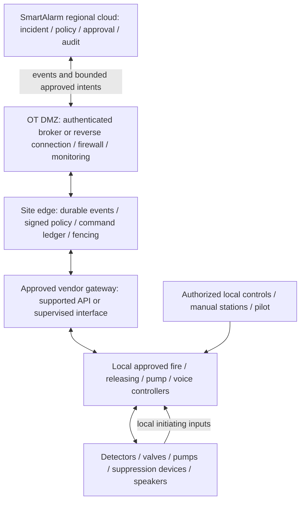

# SmartAlarm — External Integration Standards and Deployment

Research/design baseline 1.0 · 23 October 2026 · English. Scope: physical fire protection integration, deployment engineering, and acceptance. This is a proposed integration design, not a certificate, installation approval, or substitute for the site fire-protection design. Manufacturer/model research is documented separately. The architecture below is a SmartAlarm proposal; cited standards summaries describe verified public scope rather than unverified clauses.

## 1. Decision and boundary

SmartAlarm shall support real physical fire-protection systems through approved interfaces while preserving autonomous local protection. It may ingest fire/supervisory/trouble states, coordinate responders, publish approved evacuation guidance, and request explicitly authorized actions. It must not require the cloud, Internet, a mobile app, or an LLM to complete the local automatic protective sequence.

Do not implement a universal “turn on sprinklers” API. Conventional heat-operated sprinkler heads act locally and individually; an interface to a fire panel does not imply that those heads are electrically addressable. Deluge, preaction, gas suppression, pumps, smoke control, and robotic monitors have different controllers, prerequisites, and consequences. Their permitted actions must be identified by system type and exact manufacturer configuration. The distinction between individual heat operation and software control is supported by the [Pennsylvania Office of the State Fire Commissioner](https://www.pa.gov/agencies/osfc/communities/home-sprinklers).

Three approvals remain separate: the applicable local code/edition and authority having jurisdiction (AHJ); the equipment listing/certification and manufacturer compatibility constraints; and acceptance of the complete installed integration. A protocol, a compliant component, or a cloud test does not establish all three. Record local adoption explicitly: an example official 2026 notice from [Poudre Fire Authority](https://www.poudre-fire.org/home/showpublisheddocument/9013/639063278557630000) cites earlier editions for specific inspection work, illustrating why the newest publication is not automatically the project edition.

## 2. Verified standards and interface matrix

Publication versions below were checked on 23 October 2026. The project must separately freeze adopted editions, amendments, equipment approvals, and contractual requirements. Exact paywalled clauses, installation dimensions, hydraulic calculations, and test intervals have not been inferred from public summaries.

| Reference / verified version | Verified scope | Proposed SmartAlarm use and limit |
|---|---|---|
| NFPA 72, 2025 | Fire alarm, signaling, emergency communication, and mass notification | Map alarm/supervisory/trouble and approved communication interfaces; no claim that SmartAlarm is a listed fire alarm panel. [NFPA](https://www.nfpa.org/codes-and-standards/nfpa-72-standard-development/72) |
| NFPA 13, 2025 | Design and installation of automatic sprinkler systems | Preserve the engineered sprinkler installation; collect waterflow/valve supervision through approved interfaces. Software does not replace sprinkler design. [NFPA](https://www.nfpa.org/codes-and-standards/nfpa-standard-development-process/13) |
| NFPA 20, 2025 | Selection and installation of stationary fire-protection pumps | Integrate approved controller status; any permitted remote request remains subordinate to the approved controller design. [NFPA](https://www.nfpa.org/codes-and-standards/nfpa-13-standard-development/20) |
| NFPA 25, 2026 | Inspection, testing, and maintenance of water-based fire protection | Track deficiencies, impairment, restoration, and evidence; schedules must be set from the adopted text and equipment instructions. Edition corroborated by [NFPA's 2026 handbook](https://www.nfpa.org/sitecore/content/Storefront/Catalog/home/products/p/0/0/P0025HB) and [ANSI's NFPA 25 record](https://webstore.ansi.org/standards/nfpa/NFPA252026). |
| EN 54-2 / -4 / -13 | Control/indicating equipment; power supplies; component compatibility | Require exact certificates, configurations, and applicable national editions; no single “EN 54 certified system” shortcut. Public scope: [BSI fire standards guide](https://www.bsigroup.com/Documents/product-certification/BSI-fire-standards-brochure-UK-EN.pdf?epslanguage=az). Edition/amendment freeze remains a procurement task for these parts. |
| EN 54-16:2008 / EN 54-24:2008 | Voice alarm control/indicating equipment; voice alarm loudspeakers | Use an approved voice alarm chain with zone mapping, priority, power/fault monitoring, and commissioned performance; an ordinary IP speaker is not automatically equivalent. [BSI certification guide](https://www.bsigroup.com/globalassets/localfiles/it-it/PRODUCT%20SERVICES/Product%20Certification%20Interactive%20Guide.pdf) |
| ISO 7240-5:2018 | Point-type heat-detector requirements and testing | Record detector class and approved application; not a universal environmental suitability claim. [ISO](https://www.iso.org/standard/67759.html) |
| ISO 7240-16:2007 / -19:2007, both confirmed in 2025 | Emergency sound control equipment; emergency sound-system design, installation, commissioning, and service | Distinguish component evidence from installed audibility/intelligibility and operating procedures. [ISO part 16](https://www.iso.org/standard/42978.html), [ISO part 19](https://www.iso.org/standard/42979.html) |
| BACnet / ISO 16484-5:2026, edition 8, published August 2026 | Building-system data communication and object-oriented representation | Require supported objects/services, revision, writable-property allowlist, priorities, and quality semantics. Interoperability does not authorize a life-safety action. [ISO](https://www.iso.org/standard/92057.html), [BACnet committee](https://bacnet.org/about-bacnet-standard/) |
| Modbus Application Protocol V1.1b3; Modbus Security | Transactions/function codes; TLS-based authentication and integrity for the security profile | Require exact register map, scaling, byte/word order, access mode, and supported security profile. Do not assume ordinary Modbus/TCP has Modbus Security. [Modbus Organization](https://www.modbus.org/modbus-specifications) |
| OPC UA / IEC 62541; verified part 2:2026 | OPC UA security model | Require server namespace, node IDs, profiles, certificates, security policy, user rights, and status/timestamp semantics. Ordinary OPC UA use is not proof of a safety-certified control path. [IEC](https://webstore.iec.ch/en/publication/81514) |
| IEC 62443-3-2:2020; ISA/IEC 62443 series | IACS risk assessment, zones/conduits, target security levels; lifecycle security | Produce site risk assessment and zone/conduit controls. Do not assign a security level or claim certification merely because the gateway uses TLS. [IEC](https://webstore.iec.ch/en/publication/30727), [ISA](https://www.isa.org/standards-and-publications/isa-standards/isa-iec-62443-series-of-standards) |
| MQTT 5.0, OASIS Standard 7 March 2019 | Publish/subscribe messaging | Edge telemetry transport with authentication, ACLs, expiry, deduplication, and bounded queues; QoS is not physical completion. [OASIS](https://docs.oasis-open.org/mqtt/mqtt/v5.0/mqtt-v5.0.html) |
| CloudEvents; deployed schema version must be pinned | Common event description/envelope | Carry source, type, event ID, time, and versioned domain payload; does not certify detection or actuation. [CloudEvents](https://cloudevents.io/) |
| CAP 1.2, OASIS Standard 1 July 2010 | Common alert exchange | Public advisories with source/update/cancel/area/expiry handling; never a direct suppression-release protocol. [OASIS](https://docs.oasis-open.org/emergency/cap/v1.2/CAP-v1.2.html) |
| MAVLink Command Protocol; vendor/flight-stack version pinned per aircraft | Command transport and command acknowledgments | Capability-specific gateway and pilot authority; ACK and physical outcome remain distinct. Protocol support grants no flight authorization. [MAVLink](https://mavlink.io/en/services/command.html) |
| Aviation rules of the operating jurisdiction | Operator, aircraft, airspace, and mission authorization | Record jurisdiction, permission, pilot, flight constraints, and emergency procedure. The [FAA public-safety guide](https://www.faa.gov/uas/public_safety_gov/drone_program) is a United States example, not a worldwide permit. |
| WCAG 2.2 | Web content accessibility | AA design target, with keyboard, focus, contrast, target, status, and text alternatives verified independently; does not establish acoustic coverage. [W3C](https://www.w3.org/TR/WCAG22/) |

Fire suppression media, special hazards, pressure equipment, electrical installation, smoke-control systems, and local fire/building law can add other standards. The site designer must identify these from the actual system; this matrix is not an exhaustive code list.

## 3. Proposed deployment architecture

The local controller/device path runs independently of the cloud, DMZ, edge, identity service, and LLM. Existing approved hardwired/manual paths remain authoritative. SmartAlarm's edge is an integration component unless separately assessed and approved for another role; “edge” does not itself mean a safety controller.

Place cloud-facing services in an OT DMZ with explicit conduits to site systems. Prefer an authenticated site-initiated connection where supported; prohibit public Internet access to panel buses and general-purpose remote desktop into fire controllers. Separate telemetry ingestion from command authorization. Broker ACLs, firewalls, service identities, signed configurations, certificate rotation, and bounded maintenance access enforce that separation. These are proposed controls derived from the zone/conduit approach, not a claimed IEC 62443 certification.

Use a manufacturer-approved gateway or supervised I/O only where the exact design permits it. Specify input supervision, fault detection, isolation, wiring, electrical ratings, feedback, and commissioning evidence in the approved installation documents. No generic relay board bypasses a releasing panel, pump controller, interlock, or evacuation priority controller. Do not attach undocumented writes to a maintenance port. If only a common alarm contact exists, report common alarm—not a fabricated detector address or zone.

## 4. Integration permission tiers

| Tier | Permitted behavior | Evidence required before enabling |
|---|---|---|
| T0 Inventory | Register assets/documents; no live connection | Site owner, exact models, location and ownership |
| T1 Observe | Read alarm, supervisory, trouble, flow, pressure, health, and status where available | Approved read path, point list, semantic mapping, FAT/SAT |
| T2 Operational coordination | Create incident/tasks; publish approved communications through the permitted voice interface | Approved message/zone/priority policy and verified delivery feedback |
| T3 Restricted control request | Only explicitly approved target/capability combinations | Manufacturer authorization, site engineering, AHJ/other acceptance as applicable, signed cause-and-effect revision, local interlocks, completion evidence |
| T4 Local automatic protection | Executes in the local approved protection system | Existing/local system design and acceptance; not granted to the cloud by a software entitlement |

Default new connectors to T1 or lower. Alarm acknowledgment, silence, reset, disable/isolate, pump requests, and suppression release are distinct capabilities. Do not make a single generic “control” permission enable them all. Some remain local-only. An incident commander may coordinate the incident without possessing authority to reset or inhibit protection.

## 5. Asset, point, zone, and cause-and-effect contract

Each binding is versioned and reviewable before activation. Minimum contract fields:

| Object | Required information |
|---|---|
| Asset | tenant_id, site_id, asset_id, controller_id, manufacturer, exact model, firmware, serial, controller/gateway relationship, protocol revision, certificate/listing reference and scope, maintenance owner, maintenance_state, impairment_ref |
| Point | point_id, controller_id, zone_id, raw address/object/node/register, type, read/write permissions, unit, scale, byte/word order if applicable, enumeration, normal/alarm/trouble/supervisory mapping, validity, observed_at, received_at, timestamp source, quality, stale_after |
| Zone | zone_id, physical boundary/floor, fire compartment reference, detection/suppression/voice zone types, point membership, exclusions, revision and approver |
| Capability | capability_id, allowed target types, parameter schema/ranges, local preconditions/interlocks, manual/automatic authority, authorization_policy, command_ttl, expiry, idempotency_key, retry class, feedback_point_ids, completion criterion, unknown_outcome_policy |
| Cause and effect | revision, initiating condition, required local confirmations, effect, affected zone, priority, delay if approved, interlocks/inhibits, reset authority, failure response, test case and signoff |
| Evidence | source time, receive time, source quality, raw payload reference/hash, connector/firmware/config versions, operator and approval, command/result correlation |

Never equate a location zone with a suppression zone automatically. A floor may have several control zones and a control zone may cross UI boundaries. Changes to device addressing or zoning invalidate the affected mapping and require review/test before write capabilities resume. Quality states are GOOD, BAD, STALE, UNKNOWN, and TEST; absence of data is not NORMAL.

A cause-and-effect record is the approved engineer/vendor/site document reflected in software, not a rule invented by an LLM. For example, a locally approved releasing sequence may report its initiation, pending state, interlock condition, and discharge feedback to SmartAlarm. SmartAlarm records and coordinates these states; it must not infer authorization to release from camera confidence or silence alarms as a side effect of closing an incident.

## 6. Command lifecycle and physical evidence

Proposed states: DRAFT → PENDING_APPROVAL → AUTHORIZED → SENT → ACCEPTED → EXECUTING → COMPLETED_VERIFIED; alternatives REJECTED, EXPIRED, FAILED, UNKNOWN, and RECONCILED. A controller may omit EXECUTING; the adapter must declare which states are observable. UNKNOWN is mandatory when the command may have arrived but the physical outcome is unverified.

Bind approval to command_id, target, capability, parameter digest, zone revision, cause-and-effect revision, requester, approver, writer_epoch, nonce, issued_at, and expires_at. Edge and vendor gateway enforce allowlists, freshness, authorization, and local controller acceptance. Local protection/interlocks take precedence. Mutating parameters or zone revisions invalidates approval. Failover fences the old writer; it never blindly repeats an uncertain physical action.

Record transport receipt, controller acceptance, and physical feedback separately. A pump-request ACK is not pressure/flow evidence; a voice-buffer ACK is not confirmed playback or intelligibility; a valve command is not confirmed position. Completion criteria are capability-specific and may require more than one instrument. Network timeout after transmission produces UNKNOWN, blocks automatic non-idempotent retry, and opens reconciliation with local staff/controller status. A software cancellation cannot promise to reverse released agent or a completed physical action. Reset and restoration follow a separate authorized process.

## 7. Failure-mode analysis and degraded operation

This is the initial qualitative FMEA; the site team assigns severity, likelihood, detectability, residual risk, and owners using site evidence. No generic numerical risk score is asserted.

| Failure / consequence | Detection | Proposed containment and acceptance evidence |
|---|---|---|
| Cloud/Internet loss / remote visibility lost | Heartbeat age and connection state | Local automatic protection continues; edge buffers events; UI shows stale; prove with disconnection test |
| Edge loss / integration unavailable | Edge heartbeat and independent panel observation | Local sequence remains autonomous; cloud shows unavailable; restore from durable ledger without replaying uncertain writes; power-off edge test |
| Gateway restart or split brain / duplicate effect | Epoch/lease, durable command ledger | One fenced writer; uncertain writes reconciled, not replayed; reboot/failover tests |
| Wrong point or zone map / wrong action location | Independent point walkdown and revision digest | Disable affected write binding; verify every enabled target and negative cross-zone case |
| Stuck relay or failed feedback / false completion | Supervision and independent controller feedback where approved | No inferred success; local fault response and physical inspection under approved procedure |
| Lost power or depleted backup / incomplete coverage | Controller/power trouble and maintenance evidence | Preserve approved backup design; verify site-specific fail states and power restoration |
| Alarm storm / delayed critical event | Queue age, source rate, priority metrics | Reserve critical processing, bound queues, flag loss; local sequence never waits for broker |
| Compromised gateway / unauthorized request | Identity, allowlist, audit, anomaly monitoring | Revoke conduit/credential and isolate integration without disabling local protection |
| Maintenance mode confused with actual / unintended effect or ignored alarm | Explicit mode and local panel state | Separate test identities/routes, physical procedure, authorized test window, restoration checks |
| Clock skew or stale observation / unsafe premise | Source/receive times and quality flag | Block stale remote request; retain local protection; no timestamp rewrite hiding uncertainty |
| Controller ACCEPTED but no outcome / operator assumes success | Feedback deadline and missing independent evidence | UNKNOWN, local verification, alternative response; no blind retry |
| Voice zone unavailable / occupants not warned | Per-zone/controller fault and commissioned checks | Display coverage gap; initiate approved alternative communication procedure |

## 8. Impairment, testing, and change governance

An impairment record contains affected assets/zones/functions, reason, start/end plan, responsible person, required notifications, compensatory measures determined by the site authority, access controls, and restoration proof. SmartAlarm does not decide that a degraded fire system is safe merely because alerts are acknowledged. Unplanned impairment escalates to the named site responsible person.

Test mode must have an explicit boundary. Software exercise labels alone cannot prevent a physical output from operating. Use only approved isolation/test arrangements, a responsible local technician, a reviewed test script, site notifications, and the required authorization. Simulator results do not authorize live agent discharge, pump operation, or emergency broadcasts. Live tests follow the adopted standard, vendor method, and local authority/site plan.

Configuration and firmware changes require impact assessment, signed version, rollback/recovery plan, and regression of affected cause-and-effect paths. No remote software rollback is assumed to restore a physical system state. Close impairment only after local restoration, normal supervisory state, target verification, outstanding-defect review, and signed handback. Test frequency and compensatory measures remain site-specific; this document invents neither.

## 9. RFI, survey, FAT, SAT, and handover

| Gate | Required deliverable | Exit evidence |
|---|---|---|
| RFI / procurement | Exact panel/controller/device models, firmware, regional variants, supported APIs/registers, read/write permissions, gateway licenses, listing/certificates, compatible accessories, lifecycle and maintenance support | Vendor written confirmation of each proposed capability; unresolved items stay disabled |
| Site survey | As-built drawings, fire strategy, hydraulic/system boundaries, cause-and-effect, zone/point schedule, communications/power, AHJ/adopted editions, operational roles and impairment process | Designer/site owner reviews mapping and identifies missing documentation |
| Detailed binding design | Network zones/conduits, point contracts, command state/feedback, local-only controls, approved interface/wiring, migration and rollback plans | Engineering/vendor/site approval and authority acceptance where applicable |
| FAT | Representative exact hardware/firmware or documented scope-limited simulator; positive/negative mappings, access control, bad quality, clock skew, duplicates, lost ACK, timeout, expiry, restart, failover, no-Internet operation | Signed results, raw evidence, defects resolved; simulator limitations explicit |
| SAT | Installed point-to-point verification, physical zone confirmation, approved cause-and-effect tests, local autonomy on loss of cloud/edge, supervised faults, voice coverage/performance per approved plan, restoration | Witnessed site evidence; every enabled command has verified result semantics; no unresolved critical defect |
| Handover / operation | As-built configuration, credential ownership, backup/restore, training, runbooks, maintenance schedule, impairment contacts, support boundaries | Site owner acceptance; inspection/authority records where required; ongoing change control |

Acceptance means more than a green dashboard. For each enabled physical capability, demonstrate that a denied request cannot actuate, stale/expired requests cannot actuate, an uncertain outcome is shown as UNKNOWN, local controls retain priority, and cloud failure cannot stop the independent automatic sequence. Record response times measured in the approved test; do not claim a universal latency target without the site/controller acceptance criterion.

## 10. Evidence register and remaining engineering decisions

All links in section 2 and this register were consulted on **2026-10-23**. Evidence type is public official scope/catalog/technical guidance; none is a full installation conformity assessment.

| Evidence group | Official sources | Confirmed / remaining limitation |
|---|---|---|
| E01 Fire alarm and suppression | [NFPA 72](https://www.nfpa.org/codes-and-standards/nfpa-72-standard-development/72), [NFPA 13](https://www.nfpa.org/codes-and-standards/nfpa-standard-development-process/13), [NFPA 20](https://www.nfpa.org/codes-and-standards/nfpa-13-standard-development/20), [NFPA 25 handbook](https://www.nfpa.org/sitecore/content/Storefront/Catalog/home/products/p/0/0/P0025HB), [ANSI NFPA 25](https://webstore.ansi.org/standards/nfpa/NFPA252026) | Titles/editions/scope verified; adopted clauses/amendments must be checked for the project. NFPA 13 scope was available in official indexed content; direct retrieval was intermittent. |
| E02 Detection/voice | [BSI components](https://www.bsigroup.com/Documents/product-certification/BSI-fire-standards-brochure-UK-EN.pdf?epslanguage=az), [BSI voice](https://www.bsigroup.com/globalassets/localfiles/it-it/PRODUCT%20SERVICES/Product%20Certification%20Interactive%20Guide.pdf), [ISO 7240-5](https://www.iso.org/standard/67759.html), [ISO 7240-16](https://www.iso.org/standard/42978.html), [ISO 7240-19](https://www.iso.org/standard/42979.html) | Public part scopes; national EN editions/amendments and exact product certificates require procurement verification. |
| E03 Building/OT data | [ISO BACnet](https://www.iso.org/standard/92057.html), [BACnet committee](https://bacnet.org/about-bacnet-standard/), [Modbus](https://www.modbus.org/modbus-specifications), [IEC OPC UA](https://webstore.iec.ch/en/publication/81514) | Protocol scope/version; not vendor compatibility or safety approval. |
| E04 OT security | [IEC 62443-3-2](https://webstore.iec.ch/en/publication/30727), [ISA series](https://www.isa.org/standards-and-publications/isa-standards/isa-iec-62443-series-of-standards) | Risk/lifecycle framework; site target levels and evidence remain to be engineered. |
| E05 Events and warning | [MQTT](https://docs.oasis-open.org/mqtt/mqtt/v5.0/mqtt-v5.0.html), [CloudEvents](https://cloudevents.io/), [CAP](https://docs.oasis-open.org/emergency/cap/v1.2/CAP-v1.2.html) | Messaging scope; no guarantee of physical completion. |
| E06 Drone/accessibility/local context | [MAVLink](https://mavlink.io/en/services/command.html), [FAA](https://www.faa.gov/uas/public_safety_gov/drone_program), [WCAG](https://www.w3.org/TR/WCAG22/), [Pennsylvania sprinkler explanation](https://www.pa.gov/agencies/osfc/communities/home-sprinklers), [Poudre adopted-edition example](https://www.poudre-fire.org/home/showpublisheddocument/9013/639063278557630000) | Interface, jurisdiction example, accessibility target, and local physical context; not global compliance. |

Open decisions before implementation: deployment countries and authorities; installed system types and exact variants; permission to read versus write each point; vendor gateway and certificate scope; approved cause-and-effect; local-only actions; physical completion feedback; cybersecurity risk assessment; site-specific acceptance criteria and responsible signatories. These are required engineering inputs, not reasons to replace the full physical integration scope with a demo.

## UX2-PHYSICAL · Visual supervision and physical feedback

The v2 console uses a pipe/valve/pump mimic, zone coverage and explicit device state. A requested command, gateway acknowledgement and observed physical effect are separate states. Unknown or stale feedback must use a labeled pattern and timestamp, never a green success state. Review-only actions in the prototype do not operate equipment. Local fire protection authority, interlocks and commissioning requirements in this document remain binding.

Verify F08–F20 with communication loss, conflicting local state and delayed feedback. Operator access to the schematic must not bypass command authorization. PA playback feedback is not proof of audibility to every occupant. Drone/robot task acceptance is not proof of arrival or rescue.

See [UI/UX design](UIUX-Design.html), [screen specifications](Screen-Specifications.html) and [redesign audit](UX-Redesign-Audit.html).
