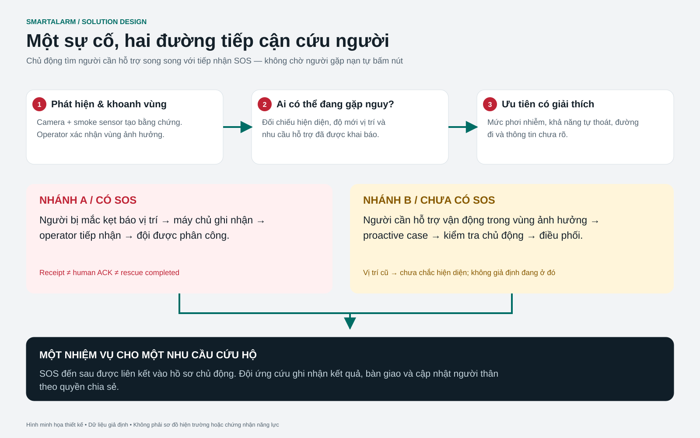

# SmartAlarm — Positioning, evacuation optimization, real-time AI and proactive rescue

Mandatory part of full-product baseline 1.0 · 23/10/2026. Adds BR-10 (positioning/optimization), BR-11 (AI decision support), BR-12 (proactive assistance). Uses the same authorization, event, region, audit, localization and command boundaries as Basic/Detail Design.

## 1. WF-23 — Fused positioning and presence determination

The Positioning service accepts outdoor GNSS; QR/NFC checkpoints; BLE beacon/RTLS; UWB anchors; Wi-Fi positioning where the platform permits; wearable/vehicle location; manual reports and responder observations. Do not assume every phone supports UWB or that operating systems allow continuous Wi-Fi scanning. Each technology requires a site survey, calibration, device capability and permission. Site onboarding records the support matrix, measured expected accuracy, coverage holes and fallback.

LocationObservation: subject_ref, source, source_device, observed_at, received_at, lat/lon or local x/y/z, coordinate_frame, floor_ref, uncertainty_m, floor_confidence, heading_deg, heading_uncertainty, method, calibration_version, permission_basis. An indoor coordinate frame has a transform to geodetic coordinates and a plan revision, validated using reference points. Fusion must not average coordinates from two floors: establish a floor hypothesis first, then use outlier rejection, motion constraints and a quality-weighted estimator; Kalman/particle filtering is an engineering choice that must be benchmarked per site. Last known location always carries a timestamp; interpolation through unobserved areas is not presented as fact.

Presence differs from location: registered occupant, expected attendance, observed present, last-seen, reported absent and unknown. An access-control entry is only evidence of presence, not proof that the person remains there. Outdoor GPS cannot establish a floor. People without devices can still have roster/check-in/visitor records and manual accountability. Data provenance is not lost when an operator changes a location; create a new observation.

**Acceptance:** conflicting-floor sources are flagged; losing a beacon does not make a person absent/safe; stale location becomes unknown; users who deny tracking can still use manual SOS; tenants cannot query history outside purpose/scope; calibration updates do not silently alter coordinates in old incidents.

## 2. WF-24 — Evacuation option optimization

“Most effective” means the best among feasible options given available data, with hard safety constraints first and time/distribution optimization second. Absolute optimality is not promised when field data is incomplete. Proposed objective: minimize weighted travel time + queue delay + uncertainty cost + exposure cost; hard constraints prohibit hazard exclusions, closed/unknown critical doors, unsuitable stairs, unavailable destinations and capacity violations. People with limited mobility have a separate feasible graph; those needing assisted evacuation receive a rendezvous/refuge area + responder task, not a route that assumes independent travel.

The planner produces 1 primary + up to 2 alternatives, displaying reason, assumptions, validity and route provenance. Crowd optimization uses aggregate occupancy estimates, measured corridor/stair throughput and uncertainty intervals; it does not send everyone to one exit merely because it is the shortest path. Flow assignment is by cohort/zone, with rate-limited route changes and operator approval for changes to zone strategy. Hysteresis prevents oscillation; emergency hazard withdrawal is immediate. Do not publish ETAs precise to the second without calibration; display intervals and confidence.

Inputs: validated graph; current hazard snapshot; presence quality; exit/shelter availability; assistance profile; actual restrictions; verified weather/road data for outdoor use. Predictions from fire/flood simulation are a separate scenario layer and do not automatically overwrite observed hazards. The simulation dashboard must display assumptions and a “not real incident” environment boundary.

### Algorithm contract

1. Filter the snapshot by incident, tenant, floor, time and freshness.
2. Build the available graph using hard exclusions; reject insufficient floor/position quality.
3. Estimate edge time from distance/speed profile and congestion; do not arbitrarily infer speed from diagnoses, and prefer self-reported ability/assessed profiles.
4. Find feasible routes, compare robust cost under uncertainty, and retain alternatives that do not share a bottleneck where possible.
5. Apply destination capacity and cohort balancing; publish route decisions with graph/hazard/policy versions.
6. Monitor deviation/new hazard/capacity; replan; invalidate queued old audio; provide the operator with the reason and affected cohort.

**Acceptance:** routes never cross prohibited polygons; stair-excluded profiles have no stairs; unknown capacity is not treated as unlimited; new hazards withdraw routes for the correct recipients; no feasible path creates assistance; route failure does not block manual SOS; compare results against site-approved scenarios and physical walkthroughs before go-live.

## 3. WF-25 — Real-time AI / LLM analysis

The AI Copilot service subscribes to read-only incident projections and an authorized retrieval corpus. Tasks: consolidate timelines, detect contradictory/missing data, suggest verification questions, cross-check playbooks, summarize sensor/camera observations, compare options computed by the route engine, and draft warnings/translations and after-action reports. The model does not independently create location nodes, approve warnings, issue commands, diagnose or close incidents.

Pipeline: event updates → coalesce by incident → build scoped context → retrieve approved SOP versions → model inference → structured result validation → evidence/permission/freshness guard → operator review. Answers include assertion, evidence_refs, observed_at, uncertainty, conflicts, proposed_action, required_approval and expires_at. Any important factual claim without evidence must be marked unsupported and cannot be used as an instruction. The LLM cannot modify the route graph; it may only call the read-only tool `compare_routes(route_ids)` through an allowlisted service, with route IDs supplied by the deterministic planner.

Proposed real-time budgets: incident projection refresh p95 ≤ 2 s; copilot summary target p95 ≤ 10 s when the model is available at the tested context size. The UI displays generated_at and data_cutoff; after TTL, content becomes stale and cannot appear live. Critical alarms, SOS, routing rules and dispatch continue during AI timeout/outage. Do not wait for an LLM to send alarms under approved policy. Streaming token text must not be played over loudspeakers before validation and approval finish.

Security: retrieved chats, external metadata and documents are all untrusted content. Prompt content cannot control system policy/tool scopes. Tool execution goes through a policy proxy, with no arbitrary network/code, result schema validation, prompt-injection fixtures and source citations. Regional model endpoints follow residency requirements; sensitive health fields are redacted or reduced to minimal functional needs. Configuration/contracts prohibiting model-vendor training on tenant data must be confirmed; self-hosted deployment may be selected where needed. Context logging is redacted, retention follows data class, and chain-of-thought is not stored; retain model/version, prompt template version, evidence IDs, structured answer and user decision.

Evaluation: scenario sets by hazard/locale, factual grounding, omitted-critical-fact, unsafe-action suggestion, prompt injection, cross-tenant leakage, hallucinated exit, stale evidence, translation meaning, calibration/abstention. Promotion requires thresholds agreed with domain reviewers, not merely generic BLEU/accuracy. Human acceptance does not automatically become a training label; feedback has a review workflow. An AI score does not independently decide who deserves rescue first.

## 4. WF-26 — Rescue care profiles and user management

The identity profile (name, contact, age/DOB as needed) is separate from the sensitive Assistance Profile. The profile includes self-reported functional needs: mobility, stairs capability, wheelchair/walking aid, hearing/vision, communication language, cognitive assistance, caregiver dependency, evacuation equipment, medically relevant emergency notes and optional condition history. Collect only what is needed for rescue; the UI does not require a comprehensive disease list to use the app. An age group may suffice instead of exact DOB. Do not automatically infer impairment from age or a condition name.

Profile sources: self, authorized guardian/caregiver, authorized clinician/occupational-health role under a service agreement, or responder observation. Record source, verification status, effective_at, last_reviewed_at, consent/legal basis, visibility scope and expiration review. A self-reported profile cannot be labeled “medically verified”. Users/caregivers can edit; conflicts between sources require review without losing history. Guardian relationships must be verified, with field-scoped rights and revocation; minors/dependent adults need jurisdiction-specific processes, without assuming a simple global consent model.

Authorization: citizens view/edit their own profiles; caregivers act within authorization; dispatchers see functional needs and reasons for assistance, not detailed medical histories by default; assigned responders see the emergency subset required for their task; only an authorized medical role sees deeper notes; platform admins cannot view them. Health-record access is audited, and emergency break-glass has scope/time/reason. Social groups see only consented status, not impairments or medical notes.

## 5. WF-27 — Proactive prioritization before SOS

Triggered when an incident affects a site/zone: build a candidate list from **presence evidence + impact zone + assistance profile + no recent confirmation**. Absence of SOS is not evidence that help is unnecessary. Groups: known exposed and needs assistance; possibly exposed/stale presence; registered but presence unknown; confirmed away. Known exposed people receive proactive contact/tasks under policy; uncertain presence first creates a welfare check and an uncertainty warning, rather than presenting the person as definitely in room X.

Prioritization is decision support: hazard imminence/exposure, inability to self-evacuate, isolation/no caregiver, route infeasibility, last contact and source confidence. Do not use wealth/nationality/social importance; age alone is not a criterion determining a person's value. Urgency categories P1/P2/P3 have explicit reasons, confidence and evidence freshness, not an absolute black-box “rescue score”. Operator adjustments require reason/audit; force override is limited to appropriate roles. Human clinical triage, when needed, follows expert-approved protocols rather than LLM diagnosis.

Flow: incident active → intersect impacted locations/presence → evaluate approved assistance policy → create ProactiveCase with idempotency key incident+person+policyVersion → notify/check-in where appropriate → operator review → dispatch assistance task → responder welfare observation/handover → close case. A subsequent SOS from the same person must be linked to the case, rather than dispatching two teams because there are two sources. No response escalates the case; it does not automatically mean “confirmed injured”. If a person reports being outside the affected area, retain correction evidence and re-evaluate; do not erase the audit trail.

**Acceptance:** people needing assistance enter the queue without SOS; registered people with stale locations are shown as uncertain; missing profiles do not default to “healthy”; every reason has evidence; simultaneous triggers do not duplicate tasks; a new SOS links to the existing case; revoked caregivers cannot read profiles; age changes do not automatically raise/lower priority without context; actors without health scope see only minimal assistance needs.

## 6. Entities / APIs / events

AssistanceProfile(id,person,version,functional_needs,emergency_notes_ref,source,verification,review_due,sharing_policy). CareRelationship(subject,caregiver,authority_ref,scopes,expires,revoked). PresenceEvidence(subject,location,kind,observed_at,confidence,source). ProactiveCase(id,incident,person,policy_version,priority,reasons,evidence_refs,presence_quality,state,task_ref). RouteOptimizationRun(id,input_snapshot,algorithm_version,constraints,alternatives,selected,approver). AIAnalysis(id,incident,model_version,context_cutoff,evidence_refs,result,guard_status,expires,user_decision).

APIs: `/assistance-profiles` field-level scopes and version; `/care-relationships` verified grants; `/presence-observations` source-bound; `/incidents/{id}/proactive-cases` authorized list; `/proactive-cases/{id}/decisions` reason + expected version; `/guidance/optimizations` computed alternatives; `/incidents/{id}/ai-analyses` asynchronous job with status; `/ai-analyses/{id}/reviews` accept/reject draft, never command endpoint. Events: presence.updated, assistance_profile.updated, proactive_case.created, guidance.optimized, ai.analysis.ready; health payloads are minimal, with details fetched only within authorized scope.

Additional services: Position & Presence, Assistance Profile & Care Relationships, Proactive Assistance Policy, Route Optimization, AI Copilot/Gateway/Evaluation. Deploy within the regional cell, encrypt sensitive fields, and keep exact health data out of generic event broker payloads, logs/search/global control plane.

## 7. Human factors and notifications

### V2 visual decisions for positioning, AI and care

Q01–Q03 place source, observation age, floor and quality beside the plan. Heading is independent: QR may confirm a position without orientation; stale points must not become a certain movement trail. C38 retains reported-location entry and assistance when no route is verified. Q04/Q05 show excluded alternatives and reasons beside the recommendation; green color or shorter distance does not replace feasibility evidence.

Q06/Q07 use claim/evidence/unknown composition, exposing sources, cutoff and unknowns before approval. Q08/Q09 retain model governance, region and deterministic fallback. AI must not infer safety from silence, invent exit nodes outside the approved graph, grant equipment authority or invent rescue ETAs. C08 shows arrival time only with a confirmed source; assignment does not prove acceptance or approach.

H08/H09 and O11/O12/O34 prioritize people by functional need, exposure and presence evidence rather than an aggregate count without provenance. No SOS is not the same as no assistance need. Medical records require their own scope; assistance cards do not expose diagnoses to every role. A self-reported safe state carries a subject and timestamp and does not apply to family members or the whole site.

V2 acceptance covers unknown heading with known floor, conflicting BLE/QR sources, withdrawal while AI drafts, stale presence without SOS, no capable team, delayed ACK, keyboard/screen-reader users and discreet mode. Results retain uncertainty, suppress invalid guidance, offer an actionable assistance step and invent neither success nor ETA. Prototype plans, AI suggestions and people lists are illustrative; they do not establish positioning performance or field rescue capability.

The prioritization screen displays “Needs mobility assistance · observed in the affected area · updated 2 minutes ago”, rather than only a condition name/score. People without profiles are labeled “Assistance information unavailable”, not “Normal”. Users actively choose how to be contacted; text/voice/haptics follow preferences. Japanese/Vietnamese/English use reviewed terminology and avoid stigmatizing labels. Dependents have an emergency profile subset and caregiver workflows; being added as a contact does not give a caretaker access to all data.

## 8. Verification gates

Site survey and indoor-positioning ground truth; route walkthrough and blocked-exit drill; crowd model calibration; clinical/domain review of assistance policies; privacy review for each jurisdiction; AI grounding/injection tests in all three locales; hardware-in-loop and live responder exercises. These are release conditions for the relevant components and cannot be replaced by a dashboard prototype or a generic “real-time AI” claim.

<!-- PHYSICAL_DESIGN_1_0 -->

## 9. Baseline 1.0 — physical feedback, routing and AI boundaries

WF-29 supplies alarm/supervisory/trouble/flow/pressure/pump/valve observations to hazard context with source, observed_at, quality and approved point/zone mapping revision. Dependent decisions use only sufficiently fresh data mapped to the correct floor/zone. Pump-running or valve-open does not prove the hazard ended; the route engine cannot reopen excluded edges without site verification. Impairment/test/maintenance and unavailable fire-water may create restrictions/review tasks under approved policy, not inferred fire-spread predictions.

Loss of controller connection, mapping changes, revoked local authority or a new hazard intersecting a route triggers reassessment of route freshness/constraints; withdraw routes and cancel queued old speech when required. Robot/drone location is a separate source with uncertainty; equipment pose is not a casualty's location. Stretcher/assisted evacuation missions link existing ProactiveCase/task records and retain owner/handover to avoid duplicate teams. Equipment completion does not automatically confirm personal safety; use a correctly typed responder observation or self-report.

AI may explain evidence, contradictions and gaps and draft options. It cannot write cause-and-effect logic, grant connector capabilities, approve release, clear impairment, control robots/drones or edit certificates. Telemetry/vendor documents are untrusted input; capability allowlists and authorization remain outside the model. Routing/SOS/dispatch services continue during AI outages.

Additional acceptance: PHY-AI-01 pump ACK does not remove a hazard restriction; PHY-AI-02 stale points or wrong-floor mappings cannot produce a current route; PHY-AI-03 prompt injection in vendor metadata cannot issue commands; PHY-AI-04 robot tasks link existing assistance cases; PHY-AI-05 device completion does not automatically mark safe; PHY-AI-06 test telemetry cannot update actual incidents. See [F01–F20 screen specifications](Screen-Specifications.md) and [device catalog](Rescue-IoT-Device-Catalog.md).
