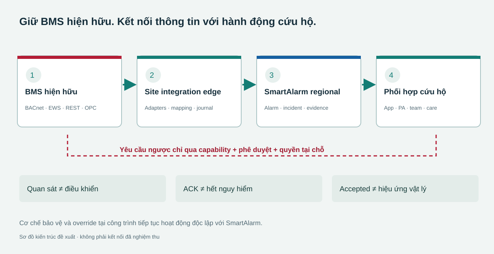
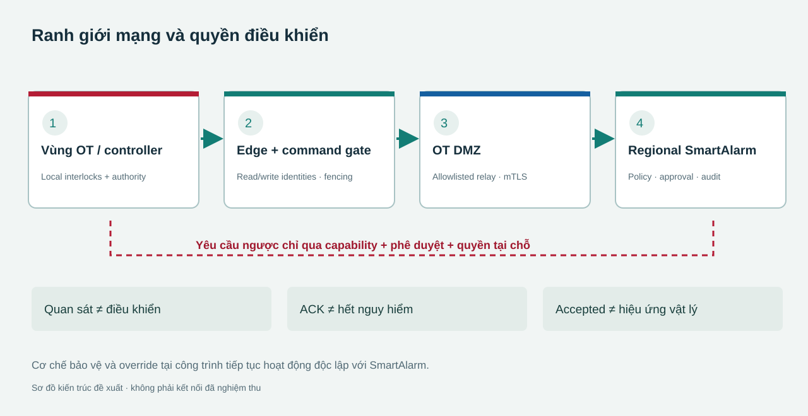

# Kết nối BMS cho SmartAlarm

**Nghiên cứu và thiết kế mở rộng · 24/10/2026 · Phạm vi quốc tế, đa tenant và đa ngành.**

Baseline 3.0 tích hợp một miền tích hợp BMS có quản lý vòng đời, dùng chung nền tảng connector và giữ profile riêng theo sản phẩm, phiên bản, giao diện và license. BMS tiếp tục vận hành cơ điện và quyền điều khiển tại chỗ; SmartAlarm sử dụng dữ liệu đó để hiểu nguy cơ, hướng dẫn thoát hiểm, phát thông báo, tìm người cần hỗ trợ và phối hợp đội cứu hộ. Nghiên cứu bao phủ **8 nhóm hãng/sản phẩm và 11 profile connector đề xuất**, không coi một giao thức là bằng chứng tương thích toàn hãng. Gói này cung cấp **40 yêu cầu FR-BMS, 8 đặc tả màn hình mới, 20 ca nghiệm thu nghiệp vụ và 28 ca giao thức**, cùng schema và các profile JSON. Các profile đã kiểm tra cấu trúc nhưng **adapter chưa được triển khai và chưa kết nối BMS thật**; capability chỉ được bật sau xác minh đúng cấu hình. Baseline tích hợp gồm 241 mockup màn hình, 37 workflow và proposal 188 slide ở mỗi ngôn ngữ. Tám màn hình BMS đã tích hợp vào danh mục mockup. API dưới đây là hợp đồng nội bộ SmartAlarm chính thức của baseline, không phải endpoint hãng. Đây là hồ sơ để triển khai, chưa phải phần mềm driver BMS đã bàn giao.



## 1. Tương thích phải được xác nhận theo sản phẩm và thao tác

Khách hàng chưa có thông tin hãng hoặc phiên bản, vì vậy kiến trúc phải hỗ trợ cả BMS hiện đại có API, supervisor chỉ xuất BACnet/OPC, và hệ cũ qua gateway hoặc register map được duyệt. Chúng không cùng độ phong phú dữ liệu: point read không chứng minh có alarm lifecycle; có alarm list không chứng minh có ACK; có write không chứng minh có quyền tác động hệ thống an toàn. Kết nối vận hành được tính bằng giao của **đã triển khai ∩ hãng hỗ trợ ∩ có license ∩ site cho phép ∩ đã nghiệm thu**. Không tự đổi protocol khi lỗi vì đường mới có thể đổi định danh, quyền và ý nghĩa dữ liệu.

| Profile | Sản phẩm và giao diện | Dữ kiện và điều kiện |
|---|---|---|
| `bms.siemens.desigo-wsi` | Desigo CC<br>REST / WSI subscriptions | Specification V8 nêu REST đọc/ghi, event và history. WSI auth có session/heartbeat theo phiên bản; northbound OPC được xác minh là DA, không phải UA. Cần project/extension, HTTPS, PICS nếu chọn BACnet. [Siemens WSI](https://sid.siemens.com/r/A6V14948151/29540941067___en-US_29542478475?contentId=l64oBrPVORrEbx6beXKzjw) |
| `bms.schneider.ebo-ews` | EcoStruxure Building Operation<br>SOAP EWS / SmartConnector REST | Guide SmartConnector2.6/EWS1.2 kiểm với EBO7.1.2: EBO từ3 dùng SoapEwsRestProvider. Không giả định root discovery/bulk. ACK áp dụng alarm event; không đồng nghĩa đổi toàn bộ trạng thái alarm. [EBO EWS](https://github.com/SchneiderElectricBuildings/SmartConnector/blob/main/docs/developer-guide/smartconnector-restful-ews-gateway.md) |
| `bms.jci.metasys-rest` | Metasys<br>Version-pinned REST / SSE | API v6 mô tả objects, command schema, alarms, histories và SSE. Phải kiểm từng kết quả batch, không chỉ HTTP200. Monitoring and Commanding cần license riêng; không suy API tương thích từ tên Metasys. [Metasys API](https://jci-metasys.github.io/api-landing/api/v6-16) |
| `bms.honeywell.ebi-api` | Enterprise Buildings Integrator<br>Vendor SDK / web services | EBI2025 giới thiệu enterprise web services nhưng trang public chưa đủ contract triển khai. Guide-spec R600 cũ có OPC DA/A&E/HDA và API; không dùng để khẳng định EBI2025 có REST hoặc UA tương đương. [EBI](https://buildings.honeywell.com/gb/en/solutions/integrated-operations/ebi) |
| `bms.honeywell.webs-niagara` | WEBs N4<br>Niagara OEM station interface | WEBs dựa trên Niagara và phải dùng profile OEM riêng. Module, station exports, quyền và license quyết định capability; không tái sử dụng EBI API. [WEBs N4](https://www.honeywellbuildings.com/bms/building-control-system/honeywell-webs) |
| `bms.tridium.niagara-local` | Niagara local station / Supervisor<br>Qualified oBIX / licensed module | Tài liệu Supervisor4.6 và catalog driver2025 có oBIX. Module REST marketplace là capability riêng, không phải REST phổ quát mặc định. Alarm ACK phải có contract đã xác minh. [Niagara local](https://pages1.tridium.com/rs/808-SGM-271/images/Niagara%204.6%20Supervisor_DataSheet_VYKON.pdf) |
| `bms.tridium.nds-cloud` | Niagara Data Service<br>Cloud API | NDS là dịch vụ cloud riêng: histories/tags, live read/write và alarm queries. Prerequisites gồm SMA và reseller. Chưa xác nhận API alarm ACK; không dùng WAN cloud làm đường dự phòng cho điều khiển critical tại chỗ. [Niagara Data Service](https://www.tridium.com/us/en/Products/niagara-cloud-suite/niagara-data-service) |
| `bms.delta.enteliweb` | enteliWEB<br>Vendor API / BACnet Web Services | Catalog4.23, cập nhật11/2022, có add-on -API. Phải xác nhận entitlement hiện tại; brochure không đủ authentication, endpoint và lifecycle contract để viết driver. [enteliWEB](https://deltacontrols.com/wp-content/uploads/enteliWEB-Catalog-Sheet.pdf) |
| `bms.alc.webctrl-events` | WebCTRL event/telemetry integration<br>Outbound GET/POST / MQTT add-on | Sheet2025 nêu alarm REST và outbound GET/POST khi alarm xảy ra; MQTT là add-on. Không suy từ outbound event rằng có REST command point hoặc native ACK. Scope khởi đầu là nhận alarm/telemetry. [WebCTRL](https://www.automatedlogic.com/en/media/WebCTRL%20Open%20Integrations%20Platform_110325_tcm702-284058.pdf) |
| `bms.alc.webctrl-soap-sdk` | WebCTRL SOAP / SDK<br>SOAP / licensed Java SDK | SOAP cần method contract đúng phiên bản; license JavaSDK được xác định theo từng trường hợp. Đọc, ACK, command và lịch sử phải kiểm theo method và scope tài khoản. [WebCTRL SDK](https://www.automatedlogic.com/en/media/WebCTRL%20Open%20Integrations%20Platform_110325_tcm702-284058.pdf) |
| `bms.distech.ecnet-niagara` | EC-Net Facilities / EC-Net4<br>Niagara OEM station interface | EC-Net Facilities là tên mới của EC-Net4, dựa trên Niagara. ECLYPSE REST thuộc dòng controller; không coi là EC-Net Supervisor API. Cần xác minh OEM module và station access. [EC-Net](https://www.distech-controls.com/de-de/products/detail/947839/distech-controls/ec-net-facilities) |


### Nguồn hãng và giới hạn áp dụng

Các link trong bảng mở trực tiếp tài liệu hãng. Phiên bản được nhắc đến là phiên bản tài liệu đã nghiên cứu, không phải phạm vi đã kiểm thử của SmartAlarm.

Các mô tả cùng một hãng cần đọc cùng nhau. Đặc biệt license Metasys là điều kiện thương mại riêng, EBI R600 là guide-spec cũ chứ không chứng minh EBI2025 triển khai mọi mục, và ECLYPSE REST thuộc controller khác EC-Net supervisor. Các giới hạn cũ trong application note không được dùng làm năng lực cam kết của bản hiện tại. Không đưa giá, rate limit, token TTL, maximum points hoặc thời gian phát triển chưa có căn cứ vào proposal. [Metasys licensing](https://docs.johnsoncontrols.com/bas/r/Metasys/en-US/Metasys-UI-Help/7.0/Overview/Licensing) · [EBI R600](https://buildings.honeywell.com/content/dam/hbtbt/en/documents/downloads/IS_Guide%20Spec_EBI%20R600_04.20%20V2.pdf) · [Distech developer portal](https://developer.distech-controls.com/)

### Giao thức là lớp nền, không phải hợp đồng nghiệp vụ

| Lớp | Thiết kế cần giữ | Nguồn |
|---|---|---|
| BACnet/IP / MS/TP | Đọc PICS đúng model. COV là thay đổi giá trị, không thay alarm lifecycle. Router IP không làm bus MS/TP nhanh như IP. Discovery và polling phải có budget. | [PICS](https://bacnet.org/conformance-pics/) |
| BACnet/SC | WebSockets/TLS bảo vệ kết nối; cần CA, trust, expiry và hub failover. SC không tự cấp quyền điều khiển hoặc thay phân vùng OT. | [BACnet/SC](https://bacnetinternational.org/bacnetsc/) |
| BACnet priority | 16 mức ưu tiên; NULL trả một slot về quyền thấp hơn/default. Không có bảo đảm chung về TTL hay ownership ứng dụng. Edge mất điện có thể để lại slot đang giữ. | [Priority model](https://reference.opcfoundation.org/specs/OPC-30030/3.2.1) · [Relinquish](https://infosys.beckhoff.com/content/1033/tf8020_bacnetrev14/12319323787.html) |
| OPC UA | Giữ StatusCode, source time và server time. A&C và history là capability riêng. ConditionRefresh nạp retained conditions; không phải replay history và có race với event mới. | [DataValue](https://reference.opcfoundation.org/specs/OPC-10000-4/7.11) · [A&C refresh](https://reference.opcfoundation.org/specs/OPC-10000-9/4.5) |
| OPC Classic | DA, A&E và HDA khác OPC UA. Nếu cần, bridge được duyệt chạy Windows trong OT; không đưa DCOM ra Internet. | [Desigo OPC](https://sid.siemens.com/r/A6V14948151/29540941067___en-US_29542447755?contentId=ryEd1gVcA_APpnx4L8EE2A) |
| Modbus | Cần register map đúng model/firmware, địa chỉ PDU, type, signedness, word order, scale, unit và invalid sentinel. Alarm suy từ register phải đánh dấu derived. Modbus Security là profile riêng. | [Modbus](https://www.modbus.org/introduction-to-modbus) · [Security](https://www.modbus.org/modbus-specifications) |
| MQTT / webhook | Payload và alarm identity là hợp đồng dự án. QoS không chứng minh tác động vật lý; dedupe vẫn cần. Không dùng retained command tức thời. Webhook cần xác thực, chống replay và đối soát snapshot. | [MQTT5](https://docs.oasis-open.org/mqtt/mqtt/v5.0/os/mqtt-v5.0-os.html) |


Brick/Haystack có thể hỗ trợ nhập semantics, không bắt khách hàng thay toàn bộ BMS. Giữ quan hệ vị trí, thành phần, luồng phục vụ và point riêng biệt; khóa version mô hình. Danh tính point ngữ nghĩa tách native reference để đổi binding có kiểm soát. [Brick relationships](https://docs.brickschema.org/brick/relationships.html) · [External references](https://docs.brickschema.org/metadata/external-representations.html) · [Haystack points](https://project-haystack.org/doc/docHaystack/Points)

## 2. Edge tại công trình giữ semantics và ranh giới điều khiển



Nền tảng tái sử dụng Integration runtime, Physical integration, event bus, Incident, Routing, PA, Care và aggregate Command hiện hữu. BMS domain bổ sung hồ sơ hệ thống, native alarm projection, semantic mapping và qualification; không tạo một Command service song song. Edge đặt tại OT hoặc DMZ theo khảo sát mạng, kết nối regional ingress bằng conduit được duyệt, ưu tiên phiên outbound mTLS. Relay không là cầu nối IP trong suốt vào field bus. Bốn hợp đồng độc lập là observation, alarm exchange, command và vận hành; khách hàng có thể dùng đầy đủ giám sát đã duyệt dù chưa được phép điều khiển. [NIST OT architecture](https://csrc.nist.gov/pubs/sp/800/82/r3/final)

| Thành phần | Trách nhiệm |
|---|---|
| Registry / qualification | Product/build/license/interface/evidence; signed profile; không tự bật write khi connect thành công. |
| Read acquisition | Worker tách subscription, poll và history; source budget, reconnect jitter, cursor và raw evidence. |
| Semantic mapping | Immutable revision cho type/unit/enum/quality và equipment/zone/route dependency. |
| Edge journal | Commit bền vững, inbox/outbox, gaps, checksum, epoch; reserve cho alarm, không silently drop. |
| Alarm bridge | Native occurrence, snapshot+stream, external ACK intent, provenance và chống echo. |
| Command gate | Credential riêng, allowlist, approval digest, TTL, mapping revision, local permissive và fencing. |
| Readback / health | Đối soát hiệu ứng; health theo subscription, độ mới, clock, queue, license/cert và vùng bị ảnh hưởng. |


### Quyền quyết định thuộc đúng hệ thống

| Nguồn có thẩm quyền | Dữ liệu và giới hạn |
|---|---|
| BMS/controller | Native object, raw value, native alarm, local override và winning priority. |
| Site-approved mapping | Equipment/space/zone semantics, source lineage và quan hệ được phép dùng cho routing. |
| SmartAlarm | Incident, SOS, nhiệm vụ, hồ sơ hỗ trợ, approval/audit và ý định Command. |
| Qualified feedback source | Bằng chứng kết quả vật lý; command=true không chứng minh fan flow, unlock không chứng minh door open. |


BMS không nhận raw bệnh án, tuổi hoặc định danh người chỉ vì đã tích hợp. Writeback chỉ gửi incident reference, vùng, mức cảnh báo và trạng thái phối hợp tối thiểu được hợp đồng cho phép. Occupancy count, badge passage và dấu vết vị trí chỉ là bằng chứng presence có chất lượng; không tự xác nhận một người còn trong phòng hoặc đã an toàn. LLM chỉ đọc projection có scope, nguồn và timestamp; rule phản ứng đã duyệt không phụ thuộc vào kết quả LLM, và LLM không có quyền ghi BMS.

### HA, offline và thu hồi quyền phải xử lý ở nơi phát lệnh

Partition theo tenant/site/connector; một control domain chỉ có một active writer. Fencing phải ngăn edge cũ thực sự ghi, không chỉ bầu leader trên cloud. Nếu controller legacy không hỗ trợ ràng buộc đủ mạnh, HA read-only vẫn triển khai được nhưng chuyển writer cần quy trình tại chỗ. Dedupe và idempotency ở ledger không biến một thao tác vật lý thành exactly-once. Sau restart, outstanding commands và priority slots phải được query/reconcile trước khi mở writes. Không replay command đã hết hạn.

TTL của Command chỉ chặn phát lệnh trễ; nó không bảo đảm BACnet tự bỏ giá trị đã ghi. Khi edge mất điện, ứng dụng không thể hứa sẽ gửi NULL đúng hạn. Thiết kế site phải có fallback/ownership được nghiệm thu tại controller hoặc bàn giao operator; nếu không chứng minh được, capability đó không được bật. Relinquish là trả slot có quyền, không phải ghi OFF hoặc restore giá trị cũ; nếu không chứng minh ownership thì chuyển đối soát thủ công.

## 3. Chức năng phục vụ toàn bộ vòng đời kết nối

Các yêu cầu sau đã tích hợp trong FRD hiện hữu với đầu vào, điều kiện, xử lý, đầu ra bền vững, lỗi, phân quyền và nghiệm thu. Workflow chính thức gồm WF-34 onboarding và qualification; WF-35 đối soát alarm và cứu hộ; WF-36 lệnh có kiểm soát; WF-37 vòng đời và khôi phục. Giữ nguyên WF-01–33. Mọi hàng áp dụng phân quyền tenant/site, audit, tách actual/exercise và version guard.

| ID | Chức năng | Điều kiện nghiệm thu | Màn liên quan |
|---|---|---|---|
| FR-BMS-01 | Hồ sơ BMS theo công trình | Thiếu build, interface hoặc evidence thì chưa kích hoạt. | BMS01, I01–I02, F17 |
| FR-BMS-02 | Phân quyền từng capability | Read, history, ACK và command có quyền riêng ở server. | I02, I07, F03 |
| FR-BMS-03 | Discovery có phạm vi và budget | Chỉ quét phạm vi duyệt; hủy được; không nghẽn alarm. | I02, S08, BMS01 |
| FR-BMS-04 | Import point và object | Preview lỗi từng dòng, trùng ID, encoding; commit có revision. | F04, S06 |
| FR-BMS-05 | Ánh xạ units và semantics | Golden fixture xác nhận scale, enum, type và byte order. | I03, F04 |
| FR-BMS-06 | Topology thiết bị và vùng | Không đồng nhất phòng, HVAC zone, fire compartment và route edge. | BMS02, F05, S02–S04 |
| FR-BMS-07 | Publish mapping có impact review | Hiện dependency, duyệt revision; rollback không đảo tác động vật lý. | BMS05, F04, F17 |
| FR-BMS-08 | Chất lượng và độ mới dữ liệu | Zero khác missing; dữ liệu trễ không ghi đè quan sát mới. | F01, F07, S07 |
| FR-BMS-09 | Subscription và polling | Renew/reconcile khi mất COV; polling theo budget đã đo. | I05, BMS06 |
| FR-BMS-10 | Lịch sử và điều tra | Giữ UTC, timezone, gaps và raw/interpolated distinction. | F07, O21–O22 |
| FR-BMS-11 | Vòng đời alarm nguồn | Active, ACK, confirmed, suppressed là các chiều riêng; unsupported=null. | BMS03, O03, F07 |
| FR-BMS-12 | Mapping mức ưu tiên | Không đảo số priority bằng quy tắc chung; test theo source. | S11–S13, O05 |
| FR-BMS-13 | Tương quan và lineage | BMS mirror và panel trực tiếp không tính thành hai nguồn độc lập. | O05–O07, BMS03 |
| FR-BMS-14 | ACK BMS có kiểm soát | Đúng occurrence/version; thất bại giữ trạng thái pending. | BMS03, O03, F07 |
| FR-BMS-15 | Nhận ACK ngoài hệ thống | Giữ actor nguồn; ACK không đóng incident cứu hộ. | BMS03, O04 |
| FR-BMS-16 | Đưa incident sang BMS | Namespace duyệt, dữ liệu tối thiểu, chống echo; không đưa bệnh án. | BMS08, I08–I10 |
| FR-BMS-17 | Giảm nhiễu alarm cho operator | Giữ raw events, số bị nhóm; không ẩn P1 chưa nhận biết. | O03, BMS03 |
| FR-BMS-18 | Bảo trì và suppression | Reason, owner, expiry; hết lịch chưa chứng minh bảo vệ phục hồi. | F14, F18 |
| FR-BMS-19 | BMS evidence cho tuyến thoát hiểm | Door/fan/lift data cũ làm giảm tin cậy hoặc thu hồi tuyến. | Q04–Q05, C35–C38 |
| FR-BMS-20 | Cứu hộ chủ động | Kết hợp nhu cầu và presence có độ mới; occupancy count không định danh. | H08–H11, O11–O12 |
| FR-BMS-21 | PA và app theo quy tắc duyệt | Không chờ LLM; không phát lại do echo hoặc historical replay. | O13–O17, P01–P09 |
| FR-BMS-22 | Xem trước tác động điều khiển | Hiện target, owner, priority, điều kiện và vùng ảnh hưởng. | F09–F10, BMS04 |
| FR-BMS-23 | Lệnh có approval và TTL | Đổi tham số làm vô hiệu approval; override tại chỗ vẫn thắng. | F10, BMS04 |
| FR-BMS-24 | Priority lease và relinquish | Chỉ slot được phép; không xóa slot không chứng minh được ownership. | BMS04, F13 |
| FR-BMS-25 | Đối soát hiệu ứng vật lý | Tách transport receipt, controller report và feedback độc lập. | F11–F12 |
| FR-BMS-26 | Timeout và kết quả chưa rõ | Không tự gửi lại tác động không biết kết quả; query/readback trước. | F12, BMS07 |
| FR-BMS-27 | Local override và bàn giao | Không khôi phục lệnh cũ khi reconnect; cleanup có người chịu trách nhiệm. | F13, BMS04, BMS07 |
| FR-BMS-28 | Journal và offline | Không ACK trước durable commit; protection tại chỗ độc lập. | I05, G02, BMS07 |
| FR-BMS-29 | HA và single writer | Fencing hiệu lực tại điểm phát lệnh; standby không ghi. | G03–G04, BMS07 |
| FR-BMS-30 | Đối soát alarm sau mất dữ liệu | Snapshot/cursor không chắc chắn phải hiện gap; không clear theo một trang. | BMS03, BMS07 |
| FR-BMS-31 | Schema drift và nâng cấp | Rename giữ ID; đổi type/unit quarantine và vô hiệu capability bị ảnh hưởng. | BMS05, G09–G10 |
| FR-BMS-32 | License, chứng thư, tài khoản | Rotation có test; revoke chặn quyền; không log secret. | I05, I07, F17 |
| FR-BMS-33 | Health theo dữ liệu và vùng | Gateway online không che points stale; đo riêng alarm latency. | I05, F01, BMS01 |
| FR-BMS-34 | Capacity, backfill và retention | Quota theo BMS; historian không chiếm alarm queue. | BMS06, G02 |
| FR-BMS-35 | Cách ly actual và exercise | Simulation không ACK/write thật; commissioning có plan riêng. | I04, F15–F16 |
| FR-BMS-36 | FAT/SAT đúng cấu hình | Signoff theo capability; read PASS không cấp command. | F15–F17, BMS01 |
| FR-BMS-37 | Support và forensic export | Timeline có revision/source; redact secret và dữ liệu sức khỏe. | O21–O22, G07–G08 |
| FR-BMS-38 | AI phân tích evidence BMS | LLM đọc dữ liệu có scope và nguồn; không điều khiển trực tiếp. | Q06–Q09 |
| FR-BMS-39 | Đa tenant/site và residency | ID native trùng vẫn tách; cross-site chỉ qua projection được phép. | G01, T02–T04, BMS01 |
| FR-BMS-40 | Ngừng kết nối có bàn giao | Kiểm open alarm/lease, bàn giao, revoke, verify và giữ audit. | BMS01, F13, G06 |


### Phân hệ cơ điện có ranh giới tác động khác nhau

| Phân hệ | Phạm vi thiết kế |
|---|---|
| HVAC | Mode, nhiệt độ, áp suất, damper feedback; setpoint có bounds nếu được duyệt. Điều khiển comfort không thay smoke control. |
| Smoke control | Sequence status, fan proof, fault/inhibit. Chỉ yêu cầu sequence qua controller/cause-and-effect đã duyệt; không ghép output để tự dựng sequence. |
| Fire / water / pumps | Alarm, trouble, supervisory, run, flow, pressure, impairment. Mặc định giám sát; reset/silence/start/release cần hồ sơ riêng. Wet-pipe sprinkler không có API bật từng đầu. |
| Doors / access | Demand, contact, fault, override và ảnh hưởng lối đi. Unlock chỉ khi được phép, không đồng nghĩa cửa mở hoặc đường an toàn. |
| Elevators | Floor/mode/fault/recall theo interface; không tự chọn thang máy thoát hiểm từ cờ available. |
| Power / UPS / generator | Nguồn mất, readiness và tải bị ảnh hưởng; generator run không chứng minh mọi tải quan trọng đã có điện. |
| Flood / gas | Sensor, level, valve/pump feedback và sequence isolation được duyệt; missing không bằng zero. |


### Tám màn BMS đã tích hợp vào baseline 241 màn hình

#### BMS01 · Hồ sơ và khả năng BMS

| Mục | Đặc tả |
|---|---|
| Visual | BMS → edge → SmartAlarm |
| Trường dữ liệu | vendor, product, build, modules, license evidence, interface, owner, capability matrix |
| Hành động chính | Duyệt hồ sơ; mở health; kích hoạt capability đã nghiệm thu |
| Trạng thái lỗi riêng | license unknown; certificate expired; incompatible build; partial coverage |
| Quyền | bms.configure / acceptance approver |
| Liên kết hiện hữu | I02, F17, I05 |


Trạng thái ready/loading/empty/partial/stale/offline/denied phải có hình và nhãn phù hợp. Hành động không khả dụng hiển thị lý do, không chỉ đổi màu. Tách native raw evidence khỏi nhãn dịch; giữ ID, unit và code gốc.

#### BMS02 · Topology ngữ nghĩa

| Mục | Đặc tả |
|---|---|
| Visual | controller → equipment → served zone → route edge |
| Trường dữ liệu | native ID, equipment, room, fire compartment, HVAC zone, relation type, evidence, revision |
| Hành động chính | Ánh xạ; kiểm quan hệ; đề nghị revision |
| Trạng thái lỗi riêng | orphan point; cyclic containment; conflicting zones |
| Quyền | bms.configure / bms.mapping.approve |
| Liên kết hiện hữu | F04, F05, S15 |


Trạng thái ready/loading/empty/partial/stale/offline/denied phải có hình và nhãn phù hợp. Hành động không khả dụng hiển thị lý do, không chỉ đổi màu. Tách native raw evidence khỏi nhãn dịch; giữ ID, unit và code gốc.

#### BMS03 · Đối soát alarm hai hệ thống

| Mục | Đặc tả |
|---|---|
| Visual | native condition ↔ incident timeline |
| Trường dữ liệu | occurrence, generation, active/ack/confirm, source actor, cursor, gap, linked incident |
| Hành động chính | ACK đúng occurrence; liên kết incident; xem receipt |
| Trạng thái lỗi riêng | unknown ACK; stale snapshot; recurrence conflict; stream gap |
| Quyền | bms.read / bms.ack |
| Liên kết hiện hữu | O03, O05, F07, F12 |


Trạng thái ready/loading/empty/partial/stale/offline/denied phải có hình và nhãn phù hợp. Hành động không khả dụng hiển thị lý do, không chỉ đổi màu. Tách native raw evidence khỏi nhãn dịch; giữ ID, unit và code gốc.

#### BMS04 · Quyền điều khiển và priority

| Mục | Đặc tả |
|---|---|
| Visual | priority ladder + demand / actual feedback |
| Trường dữ liệu | target, current winner, priority slots, lease, local override, approved intent, expiry |
| Hành động chính | Yêu cầu quyền; trả slot thuộc quyền đã duyệt |
| Trạng thái lỗi riêng | higher-priority override; foreign owner; expired lease; unknown feedback |
| Quyền | bms.command.request / bms.command.approve |
| Liên kết hiện hữu | F09–F13 |


Trạng thái ready/loading/empty/partial/stale/offline/denied phải có hình và nhãn phù hợp. Hành động không khả dụng hiển thị lý do, không chỉ đổi màu. Tách native raw evidence khỏi nhãn dịch; giữ ID, unit và code gốc.

#### BMS05 · Thay đổi point và ảnh hưởng

| Mục | Đặc tả |
|---|---|
| Visual | before / after diff + dependency graph |
| Trường dữ liệu | old/new native reference, type, unit, mapping hash, dependent rules/routes/commands |
| Hành động chính | Duyệt hoặc từ chối migration mapping |
| Trạng thái lỗi riêng | reused ID; changed type/unit; critical rule affected |
| Quyền | bms.mapping.approve |
| Liên kết hiện hữu | I03, G09, F17 |


Trạng thái ready/loading/empty/partial/stale/offline/denied phải có hình và nhãn phù hợp. Hành động không khả dụng hiển thị lý do, không chỉ đổi màu. Tách native raw evidence khỏi nhãn dịch; giữ ID, unit và code gốc.

#### BMS06 · Budget và độ mới dữ liệu

| Mục | Đặc tả |
|---|---|
| Visual | zone heatmap + alarm / telemetry / history queues |
| Trường dữ liệu | poll interval, batch size, subscriptions, queue lag, rate limits, backfill budget, freshness |
| Hành động chính | Áp policy đã review; dừng backfill; xem điểm stale |
| Trạng thái lỗi riêng | source throttling; queue pressure; partial gaps |
| Quyền | bms.configure / operations |
| Liên kết hiện hữu | I05, G02, O22 |


Trạng thái ready/loading/empty/partial/stale/offline/denied phải có hình và nhãn phù hợp. Hành động không khả dụng hiển thị lý do, không chỉ đổi màu. Tách native raw evidence khỏi nhãn dịch; giữ ID, unit và code gốc.

#### BMS07 · Khôi phục edge và bàn giao

| Mục | Đặc tả |
|---|---|
| Visual | writer / journal / cursor recovery swimlane |
| Trường dữ liệu | owner epoch, source epoch, checkpoint, journal gap, outstanding commands, leases |
| Hành động chính | Đối soát; bàn giao; cho phép ghi sau kiểm tra |
| Trạng thái lỗi riêng | split brain; missing journal; old epoch; unverified snapshot |
| Quyền | bms.reconcile / site OT approver |
| Liên kết hiện hữu | G03, G04, F12, F13 |


Trạng thái ready/loading/empty/partial/stale/offline/denied phải có hình và nhãn phù hợp. Hành động không khả dụng hiển thị lý do, không chỉ đổi màu. Tách native raw evidence khỏi nhãn dịch; giữ ID, unit và code gốc.

#### BMS08 · Theo dõi trao đổi và vòng lặp

| Mục | Đặc tả |
|---|---|
| Visual | origin → BMS → SmartAlarm causation path |
| Trường dữ liệu | origin event, causation, namespace, native outbound object, hash, receipt, quarantine reason |
| Hành động chính | Kiểm tra đường sự kiện; cách ly mapping gây loop |
| Trạng thái lỗi riêng | echo; reentry; conflicting identity; unsupported writeback |
| Quyền | bms.configure / incident reviewer |
| Liên kết hiện hữu | I06, I08, O05 |


Trạng thái ready/loading/empty/partial/stale/offline/denied phải có hình và nhãn phù hợp. Hành động không khả dụng hiển thị lý do, không chỉ đổi màu. Tách native raw evidence khỏi nhãn dịch; giữ ID, unit và code gốc.

## 4. Hợp đồng kỹ thuật giữ nguyên nghĩa khi đổi hãng

### Bốn artifact có version độc lập

Adapter image có digest/SBOM và SDK version; product profile có exact version/capability/evidence; site binding có point/zone/lineage/mapping revision; operation policy có allowlist, approval, priority, TTL và acceptance. Upgrade một artifact không tự nâng quyền của ba artifact còn lại. Profile phát hành trong catalog khác site deployment đã nghiệm thu. Các JSON đi kèm cố ý để adapter `not_implemented`, version site chưa xác minh, `enabled_capabilities=[]`, `write_enabled=false`, không chứa endpoint hoặc secret khách hàng.

```text
ConnectorFactory.create(profile, secretProvider, clock, durableStore, auditSink)
inspectEndpoint(ReadOnlyProbeContext) -> EndpointIdentity + CapabilityEvidence
importInventory(ApprovedScope, Cursor?) -> InventoryPage
readPoints(PointRefs, ReadPolicy) -> ObservationBatch
subscribe(ApprovedScope, DurableCursor?) -> AsyncStream<NativeEnvelope>
reconcile(ReconcileRequest) -> SnapshotPage + Watermark + Gaps
readHistory(HistoryRequest, Cursor?) -> HistoryPage | Unsupported
acknowledge(AuthorizedAckEnvelope) -> ExternalOperationReceipt
dispatch(AuthorizedCommandEnvelope) -> DispatchReceipt
readback(CommandRef) -> ReconciliationEvidence
relinquish(AuthorizedReleaseEnvelope) -> ReleaseReceipt | Unsupported
health() -> Endpoint + Subscription + Freshness + Queue + TrustHealth
drain() -> OutstandingIntents + Checkpoint
close() -> CloseResult
```

Method chưa hỗ trợ phải trả lỗi có kiểu, không no-op success: `Unsupported`, `PermissionDenied`, `LicenseMissing`, `MappingMismatch`, `StalePrecondition`, `RateLimited`, `TransientTransport`, `SourceRejected`, `OutcomeUnknown`. Adapter giữ native lỗi/cursor/session; orchestration không tự xây raw request để vượt adapter. Read-only probe không được thử ghi lên point production để khám phá quyền.

| Entity | Trường chính |
|---|---|
| BmsSystem | tenant/site, vendor/product/build, region/timezone, modules/licenses, owner, interface dossier |
| BmsConnection | profile, endpoint/secret references, connector group, rate budgets, lifecycle, separate health |
| BmsObject / PointBindingRevision | native stable ID, canonical physical point, semantic/type/unit/enum/scale, source and approved mapping revision |
| TopologyRelation | located_in / part_of / feeds_air / feeds_water / serves / controls / exposes / protects; source and approval |
| BmsAlarmOccurrence | native ID, generation, source epoch, condition/branch/event IDs, active/ack/confirm/retained/suppressed/out-of-service, timestamps |
| BmsAckIntent | actor, exact occurrence/version, comment, correlation, pending/accepted/rejected/unknown and receipt |
| ControlLeaseDetail | existing command_id, authorized target/slot/owner, before/desired state, expiry, release policy and physical outcome contract |
| MappingDrift / SourceAuthorityPolicy | change impact, invalidated capabilities, migration approval; physical lineage and quality-based source authority |


### Identity, alarm và command không dùng cùng một trạng thái

Native alarm lưu các chiều active, acknowledged, confirmed, retained, suppressed và out-of-service độc lập; không hỗ trợ thì null, không gán false. Source return-to-normal không đóng incident hoặc xác nhận người an toàn. ACK nội bộ chỉ xác nhận trách nhiệm operator; ACK nguồn dùng đúng occurrence/event generation và receipt/readback. ACK trễ của occurrence trước không tác động alarm tái phát. Exact dedupe trước correlation; key dùng tenant, site, BMS, native alarm ID, generation, source epoch và source event ID khi có. Nếu tạo identity tổng hợp phải công bố thuật toán và giới hạn.

Khi reconnect, mở stream/buffer rồi lấy snapshot và merge theo watermark nếu nguồn hỗ trợ. Không có atomic snapshot/cursor thì giữ trạng thái partial/gap, dùng đối soát nguồn riêng và manual review; không clear alarm vì vắng trong một trang. Historical replay được lưu làm bằng chứng, không tự phát PA, dispatch hoặc lệnh quá hạn. Hai đường BMS/direct-panel vẫn giữ provenance, nhưng cùng physical lineage không tính hai xác minh độc lập.

Command giữ aggregate và enum hiện hữu: `requested/approved/dispatched/accepted/executing/succeeded/failed/unknown/expired`. Approval ký vào digest target, tham số, mapping và policy revision; thay đổi làm vô hiệu approval. Transport receipt, controller execution report và independent physical feedback là ba bằng chứng riêng. Multi-target plan có child commands, không giả transaction all-or-nothing. Compensating action là command mới có thẩm quyền, không rollback vật lý tự động.

Writeback dùng namespace riêng và origin/causation/correlation. Nếu BMS không giữ metadata, bridge ledger liên kết native outbound object, effect key và payload hash; chỉ loại echo đủ chắc chắn, không loại mọi sự kiện giống text. Secret chỉ là vault reference; tenant/site được kiểm từ authenticated binding, không tin tenant_id trong payload.

### Hợp đồng API và event chính thức trong baseline 3.0

API hiện hữu đã có 23 operation BMS, tổng cộng 67 operation. Alias bản nháp như `/bms-systems` được thay bằng đường dẫn dưới đây. Kiểu request/response và guard được quy định tại [API-Contract.json](../API-Contract.json).

| Method | Path | Permission | Request → success response |
|---|---|---|---|
| GET | `/bms/connections` | `bms.connection.read` | — → BMSConnectionPage |
| POST | `/bms/connections` | `bms.connection.create` | BMSConnectionCreate → BMSConnectionView |
| GET | `/bms/connections/{connection_id}` | `bms.connection.read` | — → BMSConnectionView |
| POST | `/bms/connections/{connection_id}/discoveries` | `bms.discovery.run` | BMSDiscoveryRequest → BMSJob |
| POST | `/bms/connections/{connection_id}/map-revisions` | `bms.mapping.edit` | BMSMapDraftCreate → BMSMapRevision |
| POST | `/bms/connections/{connection_id}/validations` | `bms.mapping.validate` | BMSValidationRequest → BMSJob |
| POST | `/bms/connections/{connection_id}/qualifications` | `bms.qualification.submit` | BMSQualificationCreate → BMSJob |
| POST | `/bms/connections/{connection_id}/activations` | `bms.connection.activate` | BMSActivationRequest → BMSJob |
| GET | `/bms/connections/{connection_id}/points` | `bms.point.read` | — → BMSPointPage |
| GET | `/bms/connections/{connection_id}/alarms` | `bms.alarm.read` | — → BMSAlarmPage |
| POST | `/bms/connections/{connection_id}/alarms/{alarm_id}/native-acknowledgements` | `bms.alarm.ack_native` | BMSNativeAckRequest → BMSMutationReceipt |
| POST | `/bms/connections/{connection_id}/command-previews` | `bms.command.preview` | BMSCommandPreview → BMSCommandPreviewResult |
| POST | `/bms/connections/{connection_id}/commands` | `bms.command.submit` | BMSCommandSubmit → BMSMutationReceipt |
| GET | `/bms/connections/{connection_id}/commands/{command_id}` | `bms.command.read` | — → BMSMutationReceipt |
| POST | `/bms/connections/{connection_id}/commands/{command_id}/reconciliations` | `bms.command.reconcile` | BMSCommandReconcile → BMSMutationReceipt |
| POST | `/bms/connections/{connection_id}/reconciliations` | `bms.reconciliation.run` | BMSReconciliationRequest → BMSJob |
| POST | `/bms/connections/{connection_id}/lifecycle-transitions` | `bms.lifecycle.change` | BMSLifecycleRequest → BMSJob |
| GET | `/bms/connections/{connection_id}/health` | `bms.health.read` | — → BMSHealth |
| GET | `/bms/connections/{connection_id}/jobs/{job_id}` | `bms.job.read` | — → BMSJob |
| GET | `/bms/connections/{connection_id}/policies/request-budget` | `bms.policy.budget.read` | — → BMSRequestBudgetView |
| PATCH | `/bms/connections/{connection_id}/policies/request-budget` | `bms.policy.budget.change` | BMSRequestBudgetUpdate → BMSRequestBudgetView |
| GET | `/bms/connections/{connection_id}/policies/incident-export` | `bms.policy.export.read` | — → BMSIncidentExportView |
| PATCH | `/bms/connections/{connection_id}/policies/incident-export` | `bms.policy.export.change` | BMSIncidentExportUpdate → BMSIncidentExportView |

Lệnh gửi preview đã duyệt cùng approval digest đến executor Command vật lý hiện hữu; không mở raw point write. Receipt 202 chỉ chứng minh đã lưu nhận cục bộ, không chứng minh tác động vật lý. HTTP 409 là xung đột trạng thái/idempotency/quyền điều khiển; 412 là ETag/revision bằng chứng không khớp; 422 sai ngữ nghĩa; 429 vượt budget; 503 nguồn hoặc khả năng lưu nhận không sẵn sàng. Kết quả lệnh chưa rõ phải đối soát, không phát lại mù.

Policy request-budget được tạm dừng history backfill nhưng không dừng đối soát alarm đang hoạt động. Incident export cần capability `export_incident` được qualification riêng và namespace/binding được duyệt. Chỉ xuất incident_id, severity, status, zone_id, mode và occurred_at. Bắt buộc echo marker và quarantine-on-echo; quarantine vô hiệu hóa export. Lifecycle dùng contract typed drain/suspend/resume_read/upgrade/rollback/retire với expected revision, approval và bằng chứng bàn giao.

[Event-Schemas.json](../Event-Schemas.json)

```text
com.smartalarm.bms.alarm_changed.v1
com.smartalarm.bms.command_changed.v1
com.smartalarm.bms.connection_changed.v1
com.smartalarm.bms.health_changed.v1
com.smartalarm.bms.map_published.v1
com.smartalarm.bms.point_observed.v1
com.smartalarm.bms.reconciliation_completed.v1
```

Envelope typed giữ provenance, mapping revision, chất lượng nguồn và freshness; thiếu source time phải giữ unknown. Feedback vật lý và thực thi lệnh giữ ranh giới miền physical hiện hữu. Snapshot lớn dùng object reference và hash.

### Sizing theo nguồn, không theo một con số điểm chung

```text
poll_samples_per_second = Σ(N_group / poll_interval_seconds)
poll_requests_per_second = Σ(N_group / effective_batch_size / interval)
subscription_bytes_per_second = Σ(change_rate × payload_size) + protocol overhead
edge_journal_bytes >= peak_accepted_bytes_per_second × offline_seconds × overhead_factor
```

Ví dụ planning, không phải benchmark:2.000 điểm/5 giây và8.000 điểm/60 giây tạo khoảng533,3 samples/s. Payload300 byte/sample tương đương160KB/s, khoảng13,824GB cho24 giờ chưa tính header, index và replication; hệ số2 cho khoảng27,65GB, vẫn cần reserve và kiểm alarm burst. Snapshot, reconnect và shadow reader có tải riêng. Autoscale cloud không tăng năng lực BMS cũ. Đo riêng source→edge, edge commit→cloud, cloud→operator, request→native receipt và receipt→physical feedback. Chỉ công bố p95/p99 khi nguồn thời gian và fixture tải đã được chấp thuận.

## 5. Nghiệm thu theo capability và chuyển giao có bằng chứng

Release artifact đi qua draft→schema_validated→contract_tested→security_reviewed→approved→published→retired. Site activation đi qua proposed→discovered→mapped→lab_verified→site_commissioning→site_accepted→active; healthy/degraded/offline/quarantined là health riêng. Bộ JSON trong gói vẫn ở design_example. JSON Schema kiểm cấu trúc và một số guard, không kiểm chữ ký, tính thật của chứng cứ hay quyền controller.

Upgrade chụp image/profile/mapping/policy digest, cursor và outstanding intents; validate compatibility; chạy shadow reader trong budget cho phép và cấm ACK/write; drain commands mới; persist checkpoint; chuyển writer bằng fencing; reconcile trước mở lại writes. Nếu còn unknown physical outcome hoặc orphan lease, giữ write disabled và bàn giao người tại chỗ. Rollback code/config không đảo ACK hoặc tác động đã xảy ra. Retire phải rà open alarms/leases, chuyển trách nhiệm, revoke credentials/certs và giữ audit.

### 20 ca nghiệp vụ là thiết kế kiểm thử, chưa chạy FAT/SAT

| ID | Kích thích | Kết quả cần chứng minh |
|---|---|---|
| BMS-T01 | Đổi tên/type/unit/enum point | Giữ ID khi rename; cách ly semantics sai và lệnh bị ảnh hưởng. |
| BMS-T02 | ID native trùng giữa site/tenant | Không ghép, lộ dữ liệu hoặc ACK nhầm. |
| BMS-T03 | Alarm normal trước ACK | Active=false nhưng ACK có thể còn pending; incident độc lập. |
| BMS-T04 | Alarm tái phát khi ACK cũ còn pending | ACK cũ không tác động occurrence mới; refresh và báo conflict. |
| BMS-T05 | Panel trực tiếp và BMS mirror phát lại100 lần | Một physical lineage; không nhân incident, dispatch, broadcast. |
| BMS-T06 | Mất cursor; snapshot phân trang có event xen | Ghi gap; không clear alarm vì vắng trong một trang. |
| BMS-T07 | Local override ưu tiên cao hơn | Hiện đúng bị từ chối hoặc demand chưa thắng; không vượt local. |
| BMS-T08 | Mất receipt sau khi có thể đã ghi | Đánh dấu unknown và đối soát, không blind retry. |
| BMS-T09 | Lease hết hạn và slot đổi owner | Không xóa slot chưa chứng minh ownership; relinquish được duyệt và readback. |
| BMS-T10 | Fan được yêu cầu chạy nhưng proof=false/bad | Không báo physical success; hiện demand/feedback mismatch. |
| BMS-T11 | Mất link, buffer đầy và failover2 node | Protection độc lập; durable commit và writer fencing giữ đúng. |
| BMS-T12 | Alarm burst cùng historian backfill | Alarm không bị nghẽn; source budget không vượt. |
| BMS-T13 | Cert hết hạn/revoke hoặc sai tenant | Chặn privileged action; không fallback insecure. |
| BMS-T14 | BMS phản chiếu incident SmartAlarm | Không loop incident; giữ receipt evidence. |
| BMS-T15 | Hết lịch bảo trì nhưng chưa khôi phục | Restoration pending và escalation, chưa ready. |
| BMS-T16 | Door/fan stale ảnh hưởng route | Đánh giá/thu hồi tuyến và voice cũ; vẫn truy cập trợ giúp. |
| BMS-T17 | Point AI/count/badge cũ | Không coi suy luận là đo thực hoặc người an toàn. |
| BMS-T18 | VI/EN/JA, bàn phím, zoom, mù màu | Hành động/nguồn đọc rõ; native ID không bị dịch. |
| BMS-T19 | Dữ liệu exercise reconnect | Exercise không vào actual; backfill không actuation. |
| BMS-T20 | Retire còn command/lease mở | Bàn giao, revoke, verify, giữ audit; không orphan override. |


### 28 ca giao thức bổ sung, có phần giao nhau với ca nghiệp vụ

| ID | Kích thích | Kết quả cần chứng minh |
|---|---|---|
| BMS-P-01 | Dùng account read-only, gửi write/ACK | Bị chặn trước dispatch; BMS audit không có write; UI chỉ rõ capability |
| BMS-P-02 | Sensor known 6.0 bar với raw600/scale100; thử sai unit | Giá trị đúng; map chưa duyệt không vào routing/rules |
| BMS-P-03 | Fixture register0/1 và 32-bit word order khác | Parser cho kết quả golden; mismatch chặn commissioning |
| BMS-P-04 | Để subscription hết hạn hoặc BMS restart | Renew/reconcile; điểm stale trong gap, không falsely healthy |
| BMS-P-05 | Burst trong budget được phép | Critical events ưu tiên; không gây polling storm; latency ghi thực tế |
| BMS-P-06 | Connect khi alarm đã active | Current-alarm scan/ConditionRefresh nạp đủ; trạng thái syncing trước khi đủ |
| BMS-P-07 | Event mới tới giữa RefreshStart/End | Không bị snapshot cũ ghi đè; retain/branch xử lý đúng |
| BMS-P-08 | Gửi lại cùng source event nhiều lần | Một transition canonical, nhiều receipt audit; không tạo nhiều dispatch |
| BMS-P-09 | Direct panel và BMS relay cùng physical alarm | Một incident liên kết hai nguồn khi map chắc chắn; không xóa provenance |
| BMS-P-10 | Hai thiết bị cùng tên/tầng và gần thời gian | Không gộp sai chỉ vì text/time giống |
| BMS-P-11 | Occurrence1 clear, occurrence2 active trước ACK1 về | ACK1 chỉ tác động occurrence1; occurrence2 vẫn chưa ACK |
| BMS-P-12 | Operator nhận việc SmartAlarm | BMS chưa ACK giữ nguyên cho đến thao tác được phép và receipt |
| BMS-P-13 | Source NORMAL nhưng còn người cần cứu | Incident rescue không tự đóng; occupant state không tự safe |
| BMS-P-14 | Controller có thể đã nhận nhưng ACK bị mất | Outcome unknown; không blind retry; operator có reconcile evidence |
| BMS-P-15 | WAN đứt, command hết hạn, WAN trở lại | Không phát lại; explicit reauthorization nếu còn cần |
| BMS-P-16 | Local operator chiếm quyền cao hơn | SmartAlarm không báo physical success; hiển thị override và chặn write theo policy |
| BMS-P-17 | Kill active edge giữa dispatch và record receipt | Standby fenced; readback trước tiếp tục; không hai writer |
| BMS-P-18 | Edge mất điện khi đang giữ priority | Đo hành vi local controller; nghiệm thu chỉ khi fallback/ownership được site chấp thuận |
| BMS-P-19 | BMS khác ghi cùng priority | Phát hiện cấu hình nguy hiểm/không chứng minh owner; không NULL tùy tiện |
| BMS-P-20 | Hết hạn/revoke/change certificate | Fail closed cho write, cảnh báo health; read recovery theo trust policy; không auto trust |
| BMS-P-21 | Native bad/uncertain hoặc source time thiếu | Không hiển thị safe/normal giả; ảnh hưởng routing/proactive rescue có uncertainty |
| BMS-P-22 | Source clock lệch và event tới muộn | Giữ source time + received time, flag clock; không xóa occurrence đang mới |
| BMS-P-23 | Burst P1/P2 cùng telemetry thường | Critical transition không mất; coalescing chỉ telemetry đủ policy; queue/gap rõ |
| BMS-P-24 | Spool gần đầy/full | Alarm vận hành rõ; evidence gap có phạm vi; không âm thầm discard |
| BMS-P-25 | SmartAlarm summary→BMS→SmartAlarm | Không tạo incident mới/loop command; origin và namespace bảo toàn |
| BMS-P-26 | VI/EN/JA severity/action/unknown | Ý nghĩa giống nhau; raw native code vẫn truy xuất; không dịch ID/tag |
| BMS-P-27 | Credential/mapping/command từ tenant khác | Denied và audit; không lộ topology/sức khỏe người khác |
| BMS-P-28 | Cloud/edge hoàn toàn mất | Chức năng bảo vệ tại chỗ vẫn vận hành theo thiết kế đã nghiệm thu riêng; không cần SmartAlarm để kích hoạt chuỗi gốc |


18 mục protocol assurance được ánh xạ về40 FR, không cộng thành58 chức năng độc lập. Nhóm18 được đặt mã BMS-CTRL để tránh nhầm với8 màn BMS01–08.

| ID | Kiểm soát | FR-BMS | UI |
|---|---|---|---|
| BMS-CTRL-01 | Survey | 01 | BMS01 |
| BMS-CTRL-02 | Endpoint access | 02 | I02/I07 |
| BMS-CTRL-03 | Discovery/import | 03–04 | BMS01/F04 |
| BMS-CTRL-04 | Semantic mapping | 05–07 | BMS02/F04 |
| BMS-CTRL-05 | Point explorer | 08–10 | F07 |
| BMS-CTRL-06 | Alarm reconciliation | 11/30 | BMS03 |
| BMS-CTRL-07 | Multi-source correlation | 13 | O05/BMS03 |
| BMS-CTRL-08 | Internal ACK | 14–15 | O03 |
| BMS-CTRL-09 | External ACK | 14 | BMS03 |
| BMS-CTRL-10 | Incident writeback | 16 | BMS08 |
| BMS-CTRL-11 | Command approval | 22–24 | F09/F10 |
| BMS-CTRL-12 | Outcome evidence | 25–26 | F11/F12 |
| BMS-CTRL-13 | Override/relinquish | 24/27 | BMS04 |
| BMS-CTRL-14 | History/evidence | 10/37 | O21/F07 |
| BMS-CTRL-15 | Health | 32–34 | I05/BMS01 |
| BMS-CTRL-16 | Maintenance | 18 | F14/F18 |
| BMS-CTRL-17 | FAT/SAT | 35–36 | F15/F17 |
| BMS-CTRL-18 | Lifecycle | 31/40 | BMS05/BMS07 |


FAT dùng fixture/emulator và BMS sandbox đúng profile, SAT dùng cấu hình site được chủ thể có thẩm quyền cho phép. Từng case ghi expected/actual/evidence/version/witness; chưa chạy thì status=not_run. Không cần kích hoạt thiết bị chữa cháy thật để chứng minh API đọc. Test physical control phải có kế hoạch impairment, cause-and-effect, người tại chỗ và phương án dừng đã duyệt. Cổng schema trong gói chỉ chứng minh file JSON hợp lệ và thiết kế mặc định chưa bật ghi.

### Đồng bộ vào bộ tài liệu hiện hữu baseline 3.0

| Tài liệu | Nội dung đã tích hợp |
|---|---|
| BRD | Đã tích hợp BR-BMS về giữ đầu tư BMS, cứu hộ dựa evidence và governance; bổ sung BMS owner, facility, OT security, integrator; KPI coverage/gap/ACK outcome. |
| FRD | Đã tích hợp 40 FR-BMS chi tiết và WF-34–37; giữ WF-01–33; traceability theo capability. |
| Basic Design | BMS domain, edge/conduits, authority matrix, queue priority và recovery; dùng Command hiện hữu. |
| Detail Design | Entities/API/events, occurrence identity, cursor/epoch, priority ownership, unknown reconciliation và sizing. |
| UI/UX | Đã tích hợp đặc tả và mockup 8 màn mới; sửa I/F/S/O/Q/G theo mapping; hình topology, priority ladder, freshness và timeline. |
| Device / standards catalogs | Exact build/interface/license/PICS; phân loại documented, tested, unknown theo capability. |
| API/Event schemas | Extension có version, không silently break; reuse physical observation và Command types. |
| Proposal VI/EN | Đã tích hợp all-in-one BMS, ranh giới điều khiển, tình huống cháy/no-SOS và qualification; phụ lục40 FR và8 màn đã tích hợp. |
| Acceptance / deployment | Đưa48case vào ma trận theo scope, không cộng cơ học độ phủ; build/point map/owner/SLA/rollback/handover. |


### Nội dung giới thiệu khách hàng tích hợp trong proposal

**BMS tiếp tục quản lý tòa nhà; SmartAlarm bổ sung phối hợp cứu hộ dựa trên thông tin tòa nhà.** Khách hàng giữ hệ cơ điện, supervisor và quy trình hiện có, đồng thời kết nối alarm, vị trí thiết bị, trạng thái lối đi và dữ liệu bảo vệ sang app, loa và đội phản ứng. Lợi ích cần đo là độ đầy đủ nguồn, thời gian biết sự cố, người chưa được tiếp cận và kết quả bàn giao; không chỉ số point đã kết nối. Khả năng hai chiều được chọn theo từng interface và hồ sơ quyền, không bán một cam kết plug-and-play chung cho mọi hãng.

**Tình huống cháy tại tầng 12:** BMS chuyển alarm kèm source và thời gian; SmartAlarm đối chiếu panel/direct feed để tránh đếm hai lần, khoanh vùng ảnh hưởng và đánh giá route theo door/fan evidence còn hiệu lực. Hồ sơ nhu cầu hỗ trợ và presence đưa người không gửi SOS vào danh sách cần kiểm tra. App/PA sử dụng thông điệp đã duyệt; đội được phân công và phải xác nhận tiếp nhận. Nếu có thao tác BMS được duyệt, Command đi qua policy/edge, sau đó tách receipt, controller report và feedback. BMS normal trở lại không đóng incident cho đến khi điều hành xác minh công tác cứu hộ.

Thông tin cần chốt trước estimate triển khai là product/build/license, interface contract, point/alarm dictionary, network boundaries, quyền ACK/write dự kiến, local cause-and-effect, quy mô/timing/offline và người ký SAT. Thiết kế nền tảng đầy đủ ngay từ đầu; việc bật capability theo bằng chứng là cổng chất lượng, không phải kiến trúc tạm cho demo.

## Phụ lục nguồn và artifact

Nguồn được các nhánh nghiên cứu tìm/đối chiếu ngày24/10/2026. Link nguồn chuẩn live có thể thay đổi; khi commissioning phải lưu bản/version được duyệt. URL Modbus PDF mới từng timeout khi mở; kết luận Modbus được đối chiếu trang Introduction/Specifications và tài liệu register hãng, không giả định PDF đã đọc trọn. Một source ledger không phải chứng nhận site.

| ID | Nguồn | URL |
|---|---|---|
| S01 | Haystack Ops | [Open](https://project-haystack.org/doc/docHaystack/Ops) |
| S02 | Brick Relationships | [Open](https://docs.brickschema.org/brick/relationships.html) |
| S03 | Brick External Representation | [Open](https://docs.brickschema.org/metadata/external-representations.html) |
| S04 | Haystack Points | [Open](https://project-haystack.org/doc/docHaystack/Points) |
| S05 | BACnet Committee – PICS | [Open](https://bacnet.org/conformance-pics/) |
| S06 | BACnet International | [Open](https://bacnetinternational.org/bacnetsc/) |
| S07 | JCI BACnet/SC overview | [Open](https://docs.johnsoncontrols.com/bas/r/Facility-Explorer/en-US/Facility-Explorer-BACnet/SC-Commissioning-Guide/Introduction/BACnet/SC-overview) |
| S08 | OPC Foundation – BACnet companion model | [Open](https://reference.opcfoundation.org/specs/OPC-30030/3.2.1) |
| S09 | Beckhoff command prioritization | [Open](https://infosys.beckhoff.com/content/1033/tf8020_bacnetrev14/12319323787.html) |
| S10 | MSA BACnet MS/TP Driver Manual | [Open](https://assetlibrary.msasafety.com/m/79e528c359ff4020/original/Protocol-Driver-Manual-BACnet-MS-TP-8700-73.pdf) |
| S11 | CODESYS BACnetAcknowledgeAlarm | [Open](https://content.helpme-codesys.com/en/libs/CmpBACnet/Current/BACnetClientAPI/BACnetAcknowledgeAlarm.html) |
| S12 | OPC UA Part 4 – DataValue | [Open](https://reference.opcfoundation.org/specs/OPC-10000-4/7.11) |
| S13 | OPC UA Part 9 – acknowledgeable conditions | [Open](https://reference.opcfoundation.org/specs/OPC-10000-9/4.3) |
| S14 | OPC UA Part 9 – Acknowledge | [Open](https://reference.opcfoundation.org/specs/OPC-10000-9/5.7.3) |
| S15 | OPC UA Part 9 – synchronization | [Open](https://reference.opcfoundation.org/specs/OPC-10000-9/4.5) |
| S16 | OPC UA Part 4 – Services | [Open](https://reference.opcfoundation.org/specs/OPC-10000-4/5) |
| S17 | Modbus Organization – introduction | [Open](https://www.modbus.org/introduction-to-modbus) |
| S18 | Modbus Application Protocol V1.1b3 | [Open](https://www.modbus.org/file/secure/modbusprotocolspecification.pdf) |
| S19 | Schneider DOCA0302EN-04 | [Open](https://productinfo.se.com/i-o_smart_link_user_guide/doca0302-i-o-smartlink-user-guide/English/DOCA0302_Smartlink_Modbus_Plus_User_Guide_0001141942.xml/%24/SLMB_Modbus_Table_Formats_0001141927) |
| S20 | Modbus Organization – specifications | [Open](https://www.modbus.org/modbus-specifications) |
| S21 | OASIS MQTT 5.0 | [Open](https://docs.oasis-open.org/mqtt/mqtt/v5.0/os/mqtt-v5.0-os.html) |
| S22 | NIST publication status | [Open](https://csrc.nist.gov/pubs/sp/800/82/r3/final) |
| S23 | NIST SP 800-82r3, phần network segmentation | [Open](https://nvlpubs.nist.gov/nistpubs/SpecialPublications/NIST.SP.800-82r3.pdf) |
| S24 | REST specification | [Open](https://sid.siemens.com/r/A6V14948151/29540941067___en-US_29542478475?contentId=l64oBrPVORrEbx6beXKzjw) |
| S25 | OPC specification | [Open](https://sid.siemens.com/r/A6V14948151/29540941067___en-US_29542447755?contentId=ryEd1gVcA_APpnx4L8EE2A) |
| S26 | BACnet specification | [Open](https://sid.siemens.com/r/A6V14948151/29540941067___en-US_29542455435?contentId=zw8Kj4aiIKuJVOt8bK4jSA) |
| S27 | Authentication and services | [Open](https://mybuilding.siemens.com/d036861342594/help/engineeringhelp/en-US/23637026955.html) |
| S28 | 2021 application note | [Open](https://cache.industry.siemens.com/dl/files/039/109765039/att_1055671/v1/109765039_EnM_DesigoCC_en_V2.1.pdf) |
| S29 | Official SmartConnector developer guide | [Open](https://github.com/SchneiderElectricBuildings/SmartConnector/blob/main/docs/developer-guide/smartconnector-restful-ews-gateway.md) |
| S30 | API v6 reference | [Open](https://jci-metasys.github.io/api-landing/api/v6-16) |
| S31 | Metasys UI licensing | [Open](https://docs.johnsoncontrols.com/bas/r/Metasys/en-US/Metasys-UI-Help/7.0/Overview/Licensing) |
| S32 | API v4 introduction | [Open](https://jci-metasys.github.io/api-landing/api/v4) |
| S33 | EBI current product | [Open](https://buildings.honeywell.com/gb/en/solutions/integrated-operations/ebi) |
| S34 | R600 guide specification, sections OPC/API | [Open](https://buildings.honeywell.com/content/dam/hbtbt/en/documents/downloads/IS_Guide%20Spec_EBI%20R600_04.20%20V2.pdf) |
| S35 | WEBs product | [Open](https://www.honeywellbuildings.com/bms/building-control-system/honeywell-webs) |
| S36 | BTL Honeywell listings | [Open](https://www.bacnetinternational.net/btl/index.php?m=21) |
| S37 | Supervisor4.6 datasheet | [Open](https://pages1.tridium.com/rs/808-SGM-271/images/Niagara%204.6%20Supervisor_DataSheet_VYKON.pdf) |
| S38 | 2025 driver catalog | [Open](https://www.tridium.com/content/dam/tridium/en/documents/document-lists/drivers/tri-niagara-compatible-drivers-applications-en-2025-0020.pdf) |
| S39 | NDS product and prerequisites | [Open](https://www.tridium.com/us/en/Products/niagara-cloud-suite/niagara-data-service) |
| S40 | Tridium marketplace: BTIB ActiveAPI | [Open](https://www.tridium.com/us/en/niagara-marketplace/btib/active-api) |
| S41 | enteliWEB4.23 catalog, pages4/7 | [Open](https://deltacontrols.com/wp-content/uploads/enteliWEB-Catalog-Sheet.pdf) |
| S42 | Official integration sheet2025 | [Open](https://www.automatedlogic.com/en/media/WebCTRL%20Open%20Integrations%20Platform_110325_tcm702-284058.pdf) |
| S43 | EC-Net security | [Open](https://www.distech-controls.com/en-gb/resources/bms-cybersecurity-support-portal/bms-cybersecurity-products-solutions) |
| S44 | EC-Net Facilities | [Open](https://www.distech-controls.com/de-de/products/detail/947839/distech-controls/ec-net-facilities) |
| S45 | Distech developer portal | [Open](https://developer.distech-controls.com/) |


[Danh mục40chức năng CSV](BMS-Functional-Inventory.csv) · [Source ledger CSV](BMS-Source-Ledger.csv) · [Connector schema](connectors/bms-connector-profile.schema.json)

| Profile | JSON |
|---|---|
| bms.siemens.desigo-wsi | [JSON](connectors/bms.siemens.desigo-wsi.json) |
| bms.schneider.ebo-ews | [JSON](connectors/bms.schneider.ebo-ews.json) |
| bms.jci.metasys-rest | [JSON](connectors/bms.jci.metasys-rest.json) |
| bms.honeywell.ebi-api | [JSON](connectors/bms.honeywell.ebi-api.json) |
| bms.honeywell.webs-niagara | [JSON](connectors/bms.honeywell.webs-niagara.json) |
| bms.tridium.niagara-local | [JSON](connectors/bms.tridium.niagara-local.json) |
| bms.tridium.nds-cloud | [JSON](connectors/bms.tridium.nds-cloud.json) |
| bms.delta.enteliweb | [JSON](connectors/bms.delta.enteliweb.json) |
| bms.alc.webctrl-events | [JSON](connectors/bms.alc.webctrl-events.json) |
| bms.alc.webctrl-soap-sdk | [JSON](connectors/bms.alc.webctrl-soap-sdk.json) |
| bms.distech.ecnet-niagara | [JSON](connectors/bms.distech.ecnet-niagara.json) |


