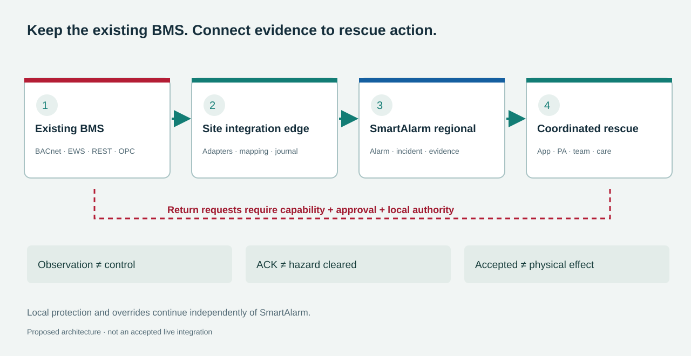

# Connect existing BMS to coordinated rescue

**Research and extension design · 24 October2026 · International, multi-tenant and multi-industry scope.**

Baseline 3.0 integrates a lifecycle-managed BMS integration domain with a shared connector platform and separate profiles for each product, version, interface and license. The BMS retains building-services operation and local control authority; SmartAlarm uses its evidence for hazard assessment, evacuation guidance, public address, proactive assistance and rescue coordination. Research covers **8 vendor/product families and 11 proposed connector profiles**, without treating protocol support as whole-brand compatibility. This package specifies **40 FR-BMS requirements,8 new screen contracts,20 business acceptance cases and 28 protocol cases**, together with a schema and JSON profiles. Their structure has been validated, but **adapters are not implemented and no live BMS has been connected**; activation requires qualification of the exact deployment. The integrated baseline contains 241 screen mockups, 37 workflows and a 188-slide proposal in each language. The eight BMS screens are integrated into the mockup catalog. The API contracts below are canonical internal SmartAlarm contracts, not vendor endpoints. This remains an implementation design package, not delivered BMS driver software.



## 1. Compatibility belongs to a product and operation

No customer product or version is known, so the architecture must accommodate modern API-enabled BMS, supervisors exposing BACnet/OPC, and legacy systems through an approved gateway or register map. Their information fidelity differs: point reads do not establish an alarm lifecycle; an alarm list does not establish acknowledgement; writable points do not authorize safety-related effects. Operational capability is the intersection of **implemented ∩ vendor-supported ∩ licensed ∩ site-authorized ∩ accepted**. Protocol fallback is never automatic because the alternate path can change identities, authority and semantics.

| Profile | Product and interface | Evidence and qualification |
|---|---|---|
| `bms.siemens.desigo-wsi` | Desigo CC<br>REST / WSI subscriptions | V8 specification describes REST read/write, events and history. WSI authentication has version-specific session/heartbeat behavior. Verified northbound OPC is DA, not UA. Qualify project/extension, HTTPS and PICS for a BACnet binding. [Siemens WSI](https://sid.siemens.com/r/A6V14948151/29540941067___en-US_29542478475?contentId=l64oBrPVORrEbx6beXKzjw) |
| `bms.schneider.ebo-ews` | EcoStruxure Building Operation<br>SOAP EWS / SmartConnector REST | The SmartConnector2.6/EWS1.2 guide was tested against EBO7.1.2. EBO3+ uses SoapEwsRestProvider. Do not assume root discovery or bulk support. Acknowledgement targets an alarm event, not every alarm-state transition. [EBO EWS](https://github.com/SchneiderElectricBuildings/SmartConnector/blob/main/docs/developer-guide/smartconnector-restful-ews-gateway.md) |
| `bms.jci.metasys-rest` | Metasys<br>Version-pinned REST / SSE | API v6 documents objects, command schemas, alarms, histories and SSE. Inspect each batch result rather than HTTP200 alone. Monitoring and Commanding needs separate licensing; the Metasys name alone does not establish compatibility. [Metasys API](https://jci-metasys.github.io/api-landing/api/v6-16) |
| `bms.honeywell.ebi-api` | Enterprise Buildings Integrator<br>Vendor SDK / web services | EBI2025 advertises enterprise web services, but the public page does not provide an implementation contract. Older R600 guide specifications discuss OPC DA/A&E/HDA and APIs; they do not establish equivalent REST or UA capability in EBI2025. [EBI](https://buildings.honeywell.com/gb/en/solutions/integrated-operations/ebi) |
| `bms.honeywell.webs-niagara` | WEBs N4<br>Niagara OEM station interface | WEBs is Niagara-based and needs an OEM profile. Modules, station exports, permissions and licensing determine capabilities. Do not reuse EBI APIs. [WEBs N4](https://www.honeywellbuildings.com/bms/building-control-system/honeywell-webs) |
| `bms.tridium.niagara-local` | Niagara local station / Supervisor<br>Qualified oBIX / licensed module | Supervisor4.6 documentation and the 2025 driver catalog identify oBIX. A marketplace REST module is a separate capability, not universal built-in REST. Alarm acknowledgement requires a qualified contract. [Niagara local](https://pages1.tridium.com/rs/808-SGM-271/images/Niagara%204.6%20Supervisor_DataSheet_VYKON.pdf) |
| `bms.tridium.nds-cloud` | Niagara Data Service<br>Cloud API | NDS is a separate cloud service for histories/tags, live read/write and alarm queries. Prerequisites include SMA and a reseller. Alarm acknowledgement is unverified; WAN cloud is not a critical local-control fallback. [Niagara Data Service](https://www.tridium.com/us/en/Products/niagara-cloud-suite/niagara-data-service) |
| `bms.delta.enteliweb` | enteliWEB<br>Vendor API / BACnet Web Services | The 4.23 catalog, updated November2022, lists an -API add-on. Confirm current entitlement; a brochure is insufficient for authentication, endpoints and lifecycle implementation. [enteliWEB](https://deltacontrols.com/wp-content/uploads/enteliWEB-Catalog-Sheet.pdf) |
| `bms.alc.webctrl-events` | WebCTRL event/telemetry integration<br>Outbound GET/POST / MQTT add-on | The 2025 sheet mentions alarm REST and outbound alarm-triggered GET/POST; MQTT is an add-on. Outbound events do not prove REST point commands or native acknowledgement. Initial scope is event/telemetry intake. [WebCTRL](https://www.automatedlogic.com/en/media/WebCTRL%20Open%20Integrations%20Platform_110325_tcm702-284058.pdf) |
| `bms.alc.webctrl-soap-sdk` | WebCTRL SOAP / SDK<br>SOAP / licensed Java SDK | SOAP needs a version-specific method contract; JavaSDK licensing is case-by-case. Qualify read, acknowledgement, commands and history by method and account scope. [WebCTRL SDK](https://www.automatedlogic.com/en/media/WebCTRL%20Open%20Integrations%20Platform_110325_tcm702-284058.pdf) |
| `bms.distech.ecnet-niagara` | EC-Net Facilities / EC-Net4<br>Niagara OEM station interface | EC-Net Facilities is the renamed Niagara-based EC-Net4. ECLYPSE REST belongs to the controller family, not automatically the EC-Net Supervisor. Qualify OEM modules and station access. [EC-Net](https://www.distech-controls.com/de-de/products/detail/947839/distech-controls/ec-net-facilities) |


### Vendor evidence and applicability

Table links open vendor documentation directly. Named versions identify researched documents, not a SmartAlarm-tested support range.

Read each vendor entry with its product boundary. In particular, Metasys licensing is a separate commercial prerequisite, the older EBI R600 guide specification does not prove every feature is implemented in EBI2025, and ECLYPSE controller REST is distinct from an EC-Net supervisor. Historical application-note limits are not current capacity commitments. Do not quote unsupported prices, rate limits, token lifetimes, point limits or development durations. [Metasys licensing](https://docs.johnsoncontrols.com/bas/r/Metasys/en-US/Metasys-UI-Help/7.0/Overview/Licensing) · [EBI R600](https://buildings.honeywell.com/content/dam/hbtbt/en/documents/downloads/IS_Guide%20Spec_EBI%20R600_04.20%20V2.pdf) · [Distech developer portal](https://developer.distech-controls.com/)

### Protocols provide transport and models, not business authority

| Layer | Design implication | Source |
|---|---|---|
| BACnet/IP / MS/TP | Read the exact-model PICS. COV is value change, not the alarm lifecycle. An IP router does not give an MS/TP bus IP-level capacity. Bound discovery and polling. | [PICS](https://bacnet.org/conformance-pics/) |
| BACnet/SC | WebSockets/TLS protect transport; manage CA, trust, expiry and hub failover. SC does not grant control authority or replace OT segmentation. | [BACnet/SC](https://bacnetinternational.org/bacnetsc/) |
| BACnet priority | There are16 priority levels; NULL relinquishes one slot to lower priority/default. Application TTL and ownership are not guaranteed. Edge power loss can leave a slot retained. | [Priority model](https://reference.opcfoundation.org/specs/OPC-30030/3.2.1) · [Relinquish](https://infosys.beckhoff.com/content/1033/tf8020_bacnetrev14/12319323787.html) |
| OPC UA | Preserve StatusCode, source time and server time. A&C and history are separate capabilities. ConditionRefresh loads retained conditions; it is not history replay and can race with new events. | [DataValue](https://reference.opcfoundation.org/specs/OPC-10000-4/7.11) · [A&C refresh](https://reference.opcfoundation.org/specs/OPC-10000-9/4.5) |
| OPC Classic | DA, A&E and HDA are not OPC UA. An approved Windows bridge belongs inside OT; do not expose DCOM to the Internet. | [Desigo OPC](https://sid.siemens.com/r/A6V14948151/29540941067___en-US_29542447755?contentId=ryEd1gVcA_APpnx4L8EE2A) |
| Modbus | Require the exact model/firmware register map, PDU address, type, signedness, word order, scaling, units and invalid sentinels. Register-derived alarms must be marked derived. Modbus Security is separate. | [Modbus](https://www.modbus.org/introduction-to-modbus) · [Security](https://www.modbus.org/modbus-specifications) |
| MQTT / webhook | Payload and alarm identity are project contracts. QoS does not prove physical effect; deduplication remains necessary. Do not retain immediate commands. Authenticate webhooks, prevent replay and reconcile state. | [MQTT5](https://docs.oasis-open.org/mqtt/mqtt/v5.0/os/mqtt-v5.0-os.html) |


Brick/Haystack can support semantic import without forcing replacement of the customer BMS. Separate location, composition, service-flow and point relationships; pin model versions. Keep semantic point identity separate from native references for controlled binding migration. [Brick relationships](https://docs.brickschema.org/brick/relationships.html) · [External references](https://docs.brickschema.org/metadata/external-representations.html) · [Haystack points](https://project-haystack.org/doc/docHaystack/Points)

## 2. The site edge preserves semantics and control boundaries


Reuse the existing Integration runtime, Physical integration, event bus, Incident, Routing, PA, Care and Command aggregate. The BMS domain adds system dossiers, native-alarm projections, semantic mapping and qualification; it does not create a second Command service. Locate edge components in OT or DMZ according to the network assessment, using approved conduits and preferably outbound mTLS sessions to regional ingress. A relay is not a transparent IP bridge to the field bus. Observation, alarm exchange, commands and operations are four independent contracts; approved monitoring remains useful even without control authorization. [NIST OT architecture](https://csrc.nist.gov/pubs/sp/800/82/r3/final)

| Component | Responsibility |
|---|---|
| Registry / qualification | Product/build/license/interface/evidence; signed profiles; connection success never enables writes. |
| Read acquisition | Separate subscription, polling and history workers; source budgets, reconnect jitter, cursors and raw evidence. |
| Semantic mapping | Immutable revisions for type/unit/enum/quality and equipment/zone/route dependencies. |
| Edge journal | Durable commit, inbox/outbox, gaps, checksum and epoch; reserve alarm capacity without silent drops. |
| Alarm bridge | Native occurrences, snapshot+stream, external ACK intents, provenance and anti-echo. |
| Command gate | Separate identity, allowlists, approval digest, expiry, mapping revision, local permissives and fencing. |
| Readback / health | Reconcile outcomes; monitor subscription, freshness, clock, queue, license/certificate and affected zones. |


### Each decision retains its proper authority

| Authority | Data and boundary |
|---|---|
| BMS/controller | Native objects, raw values, native alarms, local override and winning priority. |
| Site-approved mapping | Equipment/space/zone semantics, physical lineage and relationships approved for routing. |
| SmartAlarm | Incident, SOS, tasks, assistance profiles, approval/audit and Command intents. |
| Qualified feedback source | Physical outcome evidence; command=true does not prove fan flow, unlock does not prove door open. |


Integration does not grant the BMS access to raw medical records, ages or personal identities. Writeback contains only the permitted incident reference, zone, severity and minimal response state. Occupancy counts, badge passage and location traces are quality-qualified presence evidence, not proof that a named person remains inside or is safe. An LLM reads scoped projections with sources and timestamps; approved response rules do not depend on LLM output, and the LLM cannot write to the BMS.

### HA, offline and relinquishment are enforced at dispatch

Partition by tenant/site/connector and allow one active writer per control domain. Fencing must prevent the old edge from actually writing, not merely elect a cloud leader. Where a legacy controller cannot support sufficient safeguards, read-only HA remains viable while writer failover needs a local procedure. Ledger deduplication and idempotency do not make physical actuation exactly-once. On restart, query/reconcile outstanding commands and priority slots before enabling writes. Never replay expired commands.

A Command TTL prevents late dispatch; it does not guarantee that BACnet will remove an already written value. A powered-off edge cannot promise to send NULL on time. The site must accept a controller-level fallback/ownership arrangement or local operator handover; otherwise that capability remains disabled. Relinquishment releases an authorized slot; it is not writing OFF or restoring an old value. Unproven ownership requires manual reconciliation.

## 3. Functions cover the entire connection lifecycle

The following requirements are integrated in the existing FRD with inputs, preconditions, processing, durable outputs, failure behavior, permissions and acceptance. Canonical workflows are WF-34 onboarding and qualification; WF-35 alarm reconciliation and rescue; WF-36 governed commands; WF-37 lifecycle and recovery. WF-01–33 are preserved. Every row inherits tenant/site authorization, audit, actual/exercise isolation and version guards.

| ID | Function | Acceptance condition | Screens |
|---|---|---|---|
| FR-BMS-01 | Site BMS inventory | Activation requires build, interface and evidence. | BMS01, I01–I02, F17 |
| FR-BMS-02 | Capability-specific access | Read, history, ACK and commands have separate server permissions. | I02, I07, F03 |
| FR-BMS-03 | Bounded discovery | Scan approved scope only; cancellable; alarm intake remains available. | I02, S08, BMS01 |
| FR-BMS-04 | Point and object import | Preview row errors, duplicate IDs and encoding; commit a revision. | F04, S06 |
| FR-BMS-05 | Unit and semantic mapping | Golden fixtures verify scale, enums, types and byte order. | I03, F04 |
| FR-BMS-06 | Equipment and zone topology | Distinguish room, HVAC zone, fire compartment and route edge. | BMS02, F05, S02–S04 |
| FR-BMS-07 | Mapping publication and impact review | Show dependencies and approve revisions; rollback does not undo physical effects. | BMS05, F04, F17 |
| FR-BMS-08 | Observation quality and freshness | Zero differs from missing; late data cannot overwrite newer observations. | F01, F07, S07 |
| FR-BMS-09 | Subscriptions and polling | Renew/reconcile lost subscriptions; polling follows measured budgets. | I05, BMS06 |
| FR-BMS-10 | History and investigation | Preserve UTC, timezone, gaps and raw/interpolated distinctions. | F07, O21–O22 |
| FR-BMS-11 | Native alarm lifecycle | Active, ACK, confirmed and suppressed are independent; unsupported=null. | BMS03, O03, F07 |
| FR-BMS-12 | Priority and severity mapping | Do not invert priority numbers globally; test per source. | S11–S13, O05 |
| FR-BMS-13 | Correlation and provenance | A BMS mirror and direct panel feed are not independent evidence. | O05–O07, BMS03 |
| FR-BMS-14 | Controlled external ACK | Target the correct occurrence/version; failed receipt remains pending. | BMS03, O03, F07 |
| FR-BMS-15 | Observe external acknowledgement | Preserve source actor; ACK does not close the rescue incident. | BMS03, O04 |
| FR-BMS-16 | Publish incident summaries to BMS | Approved namespace, minimal data and anti-echo; no medical records. | BMS08, I08–I10 |
| FR-BMS-17 | Operator alarm grouping | Retain raw events and grouping counts; unacknowledged P1 remains visible. | O03, BMS03 |
| FR-BMS-18 | Maintenance and suppression | Require reason, owner and expiry; elapsed maintenance does not prove restoration. | F14, F18 |
| FR-BMS-19 | BMS evidence for evacuation | Stale door/fan/lift evidence lowers confidence or withdraws guidance. | Q04–Q05, C35–C38 |
| FR-BMS-20 | Proactive rescue | Combine needs and fresh presence; occupancy counts are not identities. | H08–H11, O11–O12 |
| FR-BMS-21 | Approved PA and app response | Do not wait for an LLM; echo/history cannot repeat broadcasts. | O13–O17, P01–P09 |
| FR-BMS-22 | Control impact preview | Show target, owner, priority, preconditions and affected zones. | F09–F10, BMS04 |
| FR-BMS-23 | Approved commands with expiry | Parameter changes invalidate approval; local override retains priority. | F10, BMS04 |
| FR-BMS-24 | Priority lease and relinquishment | Use permitted slots only; never clear an unproven foreign slot. | BMS04, F13 |
| FR-BMS-25 | Physical outcome reconciliation | Separate transport receipt, controller report and independent feedback. | F11–F12 |
| FR-BMS-26 | Timeout and unknown outcomes | Do not resend unknown effects; query/read back first. | F12, BMS07 |
| FR-BMS-27 | Local override and handover | Do not restore old commands on reconnect; assign cleanup ownership. | F13, BMS04, BMS07 |
| FR-BMS-28 | Durable journal and offline operation | Do not ACK before durable commit; local protection remains independent. | I05, G02, BMS07 |
| FR-BMS-29 | HA and single writer | Fence at the actual dispatch point; standby cannot write. | G03–G04, BMS07 |
| FR-BMS-30 | Alarm resynchronization after gaps | Uncertain snapshot/cursor exposes gaps; one page cannot clear missing alarms. | BMS03, BMS07 |
| FR-BMS-31 | Schema drift and upgrades | Rename preserves identity; type/unit changes quarantine affected capabilities. | BMS05, G09–G10 |
| FR-BMS-32 | License, certificate and account lifecycle | Test rotation; revocation blocks privileges; never log secrets. | I05, I07, F17 |
| FR-BMS-33 | Data- and zone-aware health | Online gateway does not hide stale points; alarm latency is measured separately. | I05, F01, BMS01 |
| FR-BMS-34 | Capacity, backfill and retention | Per-BMS quotas; historian work cannot starve alarm queues. | BMS06, G02 |
| FR-BMS-35 | Actual and exercise isolation | Simulation never sends real ACK/writes; commissioning has a separate plan. | I04, F15–F16 |
| FR-BMS-36 | Configuration-specific FAT/SAT | Sign off per capability; passing reads does not authorize commands. | F15–F17, BMS01 |
| FR-BMS-37 | Support and forensic export | Timeline includes revisions/sources; redact secrets and health data. | O21–O22, G07–G08 |
| FR-BMS-38 | Evidence-based BMS AI assistance | LLM reads scoped, sourced evidence; it never controls directly. | Q06–Q09 |
| FR-BMS-39 | Tenant/site isolation and residency | Repeated native IDs remain isolated; cross-site access uses authorized projections. | G01, T02–T04, BMS01 |
| FR-BMS-40 | Controlled retirement and handover | Review open alarms/leases, hand over, revoke, verify and retain audit. | BMS01, F13, G06 |


### Building-service subsystems have different actuation boundaries

| Subsystem | Design scope |
|---|---|
| HVAC | Observe modes, temperature, pressure and damper feedback; bounded setpoints only if approved. Comfort control does not replace smoke control. |
| Smoke control | Observe sequence status, fan proof, fault/inhibit. Request only approved controller/cause-and-effect sequences; never assemble a safety sequence from arbitrary outputs. |
| Fire / water / pumps | Observe alarm, trouble, supervisory, run, flow, pressure and impairments. Monitor by default; reset/silence/start/release needs a separate dossier. Wet-pipe sprinklers are not individually activated through an API. |
| Doors / access | Observe demand, contacts, faults, overrides and route relevance. Authorized unlock does not establish an open door or safe route. |
| Elevators | Observe floor/mode/fault/recall as exposed; an available flag does not authorize evacuation by elevator. |
| Power / UPS / generator | Observe power loss, readiness and affected loads; generator run does not prove every critical load is powered. |
| Flood / gas | Observe sensors, levels, valve/pump feedback and approved isolation sequences; missing is not zero. |


### Eight BMS screen contracts integrated into the 241-screen baseline

#### BMS01 · BMS dossier and capabilities

| Item | Contract |
|---|---|
| Visual | BMS → edge → SmartAlarm |
| Fields | vendor, product, build, modules, license evidence, interface, owner, capability matrix |
| Primary action | Review dossier; inspect health; activate accepted capabilities |
| Specific failure states | license unknown; certificate expired; incompatible build; partial coverage |
| Permissions | bms.configure / acceptance approver |
| Existing links | I02, F17, I05 |


Ready/loading/empty/partial/stale/offline/denied states need appropriate visuals and labels. Unavailable actions show a reason rather than color alone. Separate native raw evidence from translated labels; preserve IDs, units and native codes.

#### BMS02 · Semantic topology

| Item | Contract |
|---|---|
| Visual | controller → equipment → served zone → route edge |
| Fields | native ID, equipment, room, fire compartment, HVAC zone, relation type, evidence, revision |
| Primary action | Map; validate relationships; propose revision |
| Specific failure states | orphan point; cyclic containment; conflicting zones |
| Permissions | bms.configure / bms.mapping.approve |
| Existing links | F04, F05, S15 |


Ready/loading/empty/partial/stale/offline/denied states need appropriate visuals and labels. Unavailable actions show a reason rather than color alone. Separate native raw evidence from translated labels; preserve IDs, units and native codes.

#### BMS03 · Cross-system alarm reconciliation

| Item | Contract |
|---|---|
| Visual | native condition ↔ incident timeline |
| Fields | occurrence, generation, active/ack/confirm, source actor, cursor, gap, linked incident |
| Primary action | ACK exact occurrence; link incident; inspect receipt |
| Specific failure states | unknown ACK; stale snapshot; recurrence conflict; stream gap |
| Permissions | bms.read / bms.ack |
| Existing links | O03, O05, F07, F12 |


Ready/loading/empty/partial/stale/offline/denied states need appropriate visuals and labels. Unavailable actions show a reason rather than color alone. Separate native raw evidence from translated labels; preserve IDs, units and native codes.

#### BMS04 · Control ownership and priority

| Item | Contract |
|---|---|
| Visual | priority ladder + demand / actual feedback |
| Fields | target, current winner, priority slots, lease, local override, approved intent, expiry |
| Primary action | Request authority; relinquish an approved owned slot |
| Specific failure states | higher-priority override; foreign owner; expired lease; unknown feedback |
| Permissions | bms.command.request / bms.command.approve |
| Existing links | F09–F13 |


Ready/loading/empty/partial/stale/offline/denied states need appropriate visuals and labels. Unavailable actions show a reason rather than color alone. Separate native raw evidence from translated labels; preserve IDs, units and native codes.

#### BMS05 · Point drift and impact

| Item | Contract |
|---|---|
| Visual | before / after diff + dependency graph |
| Fields | old/new native reference, type, unit, mapping hash, dependent rules/routes/commands |
| Primary action | Approve or reject mapping migration |
| Specific failure states | reused ID; changed type/unit; critical rule affected |
| Permissions | bms.mapping.approve |
| Existing links | I03, G09, F17 |


Ready/loading/empty/partial/stale/offline/denied states need appropriate visuals and labels. Unavailable actions show a reason rather than color alone. Separate native raw evidence from translated labels; preserve IDs, units and native codes.

#### BMS06 · Capture budget and freshness

| Item | Contract |
|---|---|
| Visual | zone heatmap + alarm / telemetry / history queues |
| Fields | poll interval, batch size, subscriptions, queue lag, rate limits, backfill budget, freshness |
| Primary action | Apply reviewed policy; pause backfill; inspect stale points |
| Specific failure states | source throttling; queue pressure; partial gaps |
| Permissions | bms.configure / operations |
| Existing links | I05, G02, O22 |


Ready/loading/empty/partial/stale/offline/denied states need appropriate visuals and labels. Unavailable actions show a reason rather than color alone. Separate native raw evidence from translated labels; preserve IDs, units and native codes.

#### BMS07 · Edge recovery and handover

| Item | Contract |
|---|---|
| Visual | writer / journal / cursor recovery swimlane |
| Fields | owner epoch, source epoch, checkpoint, journal gap, outstanding commands, leases |
| Primary action | Reconcile; hand over; enable writes after checks |
| Specific failure states | split brain; missing journal; old epoch; unverified snapshot |
| Permissions | bms.reconcile / site OT approver |
| Existing links | G03, G04, F12, F13 |


Ready/loading/empty/partial/stale/offline/denied states need appropriate visuals and labels. Unavailable actions show a reason rather than color alone. Separate native raw evidence from translated labels; preserve IDs, units and native codes.

#### BMS08 · Exchange and loop trace

| Item | Contract |
|---|---|
| Visual | origin → BMS → SmartAlarm causation path |
| Fields | origin event, causation, namespace, native outbound object, hash, receipt, quarantine reason |
| Primary action | Inspect event path; quarantine looping mapping |
| Specific failure states | echo; reentry; conflicting identity; unsupported writeback |
| Permissions | bms.configure / incident reviewer |
| Existing links | I06, I08, O05 |


Ready/loading/empty/partial/stale/offline/denied states need appropriate visuals and labels. Unavailable actions show a reason rather than color alone. Separate native raw evidence from translated labels; preserve IDs, units and native codes.

## 4. Technical contracts preserve meaning across vendors

### Four artifacts have independent versions

The adapter image has a digest/SBOM and SDK version; the product profile has exact-version capabilities and evidence; the site binding has points/zones/lineage/mapping revisions; the operation policy has allowlists, approvals, priority, expiry and acceptance. Upgrading one artifact cannot increase the authority of the others. Publishing a catalog profile differs from accepting a site deployment. Included JSON profiles intentionally declare `not_implemented`, unverified site versions, `enabled_capabilities=[]` and `write_enabled=false`; they contain no customer endpoints or secrets.

```text
ConnectorFactory.create(profile, secretProvider, clock, durableStore, auditSink)
inspectEndpoint(ReadOnlyProbeContext) -> EndpointIdentity + CapabilityEvidence
importInventory(ApprovedScope, Cursor?) -> InventoryPage
readPoints(PointRefs, ReadPolicy) -> ObservationBatch
subscribe(ApprovedScope, DurableCursor?) -> AsyncStream<NativeEnvelope>
reconcile(ReconcileRequest) -> SnapshotPage + Watermark + Gaps
readHistory(HistoryRequest, Cursor?) -> HistoryPage | Unsupported
acknowledge(AuthorizedAckEnvelope) -> ExternalOperationReceipt
dispatch(AuthorizedCommandEnvelope) -> DispatchReceipt
readback(CommandRef) -> ReconciliationEvidence
relinquish(AuthorizedReleaseEnvelope) -> ReleaseReceipt | Unsupported
health() -> Endpoint + Subscription + Freshness + Queue + TrustHealth
drain() -> OutstandingIntents + Checkpoint
close() -> CloseResult
```

Unsupported methods return typed errors, never no-op success: `Unsupported`, `PermissionDenied`, `LicenseMissing`, `MappingMismatch`, `StalePrecondition`, `RateLimited`, `TransientTransport`, `SourceRejected`, `OutcomeUnknown`. Adapters preserve native errors/cursors/sessions; orchestration cannot construct raw requests to bypass them. A read-only probe must not test writes against production points to discover permissions.

| Entity | Core fields |
|---|---|
| BmsSystem | tenant/site, vendor/product/build, region/timezone, modules/licenses, owner, interface dossier |
| BmsConnection | profile, endpoint/secret references, connector group, rate budgets, lifecycle, separate health |
| BmsObject / PointBindingRevision | native stable ID, canonical physical point, semantic/type/unit/enum/scale, source and approved mapping revision |
| TopologyRelation | located_in / part_of / feeds_air / feeds_water / serves / controls / exposes / protects; source and approval |
| BmsAlarmOccurrence | native ID, generation, source epoch, condition/branch/event IDs, active/ack/confirm/retained/suppressed/out-of-service, timestamps |
| BmsAckIntent | actor, exact occurrence/version, comment, correlation, pending/accepted/rejected/unknown and receipt |
| ControlLeaseDetail | existing command_id, authorized target/slot/owner, before/desired state, expiry, release policy and physical outcome contract |
| MappingDrift / SourceAuthorityPolicy | change impact, invalidated capabilities, migration approval; physical lineage and quality-based source authority |


### Identity, alarms and commands do not share one state flag

Store native alarm dimensions independently: active, acknowledged, confirmed, retained, suppressed and out-of-service; unsupported dimensions are null, not false. Source return-to-normal does not close an incident or establish occupant safety. Internal ACK accepts operator responsibility; external ACK targets the exact occurrence/event generation and needs receipt/readback. A late acknowledgement cannot affect a recurrent alarm. Exact deduplication precedes correlation, using tenant, site, BMS, native alarm ID, generation, source epoch and source event ID where available. Synthetic identity algorithms must declare their limits.

On reconnect, open/buffer the stream, obtain a snapshot and merge against its watermark where supported. Without atomic snapshot/cursor semantics, keep partial/gap status, use source-specific reconciliation and manual review; absence from one page cannot clear an alarm. Historical replay is evidence, not permission to repeat PA, dispatch or expired commands. BMS and direct-panel paths retain their provenance but a shared physical lineage does not count as two independent confirmations.

Commands retain the existing aggregate and states: `requested/approved/dispatched/accepted/executing/succeeded/failed/unknown/expired`. Approval binds target, parameters, mapping and policy revision digests; changes invalidate approval. Transport receipt, controller execution report and independent physical feedback are separate evidence. Multi-target plans contain child commands, not a presumed all-or-nothing transaction. Compensation is a new authorized command, not automatic physical rollback.

Writeback uses a dedicated namespace and origin/causation/correlation. If the BMS cannot preserve metadata, a bridge ledger links native outbound objects, effect keys and payload hashes; suppress only proven echoes, not every similar text event. Secrets remain vault references. Derive tenant/site authority from authenticated bindings rather than trusting payload tenant_id.

### Canonical API and event contracts in baseline 3.0

The existing API contract now includes 23 BMS operations, 67 operations in total. Earlier draft aliases such as `/bms-systems` are superseded by the paths below. Request/response types and guards are normative in [API-Contract.json](../../API-Contract.json).

| Method | Path | Permission | Request → success response |
|---|---|---|---|
| GET | `/bms/connections` | `bms.connection.read` | — → BMSConnectionPage |
| POST | `/bms/connections` | `bms.connection.create` | BMSConnectionCreate → BMSConnectionView |
| GET | `/bms/connections/{connection_id}` | `bms.connection.read` | — → BMSConnectionView |
| POST | `/bms/connections/{connection_id}/discoveries` | `bms.discovery.run` | BMSDiscoveryRequest → BMSJob |
| POST | `/bms/connections/{connection_id}/map-revisions` | `bms.mapping.edit` | BMSMapDraftCreate → BMSMapRevision |
| POST | `/bms/connections/{connection_id}/validations` | `bms.mapping.validate` | BMSValidationRequest → BMSJob |
| POST | `/bms/connections/{connection_id}/qualifications` | `bms.qualification.submit` | BMSQualificationCreate → BMSJob |
| POST | `/bms/connections/{connection_id}/activations` | `bms.connection.activate` | BMSActivationRequest → BMSJob |
| GET | `/bms/connections/{connection_id}/points` | `bms.point.read` | — → BMSPointPage |
| GET | `/bms/connections/{connection_id}/alarms` | `bms.alarm.read` | — → BMSAlarmPage |
| POST | `/bms/connections/{connection_id}/alarms/{alarm_id}/native-acknowledgements` | `bms.alarm.ack_native` | BMSNativeAckRequest → BMSMutationReceipt |
| POST | `/bms/connections/{connection_id}/command-previews` | `bms.command.preview` | BMSCommandPreview → BMSCommandPreviewResult |
| POST | `/bms/connections/{connection_id}/commands` | `bms.command.submit` | BMSCommandSubmit → BMSMutationReceipt |
| GET | `/bms/connections/{connection_id}/commands/{command_id}` | `bms.command.read` | — → BMSMutationReceipt |
| POST | `/bms/connections/{connection_id}/commands/{command_id}/reconciliations` | `bms.command.reconcile` | BMSCommandReconcile → BMSMutationReceipt |
| POST | `/bms/connections/{connection_id}/reconciliations` | `bms.reconciliation.run` | BMSReconciliationRequest → BMSJob |
| POST | `/bms/connections/{connection_id}/lifecycle-transitions` | `bms.lifecycle.change` | BMSLifecycleRequest → BMSJob |
| GET | `/bms/connections/{connection_id}/health` | `bms.health.read` | — → BMSHealth |
| GET | `/bms/connections/{connection_id}/jobs/{job_id}` | `bms.job.read` | — → BMSJob |
| GET | `/bms/connections/{connection_id}/policies/request-budget` | `bms.policy.budget.read` | — → BMSRequestBudgetView |
| PATCH | `/bms/connections/{connection_id}/policies/request-budget` | `bms.policy.budget.change` | BMSRequestBudgetUpdate → BMSRequestBudgetView |
| GET | `/bms/connections/{connection_id}/policies/incident-export` | `bms.policy.export.read` | — → BMSIncidentExportView |
| PATCH | `/bms/connections/{connection_id}/policies/incident-export` | `bms.policy.export.change` | BMSIncidentExportUpdate → BMSIncidentExportView |

Commands submit an approved preview and approval digest to the existing physical Command executor; no raw point write is exposed. A 202 receipt proves durable local acceptance, not physical success. HTTP 409 covers state/idempotency/authority conflict; 412 covers ETag/evidence revision mismatch; 422 semantic invalidity; 429 budget exhaustion; 503 upstream/durable acceptance unavailable. Unknown command outcomes require reconciliation without blind replay.

Request-budget policy can pause history backfill without pausing active-alarm reconciliation. Incident export requires separately qualified `export_incident` capability and an approved namespace/binding. The only export fields are incident_id, severity, status, zone_id, mode and occurred_at. Echo markers and quarantine-on-echo are mandatory; quarantine disables export. Lifecycle actions use the typed drain/suspend/resume_read/upgrade/rollback/retire contract and expected revision, approval and handback evidence.

[Event-Schemas.json](../../Event-Schemas.json)

```text
com.smartalarm.bms.alarm_changed.v1
com.smartalarm.bms.command_changed.v1
com.smartalarm.bms.connection_changed.v1
com.smartalarm.bms.health_changed.v1
com.smartalarm.bms.map_published.v1
com.smartalarm.bms.point_observed.v1
com.smartalarm.bms.reconciliation_completed.v1
```

The typed event envelopes preserve provenance, mapping revision, source quality and freshness; missing source time remains unknown. Physical feedback and command execution retain the existing physical domain boundary. Large snapshots use object references and hashes.

### Size against the source rather than a universal point count

```text
poll_samples_per_second = Σ(N_group / poll_interval_seconds)
poll_requests_per_second = Σ(N_group / effective_batch_size / interval)
subscription_bytes_per_second = Σ(change_rate × payload_size) + protocol overhead
edge_journal_bytes >= peak_accepted_bytes_per_second × offline_seconds × overhead_factor
```

Planning example, not a benchmark:2,000 points every 5 seconds plus8,000 every 60 seconds produces about 533.3samples/s. At 300 bytes/sample this is160KB/s, approximately13.824GB for 24 hours before headers, indexes and replication; a factor of 2 yields 27.65GB, still requiring reserve and alarm-burst assessment. Snapshots, reconnects and shadow readers add separate load. Cloud autoscaling does not increase legacy-BMS capacity. Measure source→edge, edge commit→cloud, cloud→operator, request→native receipt and receipt→physical feedback separately. Publish p95/p99 only with accepted clock quality and workload fixtures.

## 5. Accept capabilities and hand over with evidence

Artifact releases move through draft→schema_validated→contract_tested→security_reviewed→approved→published→retired. Site activation moves through proposed→discovered→mapped→lab_verified→site_commissioning→site_accepted→active; healthy/degraded/offline/quarantined is a separate health dimension. Included JSON remains design_example. JSON Schema checks structure and selected guards, not signatures, evidence authenticity or controller authority.

An upgrade captures image/profile/mapping/policy digests, cursors and outstanding intents; validates compatibility; runs an authorized-budget shadow reader without ACK/write; drains new commands; persists checkpoints; transfers writer authority through fencing; and reconciles before reopening writes. Unknown physical outcomes or orphan leases keep writes disabled with local handover. Code/config rollback cannot undo acknowledgements or effects already performed. Retirement reviews open alarms/leases, transfers responsibility, revokes credentials/certificates and retains audit.

### 20 business cases are test specifications, not executed FAT/SAT

| ID | Stimulus | Required outcome |
|---|---|---|
| BMS-T01 | Rename, type, unit or enum changes | Keep identity for rename; quarantine incompatible semantics and affected commands. |
| BMS-T02 | Repeated native ID across sites/tenants | No cross-tenant joins, disclosure or wrong acknowledgement. |
| BMS-T03 | Alarm returns normal before acknowledgement | Active becomes false; acknowledgement can remain pending; incident stays independent. |
| BMS-T04 | Alarm recurs while an old ACK is pending | Old receipt cannot acknowledge the new occurrence; refresh and show conflict. |
| BMS-T05 | Panel direct feed and BMS mirror replay100 times | One physical lineage; no duplicated incident, dispatch or broadcast. |
| BMS-T06 | Lost cursor; paged snapshot with concurrent events | Record gaps; do not clear alarms based on absence from a single page. |
| BMS-T07 | Higher-priority local override | Show rejected request or accepted non-winning demand accurately; no override bypass. |
| BMS-T08 | Receipt lost after possible command execution | Mark unknown; reconcile without blind resending. |
| BMS-T09 | Lease expires and slot owner changes during restart | Do not clear another owner; approved relinquishment requires readback. |
| BMS-T10 | Fan demand accepted but proof false or bad | No physical success; show demand/feedback discrepancy. |
| BMS-T11 | Link loss, full buffer and two-node failover | Local protection independent; durable commit and single-writer fencing hold. |
| BMS-T12 | Alarm burst overlaps historian backfill | Alarm queue remains available and upstream budgets are respected. |
| BMS-T13 | Expired/revoked certificate or wrong tenant | Privileged operations fail closed; no insecure fallback. |
| BMS-T14 | Published incident is reflected by BMS | No recursive incident creation; preserve exact receipt evidence. |
| BMS-T15 | Maintenance ends before restoration | Restoration remains pending and escalates; do not mark ready. |
| BMS-T16 | Stale door/fan evidence affects route | Re-evaluate or withdraw route and old speech; assistance remains accessible. |
| BMS-T17 | AI-derived point, occupancy count or old badge event | Do not present inference as measurement or confirmed occupant safety. |
| BMS-T18 | VI/EN/JA, keyboard, zoom and color deficiency | Critical action/source owner readable; raw identifiers remain unchanged. |
| BMS-T19 | Exercise data reconnects after outage | No exercise leak to actual operations; backfill cannot actuate. |
| BMS-T20 | Retirement with open commands and leases | Handover, revoke, verify and retain audit; no orphan remote override. |


### 28 protocol cases supplement and overlap the business cases

| ID | Stimulus | Required outcome |
|---|---|---|
| BMS-P-01 | Read-only enforcement — Attempt writes and external ACK with read-only identity | Reject before dispatch; no native write audit entry. |
| BMS-P-02 | Scaling — Known pressure raw600 with scale100 and invalid unit | Decode6.0bar; unapproved mapping never enters rules. |
| BMS-P-03 | Register addressing — Zero/one-based addresses and alternate32-bit word order | Match golden fixtures; mismatches block commissioning. |
| BMS-P-04 | COV expiry — Subscription expiry or BMS restart | Renew and reconcile; report stale during gap. |
| BMS-P-05 | MS/TP contention — Authorized burst on a constrained bus | No polling storm; record actual latency and critical-event handling. |
| BMS-P-06 | Existing active alarms — Connect after alarms are already active | Load current conditions; stay syncing until reconciled. |
| BMS-P-07 | Refresh race — New event arrives between refresh boundaries | Older refresh data cannot overwrite new state. |
| BMS-P-08 | Duplicate delivery — Repeat identical source event | One canonical transition; multiple receipts retained. |
| BMS-P-09 | Dual paths — Direct panel and BMS relay same alarm | Link physical lineage; preserve both paths. |
| BMS-P-10 | Similar unrelated alarms — Equal labels and near timestamps on different devices | No false merge based only on text/time. |
| BMS-P-11 | Late acknowledgement — Occurrence2 starts before ACK1 receipt | ACK1 never clears ACK2 responsibility. |
| BMS-P-12 | Internal acknowledgement — SmartAlarm operator accepts work | Native BMS acknowledgement remains unchanged. |
| BMS-P-13 | Return to normal — Source normal while rescue is unresolved | Incident and occupant safety remain independent. |
| BMS-P-14 | Dispatch timeout — Controller might have acted but receipt is lost | Unknown outcome and reconciliation; no blind retry. |
| BMS-P-15 | Expired offline command — Reconnect after command expiry | Do not replay; require a new authorized intent. |
| BMS-P-16 | Local override — Operator obtains higher priority | Do not report physical success; show ownership conflict. |
| BMS-P-17 | Lost writer — Kill edge between dispatch and receipt persistence | Fence standby and reconcile before writes resume. |
| BMS-P-18 | Retained priority slot — Power loss while edge holds a BACnet priority | Measure controller behavior; require accepted local fallback. |
| BMS-P-19 | Same-slot collision — Another application writes the same priority | Do not assume ownership or clear with NULL automatically. |
| BMS-P-20 | Certificate rotation — Expired, changed or revoked trust material | Fail closed for privileged actions; no automatic trust. |
| BMS-P-21 | Quality loss — Bad/uncertain point or missing source time | No false normal/safe display; propagate uncertainty. |
| BMS-P-22 | Clock drift — Source clock skew and late delivery | Keep both timestamps; do not overwrite newer occurrence. |
| BMS-P-23 | Alarm flood — Alarm burst plus ordinary telemetry | Preserve transitions; only approved telemetry may coalesce. |
| BMS-P-24 | Disk capacity — Journal near/full capacity | Actionable degradation and explicit gaps; no silent discard. |
| BMS-P-25 | Reflection loop — Summary sent out and reflected back | Preserve origin; no new incident or command loop. |
| BMS-P-26 | Translation — VI/EN/JA status and action terminology | Same operational meaning; preserve native codes. |
| BMS-P-27 | Isolation — Cross-tenant credential, mapping or command | Reject and audit without topology or health-data disclosure. |
| BMS-P-28 | Emergency independence — Cloud and edge both unavailable | Local protection remains independent under its own accepted design. |


The 18 protocol-assurance controls map to the 40 FR requirements; they are not 58 independent features. Controls use BMS-CTRL IDs to avoid confusion with screens BMS01–08.

| ID | Control | FR-BMS | UI |
|---|---|---|---|
| BMS-CTRL-01 | Survey | 01 | BMS01 |
| BMS-CTRL-02 | Endpoint access | 02 | I02/I07 |
| BMS-CTRL-03 | Discovery/import | 03–04 | BMS01/F04 |
| BMS-CTRL-04 | Semantic mapping | 05–07 | BMS02/F04 |
| BMS-CTRL-05 | Point explorer | 08–10 | F07 |
| BMS-CTRL-06 | Alarm reconciliation | 11/30 | BMS03 |
| BMS-CTRL-07 | Multi-source correlation | 13 | O05/BMS03 |
| BMS-CTRL-08 | Internal ACK | 14–15 | O03 |
| BMS-CTRL-09 | External ACK | 14 | BMS03 |
| BMS-CTRL-10 | Incident writeback | 16 | BMS08 |
| BMS-CTRL-11 | Command approval | 22–24 | F09/F10 |
| BMS-CTRL-12 | Outcome evidence | 25–26 | F11/F12 |
| BMS-CTRL-13 | Override/relinquish | 24/27 | BMS04 |
| BMS-CTRL-14 | History/evidence | 10/37 | O21/F07 |
| BMS-CTRL-15 | Health | 32–34 | I05/BMS01 |
| BMS-CTRL-16 | Maintenance | 18 | F14/F18 |
| BMS-CTRL-17 | FAT/SAT | 35–36 | F15/F17 |
| BMS-CTRL-18 | Lifecycle | 31/40 | BMS05/BMS07 |


FAT uses fixtures/emulators and a profile-matched BMS sandbox; SAT uses an authorized site configuration. Each case records expected/actual/evidence/version/witness; unexecuted cases remain not_run. Proving read APIs does not require activating real firefighting equipment. Physical-control tests need approved impairment, cause-and-effect, local personnel and stop procedures. Package schema checks prove only valid JSON structure and disabled-by-default design configurations.

### Integration into the existing baseline 3.0 document set

| Document | Integrated content |
|---|---|
| BRD | Integrated: BR-BMS objectives for retained BMS investment, evidence-based rescue and governance; includes BMS owner, facility, OT security and integrator roles; measure coverage/gaps/ACK outcomes. |
| FRD | 40 detailed FR-BMS and WF-34–37 integrated; WF-01–33 preserved; capability-specific acceptance traced. |
| Basic Design | Integrated: BMS domain, edge/conduits, authority matrix, queue priorities and recovery; reuse Command. |
| Detail Design | Integrated: entities/APIs/events, occurrence identity, cursor/epoch, priority ownership, unknown reconciliation and sizing. |
| UI/UX | Integrated eight new screen specifications and mockups and mapped I/F/S/O/Q/G changes; use topology, priority ladders, freshness and timelines. |
| Device / standards catalogs | Record exact build/interface/license/PICS; distinguish documented, tested and unknown capabilities. |
| API/Event schemas | Version additive extensions without silent breaks; reuse physical observation and Command types. |
| Proposal VI/EN | Integrated: BMS all-in-one, authority boundaries, fire/no-SOS scenario and qualification; 40 FR and eight integrated screens in the appendix. |
| Acceptance / deployment | Map 48 cases by scope without additive coverage claims; bind build/point map/owner/SLA/rollback/handover. |


### Customer-facing narrative integrated into the proposal

**The BMS continues to manage the building; SmartAlarm adds coordinated rescue using building evidence.** Customers retain building services, supervisors and existing operating procedures while connecting alarms, equipment location, route readiness and protective-system information to apps, speakers and responders. Measure source coverage, time to awareness, people not yet reached and handover outcomes, rather than connected-point counts alone. Two-way functions are selected per interface and authority dossier, not sold as universal plug-and-play.

**Fire on floor 12:** The BMS forwards an alarm with source and time. SmartAlarm correlates a direct-panel feed without double counting, identifies the affected area and assesses routes against valid door/fan evidence. Assistance profiles and presence bring people who sent no SOS into the welfare-check queue. Apps/PA use approved messages; assigned responders acknowledge responsibility. Any approved BMS action passes through Command policy and edge enforcement, with receipt, controller report and feedback shown separately. Return to BMS normal does not close the incident until the incident commander verifies rescue outcomes.

Before estimating deployment, confirm product/build/license, interface contracts, point/alarm dictionaries, network boundaries, intended ACK/write authority, local cause-and-effect, scale/timing/offline requirements and SAT owners. The platform architecture is complete from the outset; evidence-gated activation is a quality gate, not a temporary demo architecture.

## Source and artifact appendix

Research branches located/cross-checked sources on24 October 2026. Live specifications can change; archive approved versions during commissioning. The newer Modbus PDF URL timed out when opened; Modbus conclusions were cross-checked against Introduction/Specifications pages and vendor register documentation, not claimed as a complete PDF read. A source ledger is not site certification.

| ID | Source | URL |
|---|---|---|
| S01 | Haystack Ops | [Open](https://project-haystack.org/doc/docHaystack/Ops) |
| S02 | Brick Relationships | [Open](https://docs.brickschema.org/brick/relationships.html) |
| S03 | Brick External Representation | [Open](https://docs.brickschema.org/metadata/external-representations.html) |
| S04 | Haystack Points | [Open](https://project-haystack.org/doc/docHaystack/Points) |
| S05 | BACnet Committee – PICS | [Open](https://bacnet.org/conformance-pics/) |
| S06 | BACnet International | [Open](https://bacnetinternational.org/bacnetsc/) |
| S07 | JCI BACnet/SC overview | [Open](https://docs.johnsoncontrols.com/bas/r/Facility-Explorer/en-US/Facility-Explorer-BACnet/SC-Commissioning-Guide/Introduction/BACnet/SC-overview) |
| S08 | OPC Foundation – BACnet companion model | [Open](https://reference.opcfoundation.org/specs/OPC-30030/3.2.1) |
| S09 | Beckhoff command prioritization | [Open](https://infosys.beckhoff.com/content/1033/tf8020_bacnetrev14/12319323787.html) |
| S10 | MSA BACnet MS/TP Driver Manual | [Open](https://assetlibrary.msasafety.com/m/79e528c359ff4020/original/Protocol-Driver-Manual-BACnet-MS-TP-8700-73.pdf) |
| S11 | CODESYS BACnetAcknowledgeAlarm | [Open](https://content.helpme-codesys.com/en/libs/CmpBACnet/Current/BACnetClientAPI/BACnetAcknowledgeAlarm.html) |
| S12 | OPC UA Part 4 – DataValue | [Open](https://reference.opcfoundation.org/specs/OPC-10000-4/7.11) |
| S13 | OPC UA Part 9 – acknowledgeable conditions | [Open](https://reference.opcfoundation.org/specs/OPC-10000-9/4.3) |
| S14 | OPC UA Part 9 – Acknowledge | [Open](https://reference.opcfoundation.org/specs/OPC-10000-9/5.7.3) |
| S15 | OPC UA Part 9 – synchronization | [Open](https://reference.opcfoundation.org/specs/OPC-10000-9/4.5) |
| S16 | OPC UA Part 4 – Services | [Open](https://reference.opcfoundation.org/specs/OPC-10000-4/5) |
| S17 | Modbus Organization – introduction | [Open](https://www.modbus.org/introduction-to-modbus) |
| S18 | Modbus Application Protocol V1.1b3 | [Open](https://www.modbus.org/file/secure/modbusprotocolspecification.pdf) |
| S19 | Schneider DOCA0302EN-04 | [Open](https://productinfo.se.com/i-o_smart_link_user_guide/doca0302-i-o-smartlink-user-guide/English/DOCA0302_Smartlink_Modbus_Plus_User_Guide_0001141942.xml/%24/SLMB_Modbus_Table_Formats_0001141927) |
| S20 | Modbus Organization – specifications | [Open](https://www.modbus.org/modbus-specifications) |
| S21 | OASIS MQTT 5.0 | [Open](https://docs.oasis-open.org/mqtt/mqtt/v5.0/os/mqtt-v5.0-os.html) |
| S22 | NIST publication status | [Open](https://csrc.nist.gov/pubs/sp/800/82/r3/final) |
| S23 | NIST SP 800-82r3, phần network segmentation | [Open](https://nvlpubs.nist.gov/nistpubs/SpecialPublications/NIST.SP.800-82r3.pdf) |
| S24 | REST specification | [Open](https://sid.siemens.com/r/A6V14948151/29540941067___en-US_29542478475?contentId=l64oBrPVORrEbx6beXKzjw) |
| S25 | OPC specification | [Open](https://sid.siemens.com/r/A6V14948151/29540941067___en-US_29542447755?contentId=ryEd1gVcA_APpnx4L8EE2A) |
| S26 | BACnet specification | [Open](https://sid.siemens.com/r/A6V14948151/29540941067___en-US_29542455435?contentId=zw8Kj4aiIKuJVOt8bK4jSA) |
| S27 | Authentication and services | [Open](https://mybuilding.siemens.com/d036861342594/help/engineeringhelp/en-US/23637026955.html) |
| S28 | 2021 application note | [Open](https://cache.industry.siemens.com/dl/files/039/109765039/att_1055671/v1/109765039_EnM_DesigoCC_en_V2.1.pdf) |
| S29 | Official SmartConnector developer guide | [Open](https://github.com/SchneiderElectricBuildings/SmartConnector/blob/main/docs/developer-guide/smartconnector-restful-ews-gateway.md) |
| S30 | API v6 reference | [Open](https://jci-metasys.github.io/api-landing/api/v6-16) |
| S31 | Metasys UI licensing | [Open](https://docs.johnsoncontrols.com/bas/r/Metasys/en-US/Metasys-UI-Help/7.0/Overview/Licensing) |
| S32 | API v4 introduction | [Open](https://jci-metasys.github.io/api-landing/api/v4) |
| S33 | EBI current product | [Open](https://buildings.honeywell.com/gb/en/solutions/integrated-operations/ebi) |
| S34 | R600 guide specification, sections OPC/API | [Open](https://buildings.honeywell.com/content/dam/hbtbt/en/documents/downloads/IS_Guide%20Spec_EBI%20R600_04.20%20V2.pdf) |
| S35 | WEBs product | [Open](https://www.honeywellbuildings.com/bms/building-control-system/honeywell-webs) |
| S36 | BTL Honeywell listings | [Open](https://www.bacnetinternational.net/btl/index.php?m=21) |
| S37 | Supervisor4.6 datasheet | [Open](https://pages1.tridium.com/rs/808-SGM-271/images/Niagara%204.6%20Supervisor_DataSheet_VYKON.pdf) |
| S38 | 2025 driver catalog | [Open](https://www.tridium.com/content/dam/tridium/en/documents/document-lists/drivers/tri-niagara-compatible-drivers-applications-en-2025-0020.pdf) |
| S39 | NDS product and prerequisites | [Open](https://www.tridium.com/us/en/Products/niagara-cloud-suite/niagara-data-service) |
| S40 | Tridium marketplace: BTIB ActiveAPI | [Open](https://www.tridium.com/us/en/niagara-marketplace/btib/active-api) |
| S41 | enteliWEB4.23 catalog, pages4/7 | [Open](https://deltacontrols.com/wp-content/uploads/enteliWEB-Catalog-Sheet.pdf) |
| S42 | Official integration sheet2025 | [Open](https://www.automatedlogic.com/en/media/WebCTRL%20Open%20Integrations%20Platform_110325_tcm702-284058.pdf) |
| S43 | EC-Net security | [Open](https://www.distech-controls.com/en-gb/resources/bms-cybersecurity-support-portal/bms-cybersecurity-products-solutions) |
| S44 | EC-Net Facilities | [Open](https://www.distech-controls.com/de-de/products/detail/947839/distech-controls/ec-net-facilities) |
| S45 | Distech developer portal | [Open](https://developer.distech-controls.com/) |


[40-function CSV inventory](../BMS-Functional-Inventory.csv) · [Source ledger CSV](../BMS-Source-Ledger.csv) · [Connector schema](../connectors/bms-connector-profile.schema.json)

| Profile | JSON |
|---|---|
| bms.siemens.desigo-wsi | [JSON](../connectors/bms.siemens.desigo-wsi.json) |
| bms.schneider.ebo-ews | [JSON](../connectors/bms.schneider.ebo-ews.json) |
| bms.jci.metasys-rest | [JSON](../connectors/bms.jci.metasys-rest.json) |
| bms.honeywell.ebi-api | [JSON](../connectors/bms.honeywell.ebi-api.json) |
| bms.honeywell.webs-niagara | [JSON](../connectors/bms.honeywell.webs-niagara.json) |
| bms.tridium.niagara-local | [JSON](../connectors/bms.tridium.niagara-local.json) |
| bms.tridium.nds-cloud | [JSON](../connectors/bms.tridium.nds-cloud.json) |
| bms.delta.enteliweb | [JSON](../connectors/bms.delta.enteliweb.json) |
| bms.alc.webctrl-events | [JSON](../connectors/bms.alc.webctrl-events.json) |
| bms.alc.webctrl-soap-sdk | [JSON](../connectors/bms.alc.webctrl-soap-sdk.json) |
| bms.distech.ecnet-niagara | [JSON](../connectors/bms.distech.ecnet-niagara.json) |


