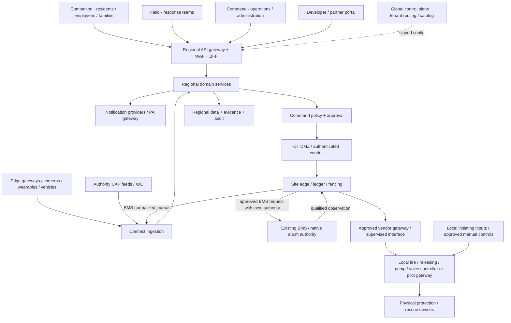
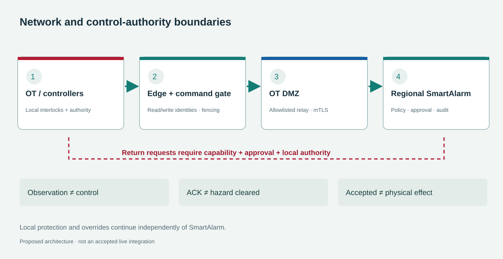

# SmartAlarm — Basic Design / Overall Production Architecture

**Baseline 3.0 · 24/10/2026 · design, not deployed.** Complete architecture for an international, cross-industry product; this is not a demo architecture. The user confirmed a complete build in one effort, with deep, long-term design. Workstreams/quality gates support implementation management and do not remove features from the baseline. The prototype is a UI review tool, not a backend product or evidence of SLO attainment.

## 1. Architectural principles and decisions

1. Independent domain services communicate through versioned APIs and events; no cross-database queries.
2. Tenant, region, authorization, provenance, and idempotency are invariants, not later additions.
3. Separate the control plane from regional data planes; a regional cell operates independently during control-plane disruption.
4. Each incident has one home region and one fenced writer; no multi-master modification of the same incident.
5. The critical path does not depend on generative AI, search, BI, or the global control plane.
6. At-least-once event delivery + consumer idempotency; no promise of exactly-once delivery across the Internet/providers/devices.
7. Edge retains independent local safety functions; cloud does not replace certified protective control loops.
8. AI provides evidence/suggestions; automation follows approved, bounded rules.
9. Three release locales: vi-VN, en, ja-JP; key-based design allows languages to be added without changing business schemas.
10. Full functionality does not mean enabling every capability for every tenant. Feature entitlements and safety policies determine access, with auditing.
11. Physical firefighting and rescue are part of the full design. Automatic local protection remains autonomous; SmartAlarm coordinates and requests only approved capabilities through approved controllers. No LLM participates in the actuation control loop.
12. Observation, authorized request, controller acceptance, and verified physical outcome are distinct. A monitoring-only gateway cannot be promoted to an actuator by an entitlement or writable protocol property.

## 2. System context

Channels: responsive web Command/Administration/Developer portal; native iOS/Android Companion and Field; optional kiosk/wallboard according to scope. Native mobile is preferred for background capabilities, secure storage, and notification integration; operating systems may restrict background delivery, so the app is not treated as the only channel.

The local controller/device sequence does not traverse the cloud or site edge. Heat-operated wet-pipe sprinkler heads are not individually activated by a generic software command; controlled-release systems require their own approved releasing controller and cause-and-effect design. Physical interfaces may provide observation only. The [physical catalog](Physical-Device-Catalog.md), [rescue/IoT catalog](Rescue-IoT-Device-Catalog.md), and [standards/deployment design](External-Integration-Standards-Deployment.md) provide dated official-source evidence, exact candidate restrictions, and procurement/acceptance gates. These researched candidates are not deployed integrations.

## 3. Service boundaries and ownership

| Service | Responsibilities / owned data | Main APIs / emitted events | Permitted dependencies |
|---|---|---|---|
| Identity & membership | Tenant membership, roles, site scopes, consent identities | memberships, sessions; membership.revoked | OIDC provider; policy store |
| Tenant & policy | Region assignment, entitlements, configuration version | tenants, policies; policy.published | Global routing metadata |
| Location & mapping | Site graph, geofences, plan revisions, shelters | locations, plans; plan.published | Regional object store |
| Device registry | Identity/cert binding, capability, firmware, maintenance | devices; device.health.changed | PKI, connector registry |
| Integration runtime | Adapter execution, mapping, source receipt, DLQ | events ingest; signal.accepted | Device/policy caches, broker |
| BMS integration domain | Connections, immutable point maps, qualification, native alarm mirror, lifecycle policies; physical commands remain in Command domain | /bms/connections; com.smartalarm.bms.*.v1 | Integration runtime, asset graph, policy, existing physical executor |
| Detection & correlation | Rule versions, candidate groupings, model metadata | candidates; incident.candidate | Signal stream, location snapshot |
| Incident | Incident aggregate, source references, state and version | incidents; incident.created/updated | Local policy cache, outbox |
| Assistance & accountability | SOS, person observations, check-in sessions | sos, safety-reports; sos.created | Incident references, consent |
| Workflow orchestration | Durable deadlines, escalation, human approvals | workflows; escalation.due | Service APIs with idempotency |
| Dispatch | Units, skills, shifts, offers, tasks, handover | tasks; task.assigned/completed | Incident projection, team roster |
| Warning & content | Warning version, translated content, audience approval | warnings; warning.approved | Approved content, audience snapshot |
| Delivery | Channel attempts, provider feedback, fallback, receipts | deliveries; delivery.status.changed | Provider adapters, recipient snapshot |
| Collaboration | Groups, memberships, restricted incident chat | conversations; message.created | IAM/consent, attachment service |
| Command & mission | Equipment commands, interlocks, approvals, mission state | commands, missions; command.result | Capability registry, edge adapter |
| Evidence/media | Upload session, hash, scan status, retention, stream auth | evidence; evidence.available | Object store, antivirus, media gateway |
| Audit & privacy | Audit ledger, legal hold, data requests, access logs | audits, privacy-requests | Events, policy, secure export |
| Analytics & reporting | Read models, metrics, deidentified warehouse | reports; report.ready | CDC/event sink, no source writes |
| Platform operations | SLOs, restore tests, region health, support access | operational endpoints | Metrics, traces, config metadata |
| Physical integration | Versioned site/controller/point bindings, quality observations, capability evidence and compatibility acceptance | physical-bindings, physical-points; physical.point.observed / physical.binding.accepted | Registry, approved vendor adapters, location revisions; no ownership of local protection logic |
| Physical readiness | Impairment records, test authorizations, restoration checks and acceptance evidence | impairments, physical-test-runs, compatibility-assessments; physical.impairment.changed / physical.test.completed | Physical binding references, maintenance roster, evidence service |
| Rescue equipment operations | Equipment mission scope, qualified operator assignment, payload/route constraints, handover and results | rescue-equipment-missions; rescue.equipment_mission.updated | Dispatch, equipment capabilities, pilot/vendor-console workflow; no inferred driving API |

Each service owns its schema and migrations. Production uses a separate logical database per service; managed clusters may be shared according to workload, but credentials and schema boundaries are not shared. Incident and SOS are independent aggregates, linked with eventual consistency through events, without distributed DB transactions. Workflow sagas manage failures and compensation; they do not roll back real-world effects already sent.

Command & mission retains the authoritative physical-command aggregate and its approvals/ledger; Physical integration owns point semantics and transport bindings, not the command decision. Physical readiness owns impairment/test state; local controller state remains the source for actual equipment mode and interlocks. A mismatch produces an explicit conflict, not a cloud overwrite. Rescue equipment operations owns equipment missions linked to existing Dispatch tasks and Command flight missions where applicable, avoiding two independent assignment authorities. Site fire engineers/vendor integrators approve cause-and-effect; the incident commander does not gain reset/inhibit authority merely by owning the incident.

## 4. Regional cells and multi-region

A cell contains API ingress, multi-AZ compute, an event broker, workflow workers, transactional DB, cache, object store, search, and observability. Each tenant is pinned to home_region; large deployments have a dedicated cell or database. The global directory contains only opaque tenant IDs, region routing, service entitlements, and aggregate health. Credential secrets, camera media, personal coordinates, and SOS data do not enter global metadata.

Within a region: stateless active-active multi-AZ APIs; multi-AZ broker replication; PostgreSQL HA with synchronous durability against measured targets; workers scale by partition/queue lag. Across regions: single-writer incident ownership, asynchronous replication according to residency policy. During disaster recovery: fence the old writer (epoch/lease), promote an approved DR destination, increment the epoch, route clients, replay the outbox, and reconcile receipts. No automatic failover to an unauthorized country. RTO/RPO are design targets that require drills as evidence, not deductions from the existence of a replica.

If the global control plane fails: the cell uses signed cached policy with an appropriate TTL and continues receiving and processing for existing tenants; it does not onboard/migrate tenants or grant new permissions when verification is unavailable. The identity revocation feed has a bounded delay and an emergency local denylist; authentication outage policy fails closed for privileged actions, while existing restricted sessions follow approved policy.

Regional disaster recovery does not automatically transfer authority to operate site equipment. An approved edge/controller pairing binds tenant, site, home region, capability revision and command writer epoch; a new region must reconcile outstanding intents and pass the site's transfer policy before remote writes resume. Local automatic protection continues while cloud command authority is unavailable. Site-edge replacement restores its durable ledger and verified binding revisions; it must not replay uncertain or expired physical requests.

## 5. Data flow and integration layer

Edge → mTLS MQTT/HTTPS → adapter → canonical CloudEvent → durable ingest → broker → correlation → incident/SOS → workflow → warning/dispatch/command → delivery/edge → receipts → projections/UI. Websocket/SSE only updates views; reconnect uses a sequence cursor and GET snapshot, and socket loss does not mean incident loss. Large media uploads go directly through signed URLs and are scanned before becoming available; events carry only references/hashes.

The adapter framework has a manifest containing kind/version/vendor/protocol, supported schema, capabilities, auth modes, direction, rate, health, retry class, and safety class. A telemetry adapter cannot be promoted to command capability through unreviewed configuration. The contract test suite includes valid/invalid/duplicate/stale/out-of-order/revoked/cross-tenant/oversize/backpressure/reconnect. Connector certification is an internal process with test evidence, not certification by a standards authority.

Integration profiles: MQTT 5 for IoT transport; HTTPS CloudEvents for events; CAP 1.2 for public warning; SensorThings for observation models where supported by partners; ONVIF/RTSP through vendor-specific media gateways; BACnet/Modbus through OT-zone gateways, without exposing the OT bus directly to the Internet; MAVLink/vendor SDK through a drone gateway and local pilot. Selecting a protocol does not make all devices automatically compatible: semantics, units, status, auth, and capabilities must be mapped.

Physical acquisition normalizes point observations with raw address, source and receive time, quality, engineering unit/scaling, controller identity and mapping revision. Read and write conduits are separately authorized. For example, catalog candidates include monitoring-only Siemens US BACnet interfaces, supplementary NOTIFIER/BACpac status paths, model-specific Tornatech maps and a Potter local releasing panel: none is a universal suppression API. Robots or drone payloads without a verified public control interface use task assignment to a qualified vendor-console operator. The loss of a link is UNKNOWN/STALE, not proof that a pump is stopped or a zone is safe.

## 6. Data, consistency, and recovery

Transactional state uses PostgreSQL/PostGIS. A Kafka-compatible broker manages durable streams and consumer offsets. Temporal or an equivalent workflow engine manages human steps/timers; this choice requires benchmarking and license/deployment review, without binding every domain module to its SDK. Redis serves cache/rate limiting, not the source of truth for SOS/deadlines. An S3-compatible object store holds media and exports. A search engine supports investigative search; a separate analytics warehouse avoids querying OLTP directly during incident bursts.

The outbox is written in the same transaction as the aggregate; its publisher retries with a stable event ID. Consumer inbox uniqueness (consumer,event_id) + a mutation transaction; external side effects use an effect key persisted in advance/receipt reconciliation. Exactly-once side effects are unavailable with providers that do not support idempotency; show unknown and deduplicate by provider message ID when available. Entity projections retain source_version and discard stale updates; latest arrival is not treated as latest observation.

Physical integration persists immutable point observations and versioned controller/zone/capability bindings; projections distinguish alarm, supervisory, trouble, test and communication quality. Command & mission persists effect intent before sending and retains SENT/ACCEPTED/EXECUTING/COMPLETED_VERIFIED/UNKNOWN evidence separately. A lost ACK after send requires reconciliation, not automatic retry of a non-idempotent actuation. Physical readiness stores impairment/restoration and FAT/SAT evidence linked to exact hardware, firmware, license and configuration. Restore procedures reapply impairments, expired capabilities and revocations before enabling writes.

## 7. Security & trust boundaries

Internet → WAF/API gateway → service identity network; device network/OT → DMZ edge gateway; third-party adapter sandbox → canonical ingestion; authenticated user → object-level authorization; tenant → partner agreement; region → approved transfer. OIDC/OAuth2, PKCE for native/browser, short-lived access tokens, rotated refresh tokens, MFA for sensitive permissions. Workload identity and service-to-service mTLS; vault for secrets; KMS/envelope encryption, keys per region and optionally per tenant tier. RLS is defense in depth, not a replacement for service policy enforcement.

Threat-model focus: forged device alerts, tenant ID spoofing, broken object authorization, malicious callbacks/SSRF, command replay, compromised adapters, poisoned AI evidence, leaked location, notification flooding, account takeover, malicious file uploads, and support overreach. Specific controls are in Detail Design and the Acceptance Matrix. Partner prompts or metadata are data only; they cannot affect system rules/policies/code.

The OT boundary adds a site DMZ, approved conduits, per-capability write allowlists, isolated adapter execution and supervised interfaces where approved. No generic relay bypasses local fire, releasing, pump or voice-alarm controllers. Local manual controls and protective interlocks keep their documented authority; cloud denial blocks its own request without inhibiting local automatic protection. Assess forged point maps, stolen gateway credentials, reset/inhibit abuse, mixed test/actual traffic, stale feedback and malicious firmware/configuration. Use a site IEC 62443 risk assessment; protocol support or TLS alone is not a security-level certification.

## 8. Capacity model and scale triggers

Reference regional production profile: 100 tenants, 1,000 sites, 100,000 devices, 1,000,000 registered users; this is not a promise that one node handles the load. A 60 s heartbeat produces approximately 1,667 messages/s; do not send every heartbeat to the Incident service. Telemetry is routed/batched separately; the critical-event profile is 100/s steady, 1,000/s burst for 60 s. One warning to 100,000 recipients × 2 channels = 200,000 delivery jobs; if the provider actually allows 1,000/s, dispatch takes at least approximately 200 s, excluding latency, so broadcast delivery to everyone within 5 s is not promised. The 5 s NFR covers only job creation, not end-device delivery.

Storage example: 100 critical events/s × 2 KB × 86,400 ≈ 17.3 GB/day raw metadata; additional replicas/indexes/audit must be measured. Video: 1 Mbps × 10,000 continuously recording cameras ≈ 108 TB/day; the design prioritizes event clips and tenant-specific retention, without uploading continuous video to the cloud by default. Clips: 15 s × 2 Mbps ≈ 3.75 MB/clip, 100,000 clips/day ≈ 375 GB/day before replicas. The capacity sheet must be updated with actual site/vendor parameters.

Scale using CPU together with p95 latency, broker lag, workflow task latency, DB locks/IO, and provider quotas; use tenant+incident partition keys to preserve aggregate ordering and avoid a giant tenant occupying only one partition. Regional shards follow tenant/site groups; hot tenants have dedicated cells. Delivery uses fair scheduling by tenant and priority; emergency reserves are not unlimited capacity. Load shedding reduces noncritical telemetry, preserves SOS/command receipts, and emits degradation events when reserves are exhausted.

Physical capacity budgets are site-specific: record point count, update/event rate, polling minimum, gateway subscription limits, edge retention, critical-event reserve and controller command limits. Avoid flooding a panel during rediscovery or recovery. Physical command latency and feedback deadlines follow the approved capability/site test criteria; the cloud job-creation target does not promise pump start, waterflow, suppression effectiveness or acoustic coverage. Partial point failures remain visible by zone rather than being hidden behind aggregate gateway health.

## 9. Deployment & release

Production deploys containers on Kubernetes/equivalent managed orchestration, with IaC, immutable images, signed artifacts, SBOM, dependency scanning, secret scanning, and migration review. Network policy is deny by default. Dev/test/staging/production have separate accounts/networks/credentials/provider sandboxes; exercise mode also isolates topic + recipient + device namespaces.

Release follows expand → migrate → switch → contract; binary rollback does not roll back destructive DB migrations. Canary releases target test tenants/sites; minor schema changes are additive; major events are dual-published/consumed during a transition window, without silently reinterpreting fields. Consumer lag and DLQ are release gates. Mobile supports a minimum supported API version with a grace period and does not block cached emergency guidance during app updates.

Physical release gates are RFI/site survey → approved point/zone/cause-and-effect binding → FAT → installed SAT → signed handover. Pin manufacturer, regional model, firmware, gateway, license, point map and certificates; a firmware or mapping change reopens affected acceptance tests. Hardware tests require an authorized impairment/test/restoration plan; exercise mode in software alone cannot isolate physical outputs. Deploy remote write capabilities disabled until exact-configuration acceptance. Existing local protection remains operational during cloud rollout, and software rollback is not a promise to reverse a physical effect.

## 10. Observability and 24/7 operations

End-to-end tracing uses trace_id, correlation_id, causation_id, and event_id; metric-label cardinality is limited and excludes user/lat/lon. Monitor SLO burn-rate alerts, synthetic SOS with a genuinely separate test tenant, provider health, certificate expiry, clock skew, stale plans, uncovered shifts, unacknowledged incidents, and orphan workflows. Logs redact secrets/PII and follow the same residency routing.

Runbooks: ingestion lag, provider outage, regional loss, database failover, compromised device, adapter quarantine, widespread false positives, missed escalation, stale location, data leak, failed deletion, and lost drone link. Each runbook has an owner, detection, containment, recovery, verification, and communication, detailed in Detail Design. Restore drills are proposed at least quarterly and after topology changes; site exercises follow operational agreements.

Physical observability adds per-point age/quality, alarm/supervisory/trouble, controller mode, active impairment, overdue restoration, command-to-feedback discrepancy and unverified physical completion. Runbooks cover loss of cloud, loss of edge, partial gateway failure, wrong-zone mapping, power trouble, duplicate writes, lost feedback and voice coverage gaps. FMEA and failure tests must show independent local operation and honest UNKNOWN states. Inspection schedules and compensatory protection are set by the adopted code, manufacturer and site authority, not invented by cloud software.

## 11. UI information architecture

### V2: presentation boundaries follow decisions

The illustrative v2 renderer separates `prototype-v2.js` (citizen, responder, command, care and public address), `enterprise-v2.js` (the remaining 124 screens) and `visuals-v2.js` (schematics). These are presentation modules, not control services. The browser remains outside the OT trust boundary; drawing a pump or valve grants no write capability. Every screen ID still maps to Screen-Registry.

| Decision family | Primary composition / boundary |
|---|---|
| C35–C39, R05, O35/O36 | Plans and landmarks bound to route revision, floor, position source and heading state; the valid route layer is separate from the surveyed base plan. |
| C05–C10, R01–R04, O08/O09 | Assistance category → reported location → review → receipt chain; owner, ACK and arrival remain separate. |
| P01–P09, F01–F20 | Speaker coverage / water-system mimic, capability dossier, authorization gate and readback; local priority is never inferred by the UI. |
| T04, D02/D03, L02/L03, Q06/Q07 | Permission matrix, request/response, parallel translation and claim/evidence; neither cards nor maps are universal layouts. |

Production requires a consistent presentation snapshot carrying source data, revision, observed time, quality and scope. A shared state selector must withdraw route overlay, text instructions and speech together when the snapshot becomes ineligible. Rendering or reloading does not refresh observation age. Missing heading cannot be inferred from screen orientation or a QR anchor that establishes position only.

The reviewer inspector keeps technical rules, FR/WF references and original fields outside the emergency flow. Progressive disclosure must not hide uncertainty that changes a decision. Equivalent text, discreet sound policy and focus management are shared capabilities rather than properties of one diagram. Current modules are prototypes; they do not replace production snapshots, validated routing or the production audio controller.

Companion prioritizes one task at a time: awareness → action selection → receipt → tracking. Field prioritizes glove-friendly targets, offline evidence, and assignment ownership. Command provides an incident workspace with map/floor, queue, people, timeline, dispatch, and delivery; dashboards do not replace workflows. Administration separates site ops / integration / tenant / platform to prevent excessive permissions. The Developer portal provides schemas, API clients, conformance tests, and version lifecycle. Global operations does not display tenant PII.

Shell design: sidebar with region/site scope; header with incident context, language, and freshness; dangerous actions clearly state target+effect+expiry. Red denotes critical/urgent action, not every function. White/cool ivory for workspaces, graphite for the command canvas, teal for states supported by good evidence; amber for unknown/stale. Dark mode does not alter severity semantics.

Physical operations adds F01–F20 to the coordinated 233-screen design set and WF-28–WF-33 to the 33-workflow baseline: point/zone onboarding, supervision, authorized actuation and UNKNOWN reconciliation, impairment/test/restoration, FAT/SAT compatibility, and rescue-equipment missions. The UI shows capability provenance, target/zone revision, controller mode, feedback quality and local authority before an action. It must not label ACCEPTED as physical success or show an unsupported robot/drone command simply because a mission exists. FR-PHY-01–FR-PHY-16 define the related functional requirements.

## 12. Key ADRs

| ADR | Decision | Rationale / trade-off |
|---|---|---|
| 001 | Domain services from the start | Supports the complete development direction; accepts higher SRE/contract-testing costs than a modular monolith |
| 002 | Regional single-writer incident | Prevents split-brain dispatch/command; federation uses read-only shared copies |
| 003 | Broker + outbox/inbox | Recoverable at-least-once processing; no distributed transaction with providers |
| 004 | Durable workflow engine | Timers and human steps survive restarts; requires operating an additional stateful platform |
| 005 | Native mobile with two role experiences | Background/offline support and ergonomics; codebase may be shared without mixing permissions |
| 006 | CAP at the boundary, CloudEvents internally | CAP for public advisories; internal events retain extensible schemas and provenance |
| 007 | AI outside safety decision authority | Confidence is insufficient for conclusions; humans/site-approved automation retain decision authority |
| 008 | First-class vi/en/ja internationalization | Versioned translations; no string concatenation; alert publication checks locale completeness |
| 009 | Local automatic protection remains independent | Cloud/edge outages cannot interrupt its sequence; integration is supplementary unless specifically assessed/approved |
| 010 | Exact-configuration physical capability admission | Protocol writes and component certificates do not establish permitted actuation; FAT/SAT binds the approved assembly |
| 011 | UNKNOWN physical outcomes require reconciliation | Prevents duplicate discharge/motion and false success; accepts manual verification when feedback is unavailable |
| 012 | Impairment and test state are operational aggregates | Prevents test/actual confusion and silent loss of protection; restoration requires site evidence |

## 13. Standards sources and application

Consulted on 23/10/2026. These are design references, not claims of product certification.

- [OASIS CAP 1.2](https://docs.oasis-open.org/emergency/cap/v1.2/CAP-v1.2.html): all-hazard warning exchange; preserve identifiers, updates, cancellations, areas, and expiration.
- [CloudEvents](https://cloudevents.io/): shared event envelope; SmartAlarm versions business-data schemas separately.
- [MQTT 5](https://docs.oasis-open.org/mqtt/mqtt/v5.0/mqtt-v5.0.html): IoT pub/sub; transport QoS does not replace business deduplication.
- [OGC SensorThings](https://www.ogc.org/standards/sensorthings/): sensor interoperability profiles supported per adapter.
- [MAVLink Command Protocol](https://mavlink.io/en/services/command.html): ACK may mean only accepted and does not prove physical completion; flight-stack capabilities determine behavior.
- [WCAG 2.2](https://www.w3.org/TR/WCAG22/): AA target for web; keyboard, contrast, focus, target sizing, and accessible errors.
- [Material Design](https://m3.material.io/) and [Apple HIG Accessibility](https://developer.apple.com/design/human-interface-guidelines/accessibility): native UI references; pages requiring JavaScript have not been read in full and are not used to claim detailed compliance.

## 14. BMS integration domain in the production architecture

This section directly incorporates WF-34–37 and FR-BMS-01–40 into the existing architecture. BMS integration is a managed domain rather than a generic BACnet/Modbus gateway. The APIs, tables and runtimes below are required development scope; the 11 researched vendor profiles remain uncommissioned designs. BMS retains ownership of plant control and native alarm state. SmartAlarm owns incident correlation, rescue tasks, messaging and human-safety evidence. A normal BMS state never automatically closes a rescue incident.

### 14.1 Component boundaries and ownership

| Component | Implementation responsibility | Output / placement |
|---|---|---|
| BMS Connection Registry | Own site, profile, vendor build, entitlement, endpoint/secret references and revision; no passwords in manifests. | Regional control plane; BMS01/BMS02 |
| Capability Admission | Intersect implemented adapter, vendor support, license, site authority and FAT/SAT; issue signed deployment projection. | Regional policy + edge cache; BMS04 |
| Discovery & Mapping | Budgeted import/browse; map native ID to point/asset/space/zone; diff, unit validation and immutable publish. | Regional worker + site probe; BMS02 |
| Site Integration Edge | Own vendor sessions, COV/subscriptions, polling, journal/outbox, cursor and writer epoch. Separate read/write workers and accounts. | OT management segment; outbound through DMZ |
| Normalization & Evidence | Normalize type/unit/quality/time, preserve raw hash; quarantine mapping errors; emit canonical events. | Site edge; regional validation repeats |
| Alarm Mirror & Correlation | Maintain native occurrences/branches and snapshot generations; link sources to an incident without discarding provenance. | Regional domain; BMS03 |
| Command Orchestrator | Preview/approval digest; separate native ACK authority; physical commands delegate to the existing physical executor. No raw-write bypass. | Regional + fenced edge; F09–F13/BMS04 |
| Connector Operations | SLOs, certificates, drift, drain, upgrade, rollback and local handback. | Regional operations; BMS05–BMS08 |

### 14.2 Data flow and network boundaries

Observation path: BMS/native API or qualified gateway → site adapter → validation/normalization → durable journal → outbound mTLS through OT DMZ → regional ingest → event bus → alarm/asset/incident read models → apps, command and rescue. Transport acknowledgment follows journal commit; business receipt follows inbox/projection commit. Never expose BACnet/IP, Modbus or OPC DA/DCOM directly to the Internet. OPC DA requires a managed Windows-zone bridge; it is not relabeled OPC UA.

Mutation path: authorized actor → impact preview → digest-bound approval → regional command ledger/outbox → edge rechecks epoch, revision, expiry and local mode/interlocks → admitted adapter → controller → feedback. Each action has one authority owner. Request acceptance, controller execution and physical feedback remain separate milestones. The existing Physical Command aggregate is the authority for physical actions; the BMS resource is a façade linked through physical_command_id.

Egress allowlists approved hosts/IPs, ports and endpoint certificates; public APIs accept endpoint_ref rather than arbitrary URLs. Edge retrieves secrets using site-scoped workload identity and short TTL; rotation uses an approved overlap window and read test. A read account must not inherit administrator command authority. Inbound BMS webhooks terminate at an authenticated, replay-protected, quota-limited DMZ reverse proxy and never call the control service directly.

### 14.3 Adapter families and selection gates

Each deployment pins an interface contract and adapter digest; connection failure never triggers automatic protocol fallback. This catalog defines implementation and qualification scope, not a promise that every version supports every operation.

| Profile | Interface | Constraint |
|---|---|---|
| bms.siemens.desigo-wsi | Versioned WSI/REST | Build-specific sessions/heartbeat; verified northbound OPC is DA, not assumed UA. |
| bms.schneider.ebo-ews | SOAP EWS / qualified SmartConnector | Version-qualified provider; event ACK is distinct from alarm state. |
| bms.jci.metasys-rest | Pinned REST / SSE | Separate API entitlement; inspect each batch result. |
| bms.honeywell.ebi-api | Qualified vendor SDK/web services | Obtain vendor contract; old specifications do not establish current capabilities. |
| bms.honeywell.webs-niagara | OEM Niagara station | Separate from EBI; qualify OEM modules and licenses. |
| bms.tridium.niagara-local | Qualified local oBIX/module | No assumption of universal REST or ACK. |
| bms.tridium.nds-cloud | NDS cloud API | Separate entitlement; not a critical local-control fallback when WAN fails. |
| bms.delta.enteliweb | Qualified API/BACnet export | Confirm API add-on and method-level contract. |
| bms.alc.webctrl-events | Outbound event HTTP/MQTT | Event export does not establish point write or native ACK. |
| bms.alc.webctrl-soap-sdk | SOAP / Java SDK | Case-specific Java SDK license; qualify SOAP methods separately. |
| bms.distech.ecnet-niagara | OEM Niagara station | ECLYPSE controller REST is not the EC-Net supervisor API. |

Evidence and version qualifications are in the [BMS research](../BMS/English/BMS-Research-and-Design-EN.md) and its 45 linked primary sources. BMS/connectors profiles are disabled designs. Connector-Manifest.schema.json describes a separate deployment projection that only the admission service may sign after acceptance.

### 14.4 Sources of truth, tenancy and time

| Data | Authority | Rule |
|---|---|---|
| Native alarm occurrence/ACK | BMS/controller | SmartAlarm mirrors it; native ACK rechecks occurrence/branch. |
| Point raw value/quality | Qualified BMS interface | Preserve source_time and received_at separately; do not fabricate a missing source timestamp. |
| Asset/space/zone map | Approved SmartAlarm map revision | Native renames do not change point_id; rebinding needs a revision/diff. |
| Rescue incident/task/human status | SmartAlarm incident/rescue domain | BMS normal, occupancy and AI do not establish human safety. |
| Physical actuation | Local controller + Physical Command aggregate | Local override wins; SmartAlarm does not replace local cause-and-effect. |

Storage keys carry tenant_id, region_id and site_id; resource lookup follows scope checking. Vendor BMS cloud does not change health/location/care residency policy. No health data is exported to BMS by default: only approved incident summaries, zones and task status enter the designated namespace. Event time is UTC; UI uses site timezone. Clock skew beyond policy thresholds marks evidence uncertain and raises an alert.

### 14.5 HA, capacity and operations

Observation SaaS workers may be active-active, with partitions by tenant/site/connection and ordering per native occurrence where a source sequence exists. Edge active/standby may both read only within upstream budgets, but only one writer may egress. A database lease is insufficient: fencing must be enforced at the command gateway, credential or an endpoint that verifies the token. Standby never replays old commands as compensation. Where effective fencing cannot be established, control failover is a manual procedure while read-only HA remains possible.

Size actual requests: R_poll = Σ ceil(points_group/batch_size)/poll_period + renewal + reconciliation + retries. Design example, not a benchmark:10,000 points, batch 100 and 30 seconds require 3.34 steady poll requests/s; without batch the rate is 333.34 requests/s and admission must reject it if the source budget is insufficient. COV/SSE reduces steady load but initial snapshots, alarm bursts and reconnects still need budgets. Max inflight, records/page, jitter and per-connection token buckets are mandatory admission settings.

Minimum journal capacity = peak events/s × bytes/event × offline seconds × safety factor, plus index/WAL. Example 50 events/s × 1 KB × 24 h × 1.5 ≈ 6.48 GB before indexes; measure actual payloads before sizing disks. A full queue must not silently drop alarms or command receipts: mark degraded, stop low-priority discovery/history, backpressure telemetry, alert capacity and mark any unrecoverable data interval. Do not promise RPO0 without durable upstream receipt and sufficient disk/replication.

Mandatory separate measures are source→edge, edge→regional, backlog age, last successful read, stale ratio, subscription renew failures, reconciliation gaps, unknown commands and certificate/license expiry. A healthy edge heartbeat does not prove fresh BMS data. Site-specific latency/SLO targets require SAT approval for the actual protocol and load; a universal default is not a vendor commitment.

### 14.6 Architecture decisions and handover

| ADR | Decision | Consequence |
|---|---|---|
| BMS-01 | One canonical domain, separate vendor/version profiles | Adding vendors leaves incident/rescue core stable without losing native semantics. |
| BMS-02 | Separate observation and mutation authorities | A read account cannot ACK/write through a side path. |
| BMS-03 | BMS commands reuse the physical executor | One physical-effect ledger, no competing state machine. |
| BMS-04 | Qualification binds digests and revisions | Build/map/license/cause-effect changes require reassessment. |
| BMS-05 | Snapshots never replay side effects | Recovering an alarm mirror does not retransmit PA or commands. |

Handover includes a signed deployment manifest, checksummed point/alarm dictionary, network diagram/allowlist, credential ownership, vendor entitlement, build-specific FAT/SAT, measured load, offline/unknown/local-override runbooks, backup/restore and named site ownership.

## Required appendices within the same baseline

[Rescue speakers and voice navigation](Voice-Rescue-Design.md) adds WF-21–22. [Positioning, optimization, AI, and care profiles](Positioning-AI-Care-Design.md) adds WF-23–27. Both documents are components of the full design, not optional features for a later phase. [Screen specifications](Screen-Specifications.md) provides FRs for each screen ID.

