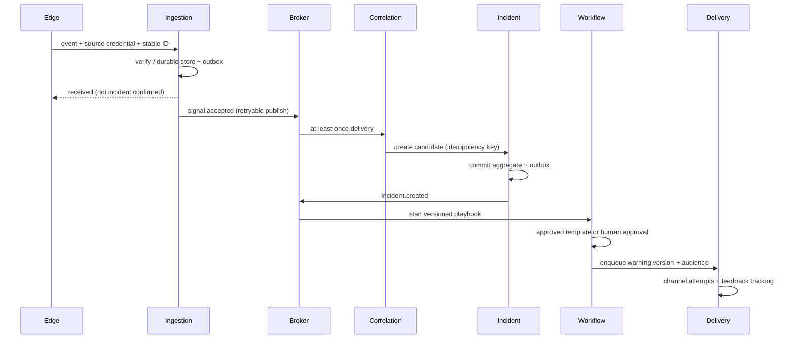

# SmartAlarm — Detail Design / Detailed Technical Design


Version 3.0 · production architecture design baseline, not deployed · 24/10/2026. This document is used together with API-Contract.json, Event-Schemas.json, Screen-Specifications.md, and Acceptance-Matrix.csv. The attached API contract is a machine-readable core baseline; vendor integrations require their own binding specifications once actual devices are available.

## 1. Domain data model

IDs use UUIDv7 or an equivalent UUID with uniqueness; external IDs exist only within their source namespace. All tenant-data tables include tenant_id, region_id, created_at in UTC, updated_at, and version bigint. Internal foreign keys use composite tenant_id+id within the same DB; cross-service references use IDs and snapshot versions, without cross-database foreign keys.

| Entity | Main fields and constraints | Proposed retention / owner |
|---|---|---|
| Tenant | id, home_region, status, policy_version, default_locale; region immutable through normal APIs | Contract end + policy / Tenant |
| Membership | tenant,user,role,site_scope,valid_from,valid_until,revoked_at; unique tenant,user,role,scope | Audit retains history / IAM |
| Location | id,parent_id,type,name_i18n,geometry,timezone,version; parent in same tenant; cycle forbidden | Versions retained long term / Location |
| PlanRevision | plan_id,revision,asset_id,scale,exit_graph,reviewer,published_at; unique plan,revision | Based on incident references / Location |
| Device | id,external_id,connector_id,location_id,cert_thumbprint,capabilities,health; unique tenant,connector,external_id | Device lifetime + audit / Registry |
| Signal | id,source,event_id,type,observed_at,received_at,schema_version,payload_ref,location_snapshot,mode | 30 days hot + archive policy / Ingestion |
| Incident | id,hazard,severity,state,home_region,writer_epoch,owner,location_ref,version,opened_at,closed_at | Proposed default of 365 days / Incident |
| IncidentSignal | incident_id,signal_id,relation,actor,reason; unique incident,signal | Based on incident / Incident |
| SOS | id,client_request_id,person_ref,incident_ref,category,state,location_report,sharing_policy,version | 365 days, precise location separate / Assistance |
| PersonObservation | id,person_ref,incident_ref,status,reporter_type,observed_at,received_at,location_ref | Append-only; precise location 30 days / Assistance |
| Task | id,incident_ref,unit_ref,state,offer_deadline,version,assignment_epoch,completed_at | 365 days / Dispatch |
| WarningVersion | warning_id,version,content_i18n,area,audience_snapshot,expiry,status,approvals | 365 days / Warning |
| DeliveryAttempt | id,warning_ref,recipient_ref,channel,attempt_no,provider_id,state,receipt_at; effect_key unique | 90 days metadata / Delivery |
| Command | id,target,capability,params_digest,nonce,expires_at,approval,state,device_receipt,writer_epoch | 365 days / Command |
| Mission | id,drone_ref,incident_ref,pilot_ref,plan_version,clearance_ref,state,flight_log_ref | 365 days by policy / Command |
| Evidence | id,tenant,object_key,sha256,mime,size,scan_state,classification,hold_id | 90 days, legal hold override / Evidence |
| Consent | subject,purpose,recipient_scope,fields,policy_version,granted_at,revoked_at | Version history / Privacy |
| AuditEntry | id,actor,action,object_ref,object_version,reason,trace_id,at,digest,previous_digest | 365+ according to policy / Audit |
| Outbox / Inbox | outbox: event_id,payload,attempt,next_attempt; inbox: consumer,event_id,processed_at | Replay horizon + margin / each service |
| PhysicalBindingRevision | binding_id,revision,controller_id,regional_model,firmware,gateway_model,gateway_firmware,license_ref,point_map_digest,zone_revision,cause_effect_revision,status,acceptance_ref; unique tenant,binding_id,revision | Referenced configuration history; approved policy / Physical integration |
| PhysicalPoint | id,binding_id,binding_revision,controller_id,zone_id,raw_address,semantic,access_mode,unit,scale,offset,byte_order,word_order,enum_map,stale_after,feedback_for; unique tenant,binding_id,binding_revision,raw_address | Binding lifetime + incident/test references / Physical integration |
| PhysicalObservation | id,binding_id,point_id,binding_revision,source_event_id,observed_at,received_at,value,quality,controller_mode,maintenance_state,raw_evidence_ref; append-only | Proposed 30 days hot; archive by incident/test policy / Physical integration |
| PhysicalCapability | id,binding_id,revision,operation,parameter_schema,allowed_targets,authorization_policy,local_interlocks,command_ttl,retry_class,feedback_point_ids,completion_criterion,unknown_outcome_policy,approval_evidence_ref | Versioned approval history / Command |
| PhysicalCommandDetail | command_id,binding_revision,capability_revision,zone_revision,cause_effect_revision,expected_point_versions,feedback_deadline,physical_state,evidence_refs; one-to-one Command | Inherits Command retention / Command |
| Impairment | id,scope_refs,functions_affected,reason,owner,planned_until,notifications,compensatory_plan_ref,status,restoration_evidence_refs,version | Site inspection policy; legal hold applies / Physical readiness |
| PhysicalTestRun | id,binding_revision,test_plan_ref,mode,authorization_ref,impairment_ref,operator,witness,started_at,ended_at,result,evidence_refs | Site inspection/acceptance policy / Physical readiness |
| CompatibilityAssessment | id,binding_revision,hardware_serials,firmware_versions,license_refs,certificate_refs,fat_run_refs,sat_run_refs,open_defects,signoffs,status | Configuration lifecycle and site policy / Physical readiness |
| RescueEquipmentMission | id,incident_ref,dispatch_task_ref,equipment_ref,operator_ref,capability_revision,mission_scope,local_console_required,flight_mission_ref,state,limitations,result_evidence_refs | Proposed 365 days; sensitive evidence separately / Rescue equipment operations |

Retention values are proposed design defaults, not legal conclusions. Legal holds prevent purging related objects. Deletion retains reference tombstones to preserve audit integrity, without retaining PII beyond its purpose. Search/indexes/backups require deletion propagation and an expiration strategy; deleting from OLTP alone is insufficient.

### Indexes and concurrency

Signal unique(tenant_id,source,event_id); index(tenant_id,observed_at DESC), partition by received_at month. Incident index(tenant_id,state,severity,opened_at DESC), spatial index on geometry; partial index for active records. SOS unique(tenant_id,client_request_id), index(tenant_id,incident_ref,state). Task updates use `WHERE version=:expected AND assignment_epoch=:epoch`; affected_rows=0 returns 409. Delivery unique(effect_key); provider callback unique(provider,event_id). Outbox index(status,next_attempt_at) and worker leasing prevent concurrent processing of the same row.

RLS uses tenant context bound from the verified principal within a transaction, not directly trusted headers. Connection pools must reset context. A tenant ID in the URL is insufficient authorization. Region routing checks the membership directory and signed region mapping; wrong-region requests receive safe redirect metadata or 409 REGION_MISMATCH.

### Physical storage and revision invariants

Every physical entity also carries the common tenant_id, region_id, created_at, updated_at and version fields above. Use composite references within a service; cross-service references retain the accepted snapshot digest. PhysicalObservation deduplication is unique(tenant_id,binding_id,source_event_id,point_id) when a stable source event ID exists; otherwise the adapter generates a stable receipt ID and documents that it cannot prove source-level deduplication. Index observations by tenant_id,point_id,observed_at and partition by received_at. A point's latest view uses source sequence/time and quality, not arrival order alone.

Binding revisions are immutable after acceptance. Activation atomically changes the active revision only after compatibility acceptance and readiness checks; outstanding command approvals pin their original revisions and are invalidated for dispatch when these no longer match the active binding. physical_state cannot become COMPLETED_VERIFIED without the declared evidence criterion. Impairment restoration and capability re-enable are different transactions; clearing a dashboard alarm cannot restore a device or authorize writes. Snapshot reconciliation compares software maintenance_state with controller mode and reports conflict.

## 2. API conventions

Base `/v1`; JSON UTF-8, RFC3339 timestamps, cursor pagination. Bearer authorization + verified tenant context; optional X-Tenant-ID is only a selector, checked against token membership by the server. `Idempotency-Key` is mandatory for POST requests creating SOS, sending warnings, offering dispatch tasks, and issuing commands; scope is principal+tenant+route+key, with a request-body hash. Same key with different payload → 409 IDEMPOTENCY_MISMATCH; same key with same payload → previous response. Receipt only after durable commit. Proposed key retention is 7 days for human mutations; source-event deduplication follows an archive replay horizon proposed at a minimum of 90 days, with older replay through a controlled path. Command expiry is independent of deduplication retention.

`If-Match` version/ETag for updates; 412 VERSION_MISMATCH or domain 409 according to API schema. Error envelope: code, message_key, params, trace_id, retryable, field_errors; no exposed stack. 400 malformed, 401 authentication, 403 permission, 404 inaccessible/not found, 409 domain conflict, 412 precondition, 413 payload, 422 validation, 429 quota, 503 unavailable. GET retries are bounded; mutations retry only with an idempotency key.

| API | Permission | Request/response and side effect |
|---|---|---|
| POST /events | event.ingest + source binding | CloudEvent; 202 durable receipt, not incident success |
| GET /incidents | incident.read scope | Filters severity/state/site/from; cursor result |
| POST /incidents | incident.create | hazard,severity,location,signal_refs; 201 aggregate + outbox |
| POST /incidents/{id}/transitions | incident.transition | expected version,to,reason; validate state guard |
| POST /sos | sos.create | client_request_id,category,location,note; 201 server receipt |
| POST /sos/{id}/updates | sos.self_update or sos.manage | append note/location/cancellation request; no deletion |
| POST /safety-reports | safety.self_report | incident_ref,status,sharing preference; save observation + fan-out event |
| POST /tasks | task.assign | unit,incident,scope,deadline; offer + workflow timer |
| POST /tasks/{id}/accept | task.accept + assigned unit | expected version; atomic owner confirmation |
| POST /warnings | warning.author | localized content,audience,expires; create draft version |
| POST /warnings/{id}/approvals | warning.approve | version,digest,decision,reason; separate actor guard |
| POST /warnings/{id}/send | warning.send | approved version; effect key, immutable audience snapshot |
| GET /deliveries | delivery.read | warning,channel,state; no private address returned without scope |
| POST /commands | command.request | capability,target,parameters,expiry; 202 requested, not yet actuated |
| POST /commands/{id}/approve | command.approve | digest,version; publish intent after interlock checks |
| POST /connectors/{id}/tests | connector.test | fixture_set,manifest_version; sandbox results |
| POST /connectors/{id}/replay | connector.replay | event IDs,reason; forbid command replay |
| POST /evidence/upload-sessions | evidence.write | mime,size,classification; short-lived scoped URL |
| POST /privacy-requests | privacy.self_request | type,scope; identity verification workflow |
| GET /stream | authenticated subscriptions | event cursor + projection changes; no mutation through socket |
| POST /physical-bindings | physical.binding.author | controller_id,regional_model,firmware,gateway,point_map,zone_revision,cause_effect_revision; create immutable candidate revision |
| POST /physical-bindings/{id}/validate | physical.binding.test | revision,fixture_set; schema/point/capability validation, no live actuation |
| POST /physical-bindings/{id}/activate | physical.binding.activate | expected_version,revision,acceptance_ref; reject absent signoff or incompatible readiness |
| GET /physical-points | physical.point.read | controller,zone,binding_revision,quality; scoped point projection |
| GET /physical-points/{id}/observations | physical.point.read | from,to,cursor; values, units, source/receive time, quality and revisions |
| POST /physical-commands | physical.command.request | capability_id,target,binding_revision,zone_revision,cause_effect_revision,parameters,expires_at; create Command + PhysicalCommandDetail, not actuation |
| POST /physical-commands/{id}/approvals | physical.command.approve | expected_version,digest,decision; separate actor where policy requires, local guards still apply |
| POST /physical-commands/{id}/reconciliations | physical.command.reconcile | expected_version,observations,evidence_refs,reason; no automatic resend; preserve UNKNOWN history |
| POST /impairments | physical.impairment.manage | scope,functions_affected,reason,owner,planned_until,compensatory_plan_ref; create tracked impairment |
| POST /impairments/{id}/restoration-checks | physical.impairment.restore | expected_version,checklist,evidence_refs,witness; verify before closure; no implicit command |
| POST /physical-test-runs | physical.test.execute | binding_revision,test_plan_ref,mode,authorization_ref,impairment_ref; approved test lifecycle |
| POST /physical-test-runs/{id}/evidence | physical.test.record | expected_version,step_id,expected,observed,evidence_refs; append evidence |
| POST /compatibility-assessments | physical.compatibility.author | binding_revision,hardware,firmware,licenses,certificates,fat_run_refs,sat_run_refs; create review record |
| POST /compatibility-assessments/{id}/acceptance | physical.compatibility.accept | expected_version,decision,signoffs,open_defects; reject unresolved critical defects |
| POST /rescue-equipment-missions | rescue.equipment.assign | incident_ref,dispatch_task_ref,equipment_ref,operator_ref,mission_scope,capability_revision; qualified operator workflow, not motion |

All physical POST mutations require Idempotency-Key; applicable updates also require expected_version/If-Match. Existing `/commands` routes remain the common command interface; `/physical-commands` is a specialized facade over the same Command aggregate, not a second actuator queue. Unknown/unapproved capabilities return 422 CAPABILITY_NOT_APPROVED; revision drift returns 409 BINDING_REVISION_MISMATCH; active impairment/local inhibit returns 409 PHYSICAL_INTERLOCK or IMPAIRMENT_ACTIVE; stale prerequisites return 409 PHYSICAL_STATE_STALE. Reconciliation cannot claim a result without supporting evidence. Permissions are site/controller/capability scoped, not tenant-wide by default.

## 3. Canonical event envelope and semantics

```json
{
  "specversion": "1.0",
  "id": "019a0000-0000-7000-8000-000000000041",
  "source": "urn:smartalarm:connector:gw-12",
  "type": "com.smartalarm.signal.fire.observed.v1",
  "subject": "devices/cam-a05-03",
  "time": "2026-10-23T08:40:12Z",
  "datacontenttype": "application/json",
  "tenantid": "tenant-northstar",
  "regionid": "eu-cell-1",
  "mode": "actual",
  "data": {
    "schema_version": "1.0.0",
    "observed_at": "2026-10-23T08:40:11Z",
    "hazard": "fire.possible_flame",
    "location": {"id":"zone-a05-03","method":"registry","version":12},
    "confidence": 0.82,
    "model_version": "flame-v3",
    "evidence_refs": ["evidence-31"]
  }
}
```

The gateway verifies tenantid against credentials; the payload is not the source of truth. source is a registered identity namespace. Event schemas have a version-specific additional-property policy; invalid fields are quarantined with a reason. Detector confidence does not map directly to severity; severity follows policy and impact. observed_at may be delayed or affected by clock errors; server received_at is always present; a skew flag is stored separately. Location geometry uses GeoJSON longitude,latitude; inbound CAP explicitly converts from lat,lon and has polygon tests.

Proposed topics: `sa.<region>.<mode>.signals.v1`, `incidents.v1`, `assistance.v1`, `dispatch.v1`, `warnings.v1`, `delivery.v1`, `commands.v1`, `audit.v1`, `deadletters.v1`. Do not create a topic per user. Broker ACLs are service-specific, with actual/exercise mode isolation. Partition keys use aggregate ID with tenant; telemetry keys use device ID. DLQs contain no secrets; they include an encrypted payload reference, reason, and replay policy.

### Physical event contract

Use the same CloudEvents envelope, verified source binding and actual/exercise isolation. Proposed types are `com.smartalarm.physical.point.observed.v1`, `com.smartalarm.physical.command.state_changed.v1`, `com.smartalarm.physical.impairment.changed.v1`, `com.smartalarm.physical.test.completed.v1`, `com.smartalarm.physical.binding.accepted.v1`, and `com.smartalarm.rescue.equipment_mission.updated.v1`. Event data includes schema_version, aggregate_id, aggregate_version, binding_revision where relevant, source provenance and evidence references. The canonical point payload example is a design fixture, not a live observation:

```json
{
  "schema_version": "1.0.0",
  "aggregate_id": "point-example",
  "aggregate_version": 1,
  "tenant_id": "tenant-example",
  "site_id": "site-example",
  "controller_id": "controller-example",
  "binding_id": "binding-example",
  "binding_revision": 1,
  "point_id": "point-example",
  "zone_id": "zone-example",
  "semantic": "pump_running",
  "value": true,
  "unit": "boolean",
  "observed_at": "2026-10-23T08:40:11Z",
  "received_at": "2026-10-23T08:40:12Z",
  "quality": "GOOD",
  "controller_mode": "AUTO",
  "maintenance_state": "IN_SERVICE",
  "cause_effect_revision": 1,
  "source_event_id": "source-example-1",
  "raw_evidence_ref": "evidence-example"
}
```

`pump_running` is not `waterflow_confirmed` and neither means fire extinguished. Units/scaling are defined by the accepted point contract; missing sensors remain UNKNOWN. Command events carry command_id, capability_revision, previous_state, state, controller_receipt_ref, feedback_observation_ids, unknown_reason and source/receive times as applicable. Impairment events carry scope/functions and restoration status; test events carry authorization and evidence references; mission events carry operator and supported-interface mode. Do not publish raw medical notes in equipment events.

## 4. Sequence: signal → incident → warning



If the Incident API times out after commit, the caller retries with the same key and receives the existing incident. If the broker is down, the outbox persists; ingestion still has bounded durable capacity and a degraded state, and does not ACK before commit. If correlation fails, queue-lag alerts and raw-signal triage remain available to operators; manual SOS is not blocked.

For physical alarms, the source is the approved local controller/gateway and preserves alarm/supervisory/trouble distinctions. Local automatic suppression operates on its own approved inputs and cause-and-effect; this cloud sequence only creates the incident and response workflow. Closing the incident does not silence/reset the panel, stop a fire pump, close a valve, or cancel local protection. Such actions require distinct permitted capabilities and site authority.

## 5. Sequence: offline SOS and reconciliation

The client creates a UUID request, saves it in an encrypted local outbox, and displays “not sent”. When online, it POSTs with the same request ID; the server commits before returning a receipt. If the response is lost, the client retries and the server returns the existing SOS ID. Only then does the client display received; human ACK arrives as a separate event. Offline location updates always include observed_at; the server retains history without overwriting a newer location simply because an update arrived late. Offline cancellation is a queued request, not a promise to stop dispatch. For a lost device or revoked account, the app purges secure cache according to policy when possible; it does not promise remote wipe while a device remains offline.

## 6. Workflows and deadlines

Workflow ID = tenant:aggregate:playbook_version. Timers run server-side; client cron polling is not a safety mechanism. Each step has an input schema, activity idempotency key, deadline, retry policy, compensation policy, and manual fallback. Retries use exponential backoff+jitter with maximum attempts/time; business rejections are not retried. An escalation step key of workflow+step+recipient prevents unbounded duplicate sends. Warning expiry cancels unsent jobs; sent jobs require a cancellation/update message and cannot be recalled by deleting DB records.

| Situation | Proposed baseline timer | On expiry |
|---|---|---|
| P1 incident without operator ACK | 60 s | Shift supervisor, then regional backup at 120 s |
| Unaccepted task offer | 60 s | Expire offer; dispatcher selects another unit |
| Possible fall check-in | Configurable 30 s | Create care request; do not make a diagnosis |
| Physical command | TTL 30 s or capability-specific | Expire before dispatch; reconcile unknown after dispatch |
| Webhook delivery | Backoff for up to 24 h or shorter event expiry | DLQ + owner alert |

These product defaults require site validation; policy includes min/max and an approver, preventing administrators from arbitrarily changing timeouts during an incident without recording a version.

Physical workflows in baseline 1.0 are WF-28 point/zone onboarding; WF-29 physical supervision; WF-30 authorized actuation, feedback and UNKNOWN reconciliation; WF-31 impairment/test/restoration; WF-32 FAT/SAT compatibility; WF-33 rescue-equipment mission. Their human deadlines and command TTL are capability/site configuration with approvers. No universal software timeout authorizes release, reset, silence or automatic pump stopping. The 30 s command default above is only a proposal and must be overridden or rejected when inconsistent with the approved equipment design.

## 7. Correlation algorithm and hazard expansion

Exact deduplication precedes fuzzy correlation. Candidate queries use tenant, mode, hazard compatibility, location graph, and event window; scoring uses time distance, same zone, source diversity, and semantic match. Scores are suggestions unless an automation rule is approved. Rule inputs include source confidence/quality; two cameras using the same model are not counted as two wholly independent pieces of evidence. When several incident candidates exist, the operator chooses; source corrections append correction events instead of editing original events.

The hazard registry contains key, localized labels, severity policy, required fields, playbook binding, sensitivity, default audience, detector schema, and retention class. Add “gas leak”, “industrial spill”, “lone worker”, “missing person”, or “infrastructure outage” through registry/schema/plugins after domain review, without changing hard-coded enums in every service. A new category does not automatically acquire physical-command permissions.

## 8. Command safety protocol

Requests contain command_id, device_id, capability, canonical params digest, tenant, writer_epoch, nonce, issued_at, expires_at, requester, and approval evidence. Approval signs the digest, so parameter changes invalidate it. The gateway checks credentials, epoch, TTL, capability, zone, local interlocks, and used nonces. Non-idempotent capabilities return retry_class=manual_reconcile; they are not automatically resent when ACK is lost. Local controller results record source time and observed physical state when available. Success requires the capability-specific completion criterion; accepted/executing/unknown must appear separately in the UI.

HA command workers use distributed fencing; failover does not reissue expired commands. Local safety interlocks may reject commands even after cloud approval. Emergency stop appears only when the device supports the correct semantics; a stop-request receipt does not prove the device has stopped. The drone gateway includes flight-stack capability negotiation, altitude frame, link health, pilot override, and lost-link policy; video streaming is separate from the command channel. MAVLink command cancel is not treated as a universal guarantee when unsupported by the flight stack.

### Physical command execution sequence

Cloud policy/approval → OT DMZ authenticated conduit → site edge durable command ledger/fencing → approved vendor gateway → local controller → physical device → independent feedback where available. The local protection sequence and manual controls do not depend on this cloud path. The adapter's access profile is observe-only unless exact model/firmware/license and site approval establish a specific write capability; a BACnet WriteProperty advertisement alone is insufficient. Use the restrictions in [Physical Device Catalog](Physical-Device-Catalog.md) and [Rescue/IoT Device Catalog](Rescue-IoT-Device-Catalog.md).

Physical states are DRAFT, PENDING_APPROVAL, AUTHORIZED, SENT, ACCEPTED, EXECUTING, COMPLETED_VERIFIED, REJECTED, EXPIRED, FAILED, UNKNOWN and RECONCILED. Map legacy Command `succeeded` only when its physical completion criterion is verified; retain the richer physical_state in PhysicalCommandDetail. Bind approval to target, capability revision, point/zone/cause-and-effect revisions, parameter digest, TTL and writer epoch. Edge checks freshness, local mode, impairment, allowed operation and feedback availability before sending; the local controller retains final interlocks. After send, a timeout is UNKNOWN unless trustworthy evidence proves failure. Reconciliation appends evidence and a reason; it never silently replays the command.

Wet-pipe thermal sprinkler heads are not generic addressable actuators. Controlled-release assemblies keep their approved local releasing logic; no generic relay bypass, AI-confidence trigger or LLM-generated cause-and-effect is allowed. Approved supervised I/O follows exact electrical, supervision and feedback design. `release_output_active`, valve position, pump running, pressure and waterflow are different observations. Manual-console-only rescue equipment receives a mission assignment, not invented drive/aim/discharge API calls. An unverified remote emergency-stop interface cannot be presented as guaranteed physical stop.

## 9. Localization vi / en / ja

UI keys use forms such as `incident.status.active`; versioned resource bundles and ICU MessageFormat handle plural/select without concatenated fragments. User locale priority: explicit choice → profile → supported OS locale → tenant default → reviewed English. Language selection does not change region or authorization. Font stack: system UI + Noto Sans when deploying a font bundle; Japanese uses Noto Sans JP/system CJK; no forced uppercase for Japanese; minimum body line height 1.5, with 40% text expansion for testing. Dates/numbers/units follow locale, with timezone shown alongside commands/incidents spanning countries.

Content templates are entities with `template_id`, `version`, `locale`, `text`, `variables_schema`, `reviewer`, `approved_at`, and `voice_asset_ref`. Warning approval references exact locale versions. If an approved translation is missing, clearly show the fallback language and require the publisher to confirm policy; do not generate and automatically publish an AI translation. Do not block all P1 communication when an emergency fallback template is preapproved. Original messages/user chat retain their language; assistive translations are labeled machine translated and do not replace original evidence. TTS voices follow locale and always have transcripts; text remains readable if TTS fails. Critical translations require native-speaker/domain-reviewer checks before release.

Physical terminology must consistently distinguish “request authorized”, “controller accepted”, “physical outcome verified”, “outcome unknown”, “test”, “impaired” and “restored” in vi/en/ja. Preserve manufacturer point labels alongside reviewed localized semantics. Translations never change register semantics, control polarity, parameter units or authority. Speaker TTS/language support is model-specific; use reviewed recordings where the researched payload lacks a verified locale or API.

## 10. Evidence, chat, and privacy

Baseline upload policy: 20 MB/file for images/documents/short clips; MIME sniffing + extension allowlist + antivirus + decompression limits; quarantine before scanning. Signed upload URLs are scoped to object keys with short expiry; download URLs check policy and TTL, with no public bucket. Video session tokens are incident-scoped, with audited access and region-resident relays. Webhook payloads do not send raw medical notes by default. Chat retention follows incident/social class, with abuse reporting/restricted threads and a shared attachment policy. Safety fan-out snapshots include group membership versions, but revocation is rechecked at send time.

Precise location has field-level protection; generalized site status is the family default. Retention purges include DB, object store, search index, caches, and export links; backups expire and restores reapply tombstones. Conflicts between legal holds and data-subject deletion go to privacy review; requests are not silently ignored. Audit hash chains/tamper-evident storage support modification detection, without claiming absolute immutability if all authority is compromised.

FAT/SAT records include exact serial/firmware/license/configuration, expected and observed point states, timestamps, witnesses, approved test authorization, deviations and signed restoration. Store raw captures separately with hashes and access controls; redact secrets without discarding traceable source references. A product brochure or component certificate cannot set field_accepted. Acceptance references the specific installed binding and approved scope; firmware, point-map or cause-and-effect changes reopen affected review.

## 11. Frontend runtime and state design

### V2 presentation contract and transition tests

`getContent()` selects a renderer by group; `SAEnterprise.render(s,c)` selects composition by screen ID; `SAVisual.scene()` draws schematics using locale and state. A generic `type` property must not determine every layout. `data-go` means navigation and `data-demo` means illustrative interaction; neither is API or actuator success. Existing FRs and `Screen-Registry.json` remain the source contract.

Production applies the following rules before rendering and speech. These are implementation rules, not new API schemas:

| Input / transition | Required result and assertion |
|---|---|
| Heading unknown, floor known | Retain valid plan/landmarks; remove relative arrows and “turn left/right.” A QR position fix does not establish heading. |
| Floor unknown / route withdrawn / evidence stale | Cancel active and queued speech; remove old route overlay and instructions in the same update; retain warning, reported-location entry and assistance. Back/history cannot restore the old route. |
| Late snapshot older than a withdrawn revision | Reject the obsolete update by revision; HTTP response time does not establish route freshness. |
| SOS local pending → durable receipt → human ACK | Advance only on evidence for the correct request ID; clicks or hash navigation never create receipts. |
| Command accepted, readback absent | F11/F12 remain UNKNOWN; no physical retry action appears. Identify missing evidence and reconciliation. |
| Enter C27 / change language / leave guidance | Cancel old audio; C27 remains silent after return, reload, state changes or new notifications. |

Component tests assert text and accessibility properties alongside SVG, rather than image snapshots alone. Integration tests change revisions during speech, interrupt connectivity between send and receipt, delay ACK and assert local override. E2E tests measure focus, targets, reflow, keyboard access and equivalent map text in VI/EN/JA. The current prototype has fixed sample speech, local state and illustrative data; it does not contain production mechanisms proving these assertions.


Server-state caches are keyed by tenant+region+user scope+resource; workspace switching purges or fully partitions them. Client stores hold only drafts/UI preferences and are not the source of incident truth. A server-rendered shell or static app + BFF is selected per deployment; strict CSP, no tokens in localStorage, secure cookies for web/session BFF. Native secure keystores hold tokens, with an encrypted offline database. Websocket sequence gap → snapshot refresh; stale banners show age. Command buttons are disabled when capability/location/policy staleness exceeds thresholds, with a reason and manual channel.

Form pattern: labels always visible; required/error indicators per field; pending submission state; receipt after server ACK; conflicts show server version and draft without automatic overwrite. List pattern: shareable filters without PII in URLs; accessible tables, keyboard focus, selectable rows with context. Maps always have list alternatives; floor controls support keyboards; safety information is never conveyed solely by color. SOS does not depend solely on a hold gesture; an explicit button + confirmation provides a fast path according to accessibility/site policy.

F01–F20 extend the coordinated screen set to 233 screens. Physical views include point/zone inventory, quality and freshness, accepted capability evidence, target review, approval, separate receipt/feedback timeline, UNKNOWN reconciliation, impairment/test/restoration and FAT/SAT acceptance, plus rescue-equipment assignment. FR-PHY-01–FR-PHY-16 governs these behaviors. Do not enable an action from a stale projection; server/edge recheck. A local-only or unsupported action shows its reason and authorized manual workflow. No AI response can submit an actuator command or alter controller configuration.

## 12. Test architecture

Unit tests for state guards/rules/unit conversion. Contract tests for OpenAPI/events/adapters. Integration tests for outbox/inbox, workflow restart, DB tenant isolation, provider callbacks, and replay. E2E tests by actor and vi/en/ja, offline/reconnect, accessibility, and role changes. Performance tests for steady/burst/fan-out, soak, noisy neighbors, and media overload. Chaos tests for broker failure, DB failover, workflow-worker termination, provider timeouts, region partition, and clock skew. Security tests for BOLA, source spoofing, SSRF URL validation, upload malware fixtures, replay nonces, key revocation, and support break-glass. Separate hardware-in-loop tests for each actuator/drone vendor in an authorized environment.

Synthetic test data, deterministic clocks for deadlines, and mock providers represent accepted/delivered/unknown separately. Passing prototype navigation is not equivalent to passing production E2E. The acceptance matrix includes actor, trigger, expected evidence, and architecture owner so independent QA can design tests rather than merely mirror implementation.

Physical acceptance adds exact-configuration FAT and installed SAT. Test every enabled point/zone mapping and capability, negative cross-tenant/site/zone authorization, wrong revision, expired approval, duplicate event, missing feedback, and accepted-without-completion. Disconnect cloud, power off edge, restart gateway, isolate a partial point group, skew clocks and restore connectivity; verify local automatic protection continues and old intents do not actuate. Test hardware under an approved impairment plan with qualified local staff; simulator success is not authority for live discharge. FMEA assigns site owners and residual-risk decisions for wrong-zone actuation, lost feedback, supply failure, relay fault, test/actual confusion and compromised gateway. The detailed test/governance gates are in [Standards and Deployment](External-Integration-Standards-Deployment.md).

## 13. Key runbooks

| Failure | Detection | Containment / recovery | Verify |
|---|---|---|---|
| Ingestion lag | oldest event age + p95 | Reserve SOS lane; scale consumers; quarantine faulty source | No lost receipts, replay preserved IDs |
| Provider outage | failed/unknown attempts + callback age | Circuit break; alternate channel; operator visibility | Human ACK tracked separately; no duplicate flood |
| DB primary loss | health + write errors | Fence; promote verified replica; refresh service connections | Committed SOS present; no dual writer |
| Region unavailable | multi-vantage synthetic | Approved DR routing; epoch increase; outbox reconcile | Residency unchanged or explicitly approved; RPO/RTO measured |
| False detector storm | incident rate + operator feedback | Disable specific rule/model deployment; retain raw signals | Manual SOS unaffected; rollback version audited |
| Lost drone link | telemetry age | Expose unknown; local pilot/lost-link procedure | Receipt and physical state reconciled; no blind command replay |
| Compromised device | abnormal source behavior | Revoke cert; quarantine; rotate binding; coverage warning | Denied traffic; replacement device validated |
| Translation error | report/locale review | Withdraw affected template version; reviewed correction | Version lineage and recipients of correction visible |
| Cloud or edge loss at site | heartbeat/quality age, local panel observation | Mark remote integration unavailable; preserve local protection; buffer/reconcile supported observations | Independent automatic sequence verified; no stale write replay |
| Wrong zone or binding revision | point walkdown, digest mismatch | Suspend affected remote capability; retain local operation; correct/reaccept mapping | Point-to-point and negative cross-zone tests signed |
| Physical outcome unknown | accepted/sent without required feedback | UNKNOWN; qualified local verification; alternative response; no blind retry | Evidence-linked reconciliation with unchanged command history |
| Impairment or test overrun | planned_until, controller mode mismatch | Notify site responsible person; follow approved compensatory plan and restoration procedure | Local restored state, witness and signoff before closure |
| Rescue equipment link/console unavailable | operator report, supported telemetry age | Operator follows vendor lost-link/stop procedure; mission shows unknown/unavailable | Local physical condition and operator handback recorded |

## 14. Delivery decomposition for the full build

Concurrent workstreams belong to the same complete scope: platform/IAM/regions; events/connectors/devices; incident/workflow/dispatch; Companion/Field; Command/admin; content/i18n; media/privacy/audit; observability/DR/security; hardware integration. Dependency order: contracts/domain invariants → platform foundations → vertical flows → complete role surfaces → integrations + resilience → independent acceptance. Administrative UI and error states are not omitted merely because they rarely appear in demos.

Definition of Ready: approved actors/permissions, state transitions, API/event schemas, error cases, translated copy, test fixtures. Definition of Done: code + migrations + contract tests + UI in three locales + accessible errors + dashboards/runbook + rollback + security/tenant tests + reviewer signoff. Production go-live requires domain/site authority validation; this document is a detailed review baseline, not acceptance signoff.

Full-build workstreams now explicitly include physical point/zone integration, OT DMZ/site edge, approved vendor gateways, capability/feedback contracts, impairment/test governance, FAT/SAT, and rescue-equipment operations. Definition of Ready for a physical write includes documented manufacturer permission, site cause-and-effect and observable completion; Definition of Done includes exact-configuration acceptance and a local restoration runbook. Unsupported actions remain visibly unavailable while the full designed scope is retained. The proposed operations/events above must be kept aligned with the separate JSON contracts during implementation.

## 15. BMS implementation detail design

This is the implementation contract for WF-34–37 and FR-BMS-01–40. Canonical endpoints are /bms/connections/... in API-Contract.json 1.1. Draft research names such as bms-systems/bms-release-intents are conceptual and do not create public aliases. No public API accepts arbitrary vendor methods or raw endpoints. The JSON contract adds23 operations and 7 BMS event types while preserving all 44 existing operations.

### 15.1 Storage schema and transactions

The following tables extend regional PostgreSQL. Large raw payloads and evidence live in same-region object storage with hashes/references in tables. Business foreign keys include tenant/site in composite keys to prevent cross-tenant joins. Use UTC timestamptz and a transactionally monotonic bigint revision. RLS supplements service authorization rather than replacing scope checks.

| Table / key | Columns and implementation constraints | Index / proposed retention |
|---|---|---|
| bms_connection PK(tenant_id,site_id,connection_id) | region_id, profile_id/version, vendor_build, adapter_digest, endpoint_ref, credential_ref, state, revision; UNIQUE(tenant_id,site_id,connection_id); endpoint refs are registry FK | (tenant_id,site_id,state); metadata through lifecycle plus approved audit retention |
| bms_map_revision PK(scope,map_revision) | connection_id, mapping_digest, base_revision, state, approved_by, approved_at; immutable after approval; one active via partial UNIQUE(scope) WHERE state=active | (scope,state,created_at); retain every revision referenced by an incident/command |
| bms_point_binding PK(scope,map_revision,point_id) | native_address_hash, asset_id, space_id, zone_id, type, units, scale, offset, quality_policy, stale_after; UNIQUE(scope,map_revision,native_address_hash); scale finite/nonzero when conversion needs inversion | (scope,asset_id); (scope,zone_id); no hard delete of referenced bindings |
| bms_qualification PK(scope,qualification_id) | adapter_digest, vendor_build, map_revision, license_ref, capabilities, expires_at, signature_ref, status; admission verifies all evidence references | (scope,status,expires_at); expiry never deletes history |
| bms_observation PK(scope,observation_id) | point_id, source_time nullable, received_at, value_json, unit, quality, map_revision, raw_ref/hash, source_seq nullable; append-only | partition received_at; (scope,point_id,received_at DESC); hot 30 days is an approval-required assumption; incident hold overrides |
| bms_alarm_occurrence PK(scope,alarm_id) | native_id, occurrence_id, branch_id nullable, active_state, native_ack_state, reviewed_at, source_time, quality, revision, incident_id; UNIQUE(scope,native_id,occurrence_id,normalized_branch) | (scope,active_state,severity); never purge active/unknown alarms; policy-based archive |
| bms_alarm_receipt PK(scope,receipt_id) | source_event_id/cursor, raw_hash, received_at, alarm_id, mapping_revision, replay_mode; duplicate receipts retain audit link | UNIQUE(scope,source_stream,source_event_id) if source ID stable; otherwise deterministic fingerprint plus collision evidence |
| bms_snapshot_generation PK(scope,generation_id) | kind, started_at, ended_at, complete, gap_detected, cursor_ref, expected_count nullable, actual_count; only complete scoped generation can reconcile absence | (scope,kind,started_at DESC); retain incident-relevant gaps |
| bms_command_link PK(scope,operation_id) | operation_kind, physical_command_id nullable, alarm_id nullable, preview_id, approval_digest, idempotency_key, request_hash, state, expires_at, revision; physical_command_id FK existing command | UNIQUE(scope,operation_kind,idempotency_key); no deletion while outcome unknown |
| bms_writer_lease PK(scope) | epoch bigint, owner_instance, lease_until, egress_fencing_ref; epoch advances atomically; egress validates current epoch | UNIQUE(scope); lease/epoch history to audit |
| bms_inbox / bms_outbox | inbox UNIQUE(tenant_id,event_source,event_id); outbox aggregate_id/revision/type/body/created_at/published_at; projection+inbox and state+outbox each atomic | outbox unpublished index; receipt retention >= upstream retry/replay horizon; proposed 90 days requires approval |
| bms_lifecycle_job PK(scope,job_id) | kind,state,from_revision,to_digest,steps_json,approval_id,rollback_ref,started_at,finished_at; resumable steps have idempotency markers | (scope,state,submitted_at); lifecycle audit survives restart |

Never use a time-window dedupe key as an alarm occurrence identity. Without a stable source occurrence ID/sequence, an adapter derives occurrences from observed active→inactive→active cycles and records generation/uncertainty across gaps; it does not invent missed cycles. Direct panel and BMS feeds create two receipts/provenance records. Correlation may link one incident but must not merge native ACK identities.

### 15.2 Adapter SDK and scheduler

```text
AdapterContext = {scope, workload_identity, approved_endpoint, secret_provider,
  profile_revision, map_revision, capability_snapshot, request_budget, journal, clock}
probe(context) -> ProductIdentity + SupportedInterfaces + Diagnostics
discover(context, allowlist, cursor) -> Page<NativePointDescriptor>
readPoints(context, native_ids, cursor) -> Page<NativeObservation>
subscribePoints(context, approved_filter, resume_token) -> SubscriptionHandle
readActiveAlarms(context, cursor, generation) -> Page<NativeAlarm>
subscribeAlarms(context, approved_filter, resume_token) -> SubscriptionHandle
readHistory(context, native_id, interval, cursor) -> Page<HistoricalObservation>
acknowledge(context, validated_native_ack, egress_epoch) -> NativeReceipt
execute(context, validated_physical_command, egress_epoch) -> NativeReceipt
readback(context, accepted_target, predicate) -> Evidence
relinquish(context, validated_release, egress_epoch) -> NativeReceipt
drain(context) -> OutstandingWork + RetainedAuthority
close(context) -> CloseEvidence
```

Mutation methods are never callable directly from UI/API controllers. Runtime supplies ValidatedNativeAck/ValidatedPhysicalCommand objects minted by the policy executor, not arbitrary JSON. Adapter support is distinct from admission; missing or unverified methods return unsupported errors, never fabricated success. Plugins pin immutable image digests. Windows/Java vendor SDKs run in OS-specific sidecars rather than in the shared API process.

Priority queues separate command receipts/local overrides/critical alarms, active snapshots, point refresh, and discovery/history. Unknown alarm severity is not silently downgraded. COV leases renew with jitter and token budgets. Polling fallback is an approved strategy within the same contract, never an automatic new protocol/account. Retry is limited to proven idempotent/read operations within budget. Reconnect uses capped exponential backoff with jitter; deadlines include queue time. An open circuit marks stale/unknown by evidence age; it never substitutes zero for missing data.

### 15.3 Ingestion and alarm reconciliation

1. Authenticate source and journal raw receipt/hash/cursor before transport ACK where supported. Validate scope, mapping revision, type/unit/status. Decode/scale failures are quarantined and excluded from routing; retain a privacy-limited raw reference.
2. Regional ingest uses an inbox unique key and atomic observation/alarm-mirror plus outbox transaction. Same event ID and digest returns the previous receipt; reused ID with changed digest is an auditable conflict.
3. Active state and native_ack_state are independent axes. SmartAlarm reviewed is a third axis and does not send ACK. Native ACK binds the current occurrence_id, branch_id and native_transition_token, valid expiry, authority and approval.
4. Lost subscriptions mark the generation incomplete and retain active/unknown alarms. Reconnect establishes the stream and obtains an active snapshot/ConditionRefresh according to the vendor contract, buffering/reconciling interleaved events and recording gaps where ordering is unproven.
5. Only a demonstrably complete snapshot within its exact scope may reconcile absence. Sources without completeness guarantees cannot auto-clear missing alarms; readback or review is required. Historical backfill carries replay mode and never re-triggers PA, dispatch or commands.
6. Return-to-normal updates native inactive state; incident closure still follows rescue workflow. Source suppression/disable/maintenance has an owner and expiry and never deletes evidence.

### 15.4 Commands, approvals and fencing

Connection states are draft→validating→qualified→active_read; active_control requires control qualification and approved handback. Degraded/suspended/draining deny new commands; retired is terminal. Resume_read never automatically restores control. Adapter upgrades, map publication or entitlement changes invalidate old qualification.

The BMS operation receipt is a transport projection: persisted→dispatch_pending→accepted_by_gateway→accepted_by_controller→feedback_confirmed, with rejected/expired/unknown/superseded branches. The existing Physical Command aggregate remains authoritative; the projection does not independently decide physical state. effect_confirmed=true requires feedback_confirmed and valid feedback_ref. For native_ack, feedback is readback of the correct occurrence acknowledgment, not a plant effect. physical_command_id is required for physical_command and null for native_ack.

```text
BEGIN
  lock connection revision; verify If-Match == expected_revision
  verify token scope + current qualification + immutable preview/approval digest
  insert operation using UNIQUE(scope,operation_kind,idempotency_key)
  on duplicate: same request_hash => return prior receipt; else409
  insert transactional outbox(operation_id, deadline, approved envelope)
COMMIT  -- only now 202 persisted
edge consumes -> journal + check current epoch at egress
recheck expiry/map/adapter/interlocks/local mode -> execute once if admissible
transport timeout after possible send -> UNKNOWN -> readback/reconcile; no blind replay
feedback predicate + stable period + evidence identity -> Physical Command transition
regional projection follows authoritative command event
```

Approval digests bind tenant/site, connection/point/native address, unit/value, priority, adapter digest, map/qualification/cause-effect revision, feedback predicate and expiry. Approvers cannot edit the payload; edits require a new preview. Target/capability allowlists and approval levels are site policy rather than generic protocol enums. Requester/approver separation applies when required; an LLM cannot approve or establish qualification.

BACnet priority arrays provide no owner ID or application TTL. Do not relinquish by writing NULL into a slot that might be owned by another actor. Check effective ownership, reserved-priority policy, local mode and handback. Where ownership is unproven, stop for local reconciliation. Cloud TTL prevents new dispatch but does not guarantee release after edge power loss. Automatic fail-safe requires a qualified local controller/watchdog. Otherwise admission must reject an auto-relinquish promise and require the manual runbook.

### 15.5 Canonical API, errors and pagination

| Method / path | Request → response | Permission |
|---|---|---|
| GET /bms/connections | — → BMSConnectionPage | bms.connection.read |
| POST /bms/connections | BMSConnectionCreate → BMSConnectionView | bms.connection.create |
| GET /bms/connections/{connection_id} | — → BMSConnectionView | bms.connection.read |
| POST /bms/connections/{connection_id}/discoveries | BMSDiscoveryRequest → BMSJob | bms.discovery.run |
| POST /bms/connections/{connection_id}/map-revisions | BMSMapDraftCreate → BMSMapRevision | bms.mapping.edit |
| POST /bms/connections/{connection_id}/validations | BMSValidationRequest → BMSJob | bms.mapping.validate |
| POST /bms/connections/{connection_id}/qualifications | BMSQualificationCreate → BMSJob | bms.qualification.submit |
| POST /bms/connections/{connection_id}/activations | BMSActivationRequest → BMSJob | bms.connection.activate |
| GET /bms/connections/{connection_id}/points | — → BMSPointPage | bms.point.read |
| GET /bms/connections/{connection_id}/alarms | — → BMSAlarmPage | bms.alarm.read |
| POST /bms/connections/{connection_id}/alarms/{alarm_id}/native-acknowledgements | BMSNativeAckRequest → BMSMutationReceipt | bms.alarm.ack_native |
| POST /bms/connections/{connection_id}/command-previews | BMSCommandPreview → BMSCommandPreviewResult | bms.command.preview |
| POST /bms/connections/{connection_id}/commands | BMSCommandSubmit → BMSMutationReceipt | bms.command.submit |
| GET /bms/connections/{connection_id}/commands/{command_id} | — → BMSMutationReceipt | bms.command.read |
| POST /bms/connections/{connection_id}/commands/{command_id}/reconciliations | BMSCommandReconcile → BMSMutationReceipt | bms.command.reconcile |
| POST /bms/connections/{connection_id}/reconciliations | BMSReconciliationRequest → BMSJob | bms.reconciliation.run |
| POST /bms/connections/{connection_id}/lifecycle-transitions | BMSLifecycleRequest → BMSJob | bms.lifecycle.change |
| GET /bms/connections/{connection_id}/health | — → BMSHealth | bms.health.read |
| GET /bms/connections/{connection_id}/jobs/{job_id} | — → BMSJob | bms.job.read |
| GET /bms/connections/{connection_id}/policies/request-budget | — → BMSRequestBudgetView | bms.policy.budget.read |
| PATCH /bms/connections/{connection_id}/policies/request-budget | BMSRequestBudgetUpdate → BMSRequestBudgetView | bms.policy.budget.change |
| GET /bms/connections/{connection_id}/policies/incident-export | — → BMSIncidentExportView | bms.policy.export.read |
| PATCH /bms/connections/{connection_id}/policies/incident-export | BMSIncidentExportUpdate → BMSIncidentExportView | bms.policy.export.change |

POST requires Idempotency-Key; existing-resource mutations add If-Match and expected_revision. Collections use opaque tenant/site/filter-bound snapshot-stable cursors with limit1–500. A changed filter invalidates the cursor with 400. Never return an unbounded point inventory. Tenant/region bind from token; body cannot select another tenant. Credential_ref and endpoint_ref must be scoped registry resources, not client URLs.

401/403 distinguish authentication/authority;404 hides out-of-scope resources;409 signals state/idempotency conflict;412 indicates ETag/evidence drift;422 indicates semantic/unit/domain failure;429 supplies a budget-based Retry-After;503 does not imply acceptance. If the ledger committed before response loss, the same key returns the old receipt. Vendor HTTP 200 batches still require per-item inspection; missing/partial outcomes are recorded in job results rather than marked universally successful. Completed jobs expose result_ref and structured problem. UI polling backs off; cancel stops undispatched work only and never undoes a physical command.

### 15.6 Events and version compatibility

| CloudEvent type | Payload |
|---|---|
| com.smartalarm.bms.point_observed.v1 | BMSPointView |
| com.smartalarm.bms.alarm_changed.v1 | BMSAlarmView |
| com.smartalarm.bms.command_changed.v1 | BMSMutationReceipt |
| com.smartalarm.bms.connection_changed.v1 | BMSConnectionView |
| com.smartalarm.bms.health_changed.v1 | BMSHealth |
| com.smartalarm.bms.map_published.v1 | BMSMapRevision |
| com.smartalarm.bms.reconciliation_completed.v1 | BMSReconciliationCompleted |

Keep the existing CloudEvents envelope, require time for the BMS namespace and validate strict payloads. Envelope tenantid/regionid must match payload tenant_id/region_id and workload certificate scope; this is a service invariant, not something JSON Schema can prove. id is stable after durable ingest; source identifies adapter deployment without secrets. Consumers atomically store inbox and projection. Side effects originate only from the policy engine with a separate dedupe key, not from every alarm_changed event. Optional v1 additions follow compatibility policy; meaning/type/enum changes require a v2 event and consumer migration. Profile version, adapter digest, map revision and qualification version evolve independently.

### 15.7 Migration, upgrade and recovery

M1 expands the database with new tables/indexes without changing old keys; online-index migration follows a lock-time runbook. M2 deploys BMS-aware consumers with ingestion disabled. M3 deploys a read-only lab adapter with pinned digest/schema and validates mapping, units and alarm gaps. M4 publishes a signed map and runs shadow correlation without dispatch, comparing samples to the BMS console. M5 enables site alarm/incident integration after FAT/SAT; ACK/write remain disabled. M6 enables capabilities individually after authority, interlock, feedback and handback checks. These are release gates within the full design, not scope cuts.

Upgrade/rollback: drain rejects new mutations; wait for journaled outbox work and record pending/unknown commands. If the controller retains authority, complete local handback before stopping the writer. Preserve cursor, generation, mapping digest and prior image. A new adapter undergoes read qualification; semantic/native-ID changes need map migration and rebinding tests. Rolling back an image does not undo physical effects or native ACK, and does not automatically reactivate an old qualification. Database/edge restore always starts suspended/read-reconcile, advances epoch, reconciles snapshots and command readback, then requests renewed control admission.

### 15.8 Mandatory implementation tests

Contract tests cover23 request/response schemas,7 event payloads, reference resolution, preservation of44 existing APIs, tenant isolation, read-only ACK/write denial, expiry/revision and effect_confirmed invariants. Simulator tests cover subscription loss, duplicate/late/out-of-order delivery, units/endianness, active alarms at startup, incomplete generations, wrong-occurrence ACK, post-send timeout and split-brain fencing. Real-source FAT/SAT verifies entitlements, native methods, ACK semantics, timestamps/quality, actual batch/rate limits, local override/interlocks, feedback criteria, retained BACnet priority after power loss and handback.

Evidence binds adapter digest, vendor build, mapping and qualification; simulation is insufficient for field_accepted. Executable JSON checks are in work/test_bms_technical_contracts.py with a separately packaged QA report. Schema tests do not establish authentication, current expiry, signer authority or physical effects; service, integration and hardware tests remain distinct gates.


BMS06 budget policy applies through GET/PATCH request-budget with CAS and approval. history_backfill_paused pauses only historical backfill, not active alarm reconciliation. Upstream tested quotas and priority floors remain mandatory. BMS08 incident-export policy pins the approved namespace, target binding and field allowlist. Quarantine sets enabled=false, keeps raw/provenance evidence and stops new exports without changing native alarm state. Re-enable requires review of causation/echo and current export_incident qualification. No health/person fields are accepted by the contract.


## Required appendices within the same baseline

[Rescue speakers and voice navigation](Voice-Rescue-Design.md) adds WF-21–22. [Positioning, optimization, AI, and care profiles](Positioning-AI-Care-Design.md) adds WF-23–27. Both documents are components of the full design, not optional features for a later phase. [Screen specifications](Screen-Specifications.md) provides FRs for each screen ID.


