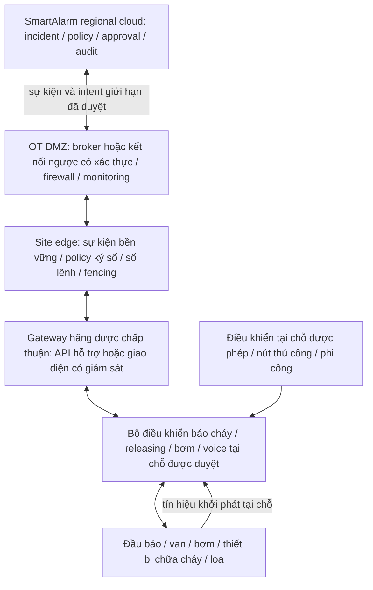

# SmartAlarm — Tiêu chuẩn tích hợp bên ngoài và triển khai

Baseline 3.0 nghiên cứu/thiết kế · 24/10/2026 · Tiếng Việt. Phạm vi: tích hợp hệ thống PCCC vật lý, kỹ thuật triển khai và nghiệm thu. Đây là thiết kế tích hợp đề xuất, không phải chứng nhận, phê duyệt lắp đặt hoặc tài liệu thay thế thiết kế PCCC của cơ sở. Nghiên cứu hãng/model nằm trong tài liệu riêng. Kiến trúc dưới đây là đề xuất của SmartAlarm; phần tóm tắt tiêu chuẩn có nguồn dẫn mô tả phạm vi công khai đã xác minh, không suy diễn điều khoản chưa đọc.

## 1. Quyết định và ranh giới

SmartAlarm phải hỗ trợ hệ thống PCCC vật lý thật qua giao diện được chấp thuận, đồng thời giữ khả năng bảo vệ tự động độc lập tại chỗ. Hệ thống có thể nhận trạng thái cháy/giám sát/sự cố, điều phối lực lượng, phát hướng dẫn sơ tán đã duyệt và yêu cầu hành động được cấp quyền cụ thể. Cloud, Internet, ứng dụng di động hoặc LLM không được trở thành điều kiện để chuỗi bảo vệ tự động tại chỗ hoàn thành.

Không xây dựng API phổ quát “bật sprinkler”. Đầu sprinkler tác động bằng nhiệt thông thường hoạt động tại chỗ và riêng lẻ; có giao diện với tủ báo cháy không có nghĩa các đầu này điều khiển được bằng địa chỉ điện. Hệ deluge, preaction, chữa cháy khí, bơm, kiểm soát khói và monitor robot có bộ điều khiển, điều kiện tiên quyết và hậu quả khác nhau. Phải xác định hành động được phép theo loại hệ thống và cấu hình chính xác của hãng. Sự khác biệt giữa tác động nhiệt riêng lẻ và điều khiển phần mềm được giải thích bởi [Cơ quan Phòng cháy bang Pennsylvania](https://www.pa.gov/agencies/osfc/communities/home-sprinklers).

Ba loại phê duyệt phải tách biệt: quy chuẩn/phiên bản áp dụng tại địa phương và cơ quan có thẩm quyền (AHJ); chứng nhận/listing thiết bị và giới hạn tương thích của hãng; nghiệm thu tổ hợp tích hợp đã lắp đặt. Một giao thức, linh kiện phù hợp hoặc bài test cloud không chứng minh cả ba. Ghi rõ phiên bản địa phương áp dụng: [thông báo chính thức năm 2026 của Poudre Fire Authority](https://www.poudre-fire.org/home/showpublisheddocument/9013/639063278557630000) viện dẫn các phiên bản cũ hơn cho công việc kiểm tra cụ thể, minh họa vì sao bản mới nhất không tự động là bản áp dụng cho dự án.

## 2. Ma trận tiêu chuẩn và giao diện đã xác minh

Các phiên bản xuất bản dưới đây được kiểm tra ngày 23/10/2026. Dự án phải chốt riêng phiên bản được áp dụng, sửa đổi, phê duyệt thiết bị và yêu cầu hợp đồng. Không suy diễn điều khoản đầy đủ sau paywall, kích thước lắp đặt, tính toán thủy lực hoặc chu kỳ thử nghiệm từ tóm tắt công khai.

| Tham chiếu / phiên bản xác minh | Phạm vi đã xác minh | Cách dùng và giới hạn đề xuất cho SmartAlarm |
|---|---|---|
| NFPA 72, 2025 | Báo cháy, tín hiệu, thông tin khẩn cấp và thông báo đại chúng | Ánh xạ alarm/supervisory/trouble và giao diện thông tin được duyệt; không tuyên bố SmartAlarm là tủ báo cháy có listing. [NFPA](https://www.nfpa.org/codes-and-standards/nfpa-72-standard-development/72) |
| NFPA 13, 2025 | Thiết kế và lắp đặt hệ thống sprinkler tự động | Giữ thiết kế sprinkler chuyên ngành; nhận waterflow/giám sát van qua giao diện được duyệt. Phần mềm không thay thiết kế sprinkler. [NFPA](https://www.nfpa.org/codes-and-standards/nfpa-standard-development-process/13) |
| NFPA 20, 2025 | Lựa chọn và lắp đặt bơm PCCC cố định | Tích hợp trạng thái bộ điều khiển được phép; yêu cầu từ xa nếu được cho phép vẫn chịu thiết kế bộ điều khiển đã duyệt. [NFPA](https://www.nfpa.org/codes-and-standards/nfpa-13-standard-development/20) |
| NFPA 25, 2026 | Kiểm tra, thử nghiệm và bảo trì hệ thống PCCC dùng nước | Theo dõi khiếm khuyết, suy giảm chức năng, khôi phục và chứng cứ; lịch phải lấy từ văn bản áp dụng và hướng dẫn thiết bị. Phiên bản được đối chiếu qua [handbook 2026 của NFPA](https://www.nfpa.org/sitecore/content/Storefront/Catalog/home/products/p/0/0/P0025HB) và [hồ sơ NFPA 25 của ANSI](https://webstore.ansi.org/standards/nfpa/NFPA252026). |
| EN 54-2 / -4 / -13 | Thiết bị điều khiển/hiển thị; nguồn điện; tương thích thành phần | Yêu cầu chứng chỉ, cấu hình và phiên bản quốc gia chính xác; không dùng nhãn chung “toàn hệ thống đạt EN 54”. Phạm vi công khai: [hướng dẫn BSI](https://www.bsigroup.com/Documents/product-certification/BSI-fire-standards-brochure-UK-EN.pdf?epslanguage=az). Chốt phiên bản/sửa đổi của các phần này là đầu việc mua sắm. |
| EN 54-16:2008 / EN 54-24:2008 | Thiết bị điều khiển/hiển thị báo động bằng giọng nói; loa báo động bằng giọng nói | Dùng chuỗi voice alarm được duyệt, có ánh xạ vùng, ưu tiên, giám sát nguồn/lỗi và kiểm chứng hiệu năng khi chạy thử; loa IP thông thường không tự động tương đương. [Hướng dẫn chứng nhận BSI](https://www.bsigroup.com/globalassets/localfiles/it-it/PRODUCT%20SERVICES/Product%20Certification%20Interactive%20Guide.pdf) |
| ISO 7240-5:2018 | Yêu cầu và thử nghiệm đầu báo nhiệt điểm | Lưu loại đầu báo và môi trường ứng dụng được duyệt; không suy ra phù hợp với mọi môi trường. [ISO](https://www.iso.org/standard/67759.html) |
| ISO 7240-16:2007 / -19:2007, đều được xác nhận lại năm 2025 | Thiết bị điều khiển âm thanh khẩn cấp; thiết kế, lắp đặt, chạy thử và bảo dưỡng hệ thống âm thanh khẩn cấp | Tách chứng cứ thành phần khỏi độ nghe rõ/hiểu rõ sau lắp đặt và quy trình vận hành. [ISO phần 16](https://www.iso.org/standard/42978.html), [ISO phần 19](https://www.iso.org/standard/42979.html) |
| BACnet / ISO 16484-5:2026, lần xuất bản 8, tháng 8/2026 | Truyền thông dữ liệu và biểu diễn hướng đối tượng cho hệ thống tòa nhà | Yêu cầu objects/services được hỗ trợ, revision, allowlist thuộc tính ghi, priority và ngữ nghĩa quality. Tương tác được không đồng nghĩa được phép tác động an toàn sinh mạng. [ISO](https://www.iso.org/standard/92057.html), [Ủy ban BACnet](https://bacnet.org/about-bacnet-standard/) |
| Modbus Application Protocol V1.1b3; Modbus Security | Transaction/function code; xác thực và toàn vẹn qua TLS cho security profile | Cần register map, scaling, byte/word order, quyền truy cập và security profile thực sự hỗ trợ. Không mặc định Modbus/TCP thông thường đã có Modbus Security. [Modbus Organization](https://www.modbus.org/modbus-specifications) |
| OPC UA / IEC 62541; phần 2:2026 đã xác minh | Mô hình bảo mật OPC UA | Cần namespace, node ID, profile, chứng thư, security policy, quyền người dùng và ngữ nghĩa status/timestamp. Dùng OPC UA thông thường không chứng minh đường điều khiển có chứng nhận an toàn. [IEC](https://webstore.iec.ch/en/publication/81514) |
| IEC 62443-3-2:2020; bộ ISA/IEC 62443 | Đánh giá rủi ro IACS, zones/conduits, mức an ninh mục tiêu; bảo mật vòng đời | Lập đánh giá rủi ro và kiểm soát zones/conduits cho cơ sở. Không gán security level hoặc tuyên bố chứng nhận chỉ vì gateway dùng TLS. [IEC](https://webstore.iec.ch/en/publication/30727), [ISA](https://www.isa.org/standards-and-publications/isa-standards/isa-iec-62443-series-of-standards) |
| MQTT 5.0, OASIS Standard 07/03/2019 | Messaging publish/subscribe | Transport telemetry edge có xác thực, ACL, expiry, dedupe và queue giới hạn; QoS không phải hoàn thành vật lý. [OASIS](https://docs.oasis-open.org/mqtt/mqtt/v5.0/mqtt-v5.0.html) |
| CloudEvents; phải chốt schema version triển khai | Mô tả/envelope sự kiện chung | Mang source, type, event ID, time và payload domain có version; không chứng nhận phát hiện hoặc chấp hành. [CloudEvents](https://cloudevents.io/) |
| CAP 1.2, OASIS Standard 01/07/2010 | Trao đổi cảnh báo chung | Public advisory có xử lý nguồn/update/cancel/area/expiry; không dùng làm giao thức trực tiếp kích hoạt chữa cháy. [OASIS](https://docs.oasis-open.org/emergency/cap/v1.2/CAP-v1.2.html) |
| MAVLink Command Protocol; chốt version hãng/flight stack cho từng tàu bay | Truyền lệnh và xác nhận lệnh | Gateway theo capability, giữ quyền phi công; ACK khác kết quả vật lý. Hỗ trợ giao thức không cấp phép bay. [MAVLink](https://mavlink.io/en/services/command.html) |
| Quy định hàng không tại nơi hoạt động | Quyền của đơn vị vận hành, tàu bay, vùng trời và nhiệm vụ | Lưu quốc gia/thẩm quyền, giấy phép, phi công, giới hạn bay và quy trình khẩn cấp. [Hướng dẫn public safety của FAA](https://www.faa.gov/uas/public_safety_gov/drone_program) là ví dụ Hoa Kỳ, không phải giấy phép toàn cầu. |
| WCAG 2.2 | Khả năng tiếp cận nội dung web | Mục tiêu thiết kế AA; keyboard, focus, contrast, target, status và text alternative phải kiểm tra độc lập; không chứng minh vùng phủ âm thanh. [W3C](https://www.w3.org/TR/WCAG22/) |

Chất chữa cháy, nguy cơ đặc biệt, thiết bị áp lực, điện, kiểm soát khói và luật PCCC/xây dựng địa phương có thể bổ sung tiêu chuẩn khác. Người thiết kế cơ sở phải xác định theo hệ thống thật; ma trận này không phải danh sách quy chuẩn đầy đủ.

## 3. Kiến trúc triển khai đề xuất

Đường bộ điều khiển/thiết bị tại chỗ chạy độc lập với cloud, DMZ, edge, dịch vụ định danh và LLM. Các đường hardwired/thủ công đã được duyệt giữ quyền quyết định. Edge SmartAlarm là thành phần tích hợp trừ khi được đánh giá và phê duyệt riêng cho vai trò khác; tên gọi “edge” không có nghĩa là safety controller.

Đặt dịch vụ hướng cloud trong OT DMZ, có conduits tường minh tới hệ thống cơ sở. Ưu tiên kết nối do site chủ động mở và có xác thực khi được hỗ trợ; cấm public Internet truy cập bus tủ và remote desktop đa dụng vào bộ điều khiển PCCC. Tách nhận telemetry khỏi cấp quyền lệnh. Broker ACL, firewall, service identity, cấu hình ký số, xoay chứng thư và truy cập bảo trì có giới hạn thực thi sự phân tách. Đây là biện pháp đề xuất từ cách tiếp cận zone/conduit, không phải tuyên bố đạt IEC 62443.

Chỉ dùng gateway hãng chấp thuận hoặc I/O có giám sát khi thiết kế cụ thể cho phép. Tài liệu lắp đặt đã duyệt phải nêu supervision đầu vào, phát hiện lỗi, cách ly, dây dẫn, định mức điện, feedback và chứng cứ chạy thử. Không dùng relay board đa dụng để bỏ qua tủ releasing, bộ điều khiển bơm, interlock hoặc bộ quản lý ưu tiên sơ tán. Không gắn thao tác ghi không được tài liệu hóa vào cổng bảo trì. Nếu chỉ có tiếp điểm báo cháy chung, báo đúng trạng thái chung, không bịa địa chỉ đầu báo hoặc vùng.

## 4. Các cấp quyền tích hợp

| Cấp | Hành vi được phép | Chứng cứ cần trước khi bật |
|---|---|---|
| T0 Inventory | Đăng ký tài sản/tài liệu; chưa kết nối trực tiếp | Chủ cơ sở, model chính xác, vị trí và người sở hữu |
| T1 Observe | Đọc alarm, supervisory, trouble, flow, pressure, health và status khi có | Đường đọc được duyệt, danh sách point, ánh xạ ngữ nghĩa, FAT/SAT |
| T2 Operational coordination | Tạo incident/task; phát thông tin được duyệt qua giao diện voice được phép | Policy thông điệp/vùng/ưu tiên được duyệt và feedback delivery đã kiểm chứng |
| T3 Restricted control request | Chỉ cặp target/capability được duyệt cụ thể | Hãng cho phép, thiết kế cơ sở, nghiệm thu AHJ/bên khác khi áp dụng, revision cause-and-effect đã ký, interlock tại chỗ, chứng cứ hoàn thành |
| T4 Local automatic protection | Thực thi trong hệ thống bảo vệ tại chỗ đã được duyệt | Thiết kế và nghiệm thu hệ thống tại chỗ/hiện hữu; không cấp cho cloud bằng entitlement phần mềm |

Connector mới mặc định T1 hoặc thấp hơn. Acknowledge, silence, reset, disable/isolate, yêu cầu bơm và kích hoạt chữa cháy là capability khác nhau. Không để một quyền “control” chung bật tất cả. Một số chỉ được thực hiện tại chỗ. Incident commander có thể điều phối incident mà không có thẩm quyền reset hoặc vô hiệu chức năng bảo vệ.

## 5. Hợp đồng asset, point, zone và cause-and-effect

Mỗi binding có version và được review trước khi kích hoạt. Các trường tối thiểu:

| Đối tượng | Thông tin bắt buộc |
|---|---|
| Asset | tenant_id, site_id, asset_id, controller_id, manufacturer, exact model, firmware, serial, quan hệ controller/gateway, protocol revision, certificate/listing reference và scope, maintenance owner, maintenance_state, impairment_ref |
| Point | point_id, controller_id, zone_id, raw address/object/node/register, type, quyền read/write, unit, scale, byte/word order khi áp dụng, enumeration, ánh xạ normal/alarm/trouble/supervisory, validity, observed_at, received_at, timestamp source, quality, stale_after |
| Zone | zone_id, ranh giới vật lý/tầng, tham chiếu khoang cháy, loại vùng detection/suppression/voice, point membership, exclusions, revision và approver |
| Capability | capability_id, loại target cho phép, parameter schema/ranges, preconditions/interlocks tại chỗ, thẩm quyền manual/automatic, authorization_policy, command_ttl, expiry, idempotency_key, retry class, feedback_point_ids, tiêu chí hoàn thành, unknown_outcome_policy |
| Cause and effect | revision, điều kiện khởi phát, xác nhận tại chỗ bắt buộc, effect, vùng tác động, priority, delay nếu được duyệt, interlocks/inhibits, thẩm quyền reset, phản ứng lỗi, test case và signoff |
| Evidence | source time, receive time, source quality, raw payload reference/hash, version connector/firmware/config, operator và approval, liên kết command/result |

Không tự động coi location zone là suppression zone. Một tầng có thể có nhiều vùng điều khiển; một vùng điều khiển có thể vượt ranh giới UI. Đổi địa chỉ thiết bị hoặc phân vùng làm mất hiệu lực mapping liên quan và phải review/test trước khi khôi phục khả năng ghi. Quality gồm GOOD, BAD, STALE, UNKNOWN, TEST; thiếu dữ liệu không phải NORMAL.

Cause-and-effect là tài liệu đã duyệt của kỹ sư/hãng/cơ sở được phản ánh vào phần mềm, không phải rule do LLM tự tạo. Ví dụ chuỗi releasing đã duyệt tại chỗ có thể báo trạng thái khởi phát, đang chờ, interlock và feedback xả về SmartAlarm. SmartAlarm ghi nhận và điều phối; không suy ra quyền xả từ confidence camera hoặc tự silence alarm khi đóng incident.

## 6. Vòng đời lệnh và chứng cứ vật lý

Trạng thái đề xuất: DRAFT → PENDING_APPROVAL → AUTHORIZED → SENT → ACCEPTED → EXECUTING → COMPLETED_VERIFIED; nhánh REJECTED, EXPIRED, FAILED, UNKNOWN, RECONCILED. Bộ điều khiển có thể không cung cấp EXECUTING; adapter phải công bố trạng thái nào quan sát được. UNKNOWN bắt buộc khi lệnh có thể đã tới nhưng chưa kiểm chứng kết quả vật lý.

Approval gắn với command_id, target, capability, parameter digest, zone revision, cause-and-effect revision, requester, approver, writer_epoch, nonce, issued_at, expires_at. Edge và gateway hãng kiểm tra allowlist, freshness, authorization và việc bộ điều khiển tại chỗ chấp nhận. Bảo vệ/interlock tại chỗ có ưu tiên. Thay parameter hoặc zone revision làm mất approval. Failover fence writer cũ; không lặp mù tác động vật lý chưa rõ kết quả.

Ghi riêng transport receipt, controller acceptance và physical feedback. ACK yêu cầu bơm không phải bằng chứng áp suất/lưu lượng; ACK đã buffer voice không phải xác nhận phát âm thanh hoặc nghe hiểu; lệnh van không phải xác nhận vị trí van. Tiêu chí hoàn thành theo capability và có thể cần nhiều cảm biến. Timeout mạng sau khi gửi tạo UNKNOWN, chặn tự retry hành động không idempotent và mở reconciliation với nhân sự tại chỗ/trạng thái controller. Hủy phần mềm không được hứa đảo ngược chất đã xả hoặc hành động vật lý hoàn tất. Reset và khôi phục theo quy trình cấp quyền riêng.

## 7. Phân tích dạng lỗi và vận hành suy giảm

Đây là FMEA định tính ban đầu; đội site gán severity, likelihood, detectability, residual risk và owner theo chứng cứ tại cơ sở. Không đưa điểm rủi ro số phổ quát.

| Lỗi / hậu quả | Phát hiện | Cô lập và chứng cứ nghiệm thu đề xuất |
|---|---|---|
| Mất cloud/Internet / mất quan sát từ xa | Tuổi heartbeat và trạng thái kết nối | Bảo vệ tự động tại chỗ tiếp tục; edge buffer sự kiện; UI hiện stale; chứng minh bằng ngắt kết nối |
| Mất edge / tích hợp không sẵn sàng | Heartbeat edge và quan sát tủ độc lập | Chuỗi tại chỗ tự vận hành; cloud hiện unavailable; khôi phục từ ledger bền vững, không replay lệnh ghi chưa rõ; test tắt nguồn edge |
| Gateway restart hoặc split brain / lặp tác động | Epoch/lease, command ledger bền vững | Một writer được fence; reconcile lệnh chưa rõ, không replay; test reboot/failover |
| Sai point hoặc zone map / tác động sai vị trí | Walkdown point độc lập và revision digest | Tắt write binding liên quan; kiểm mọi target được bật và negative case chéo vùng |
| Relay kẹt hoặc mất feedback / hoàn thành giả | Supervision và feedback controller độc lập khi được duyệt | Không suy ra thành công; xử lý lỗi tại chỗ và kiểm tra vật lý theo quy trình đã duyệt |
| Mất điện hoặc cạn nguồn dự phòng / thiếu phủ bảo vệ | Trouble controller/nguồn và chứng cứ bảo trì | Giữ thiết kế nguồn dự phòng đã duyệt; kiểm trạng thái lỗi và khôi phục theo site |
| Alarm storm / trễ sự kiện khẩn | Tuổi queue, source rate, priority metrics | Dành tài nguyên xử lý khẩn, giới hạn queue, báo mất dữ liệu; chuỗi tại chỗ không chờ broker |
| Gateway bị xâm nhập / lệnh trái phép | Identity, allowlist, audit, anomaly monitoring | Thu hồi conduit/credential, cô lập tích hợp nhưng không tắt bảo vệ tại chỗ |
| Nhầm maintenance với actual / tác động ngoài ý muốn hoặc bỏ qua báo cháy | Mode tường minh và trạng thái tủ tại chỗ | Tách identity/route test, quy trình vật lý, cửa sổ test có quyền, kiểm tra khôi phục |
| Clock skew hoặc observation cũ / tiền đề không an toàn | Source/receive time và quality flag | Chặn yêu cầu từ xa dựa trên dữ liệu cũ; giữ bảo vệ tại chỗ; không sửa timestamp che bất định |
| Controller ACCEPTED nhưng không có kết quả / operator tưởng thành công | Deadline feedback và thiếu chứng cứ độc lập | UNKNOWN, xác minh tại chỗ, phương án phản ứng thay thế; không retry mù |
| Vùng voice mất khả dụng / người trong vùng không được cảnh báo | Fault theo vùng/controller và kiểm tra đã chạy thử | Hiện khoảng trống vùng phủ; thực hiện quy trình thông tin thay thế đã duyệt |

## 8. Quản trị impairment, thử nghiệm và thay đổi

Hồ sơ impairment chứa tài sản/vùng/chức năng bị ảnh hưởng, lý do, kế hoạch bắt đầu/kết thúc, người chịu trách nhiệm, thông báo cần thực hiện, biện pháp bù trừ do thẩm quyền site xác định, kiểm soát truy cập và chứng cứ khôi phục. SmartAlarm không kết luận hệ PCCC suy giảm đã an toàn chỉ vì cảnh báo được acknowledge. Impairment ngoài kế hoạch phải escalation đến người phụ trách cơ sở đã chỉ định.

Test mode phải có ranh giới rõ. Nhãn exercise phần mềm đơn thuần không ngăn output vật lý hoạt động. Chỉ dùng phương án cô lập/test được duyệt, kỹ thuật viên chịu trách nhiệm tại chỗ, kịch bản được review, thông báo site và quyền bắt buộc. Kết quả simulator không cấp quyền xả chất thật, chạy bơm hoặc phát broadcast khẩn. Test thật theo tiêu chuẩn áp dụng, phương pháp hãng và kế hoạch của cơ sở/cơ quan có thẩm quyền.

Đổi cấu hình/firmware cần đánh giá ảnh hưởng, version ký số, kế hoạch rollback/recovery và regression các đường cause-and-effect bị ảnh hưởng. Không mặc định rollback phần mềm từ xa khôi phục được trạng thái vật lý. Chỉ đóng impairment sau phục hồi tại chỗ, trạng thái supervision bình thường, xác minh target, review lỗi còn mở và bàn giao có ký. Tần suất test và biện pháp bù trừ theo từng cơ sở; tài liệu này không tự đặt các giá trị đó.

## 9. RFI, khảo sát, FAT, SAT và bàn giao

| Gate | Sản phẩm bắt buộc | Chứng cứ qua gate |
|---|---|---|
| RFI / mua sắm | Model tủ/controller/thiết bị chính xác, firmware, biến thể vùng, API/register hỗ trợ, quyền read/write, license gateway, listing/chứng chỉ, phụ kiện tương thích, vòng đời và hỗ trợ bảo trì | Hãng xác nhận bằng văn bản từng capability đề xuất; mục chưa rõ giữ disabled |
| Khảo sát site | Bản vẽ hoàn công, chiến lược PCCC, ranh giới thủy lực/hệ thống, cause-and-effect, danh sách zone/point, truyền thông/nguồn, AHJ/phiên bản áp dụng, vai trò vận hành và quy trình impairment | Người thiết kế/chủ cơ sở review mapping và xác định hồ sơ thiếu |
| Thiết kế binding chi tiết | Network zones/conduits, point contract, trạng thái/feedback lệnh, điều khiển local-only, interface/dây dẫn được duyệt, migration và rollback | Kỹ thuật/hãng/site phê duyệt; thẩm quyền nghiệm thu khi áp dụng |
| FAT | Phần cứng/firmware đúng hoặc simulator ghi rõ giới hạn; mapping đúng/sai, quyền, bad quality, clock skew, duplicate, mất ACK, timeout, expiry, restart, failover, hoạt động không Internet | Kết quả ký, dữ liệu chứng cứ gốc, lỗi được xử lý; nêu rõ giới hạn simulator |
| SAT | Kiểm point-to-point sau lắp, xác nhận vùng vật lý, test cause-and-effect đã duyệt, tự vận hành khi mất cloud/edge, lỗi supervision, vùng phủ/hiệu năng voice theo kế hoạch duyệt, khôi phục | Chứng cứ có chứng kiến tại site; mọi lệnh được bật có ngữ nghĩa kết quả đã xác minh; không còn lỗi nghiêm trọng chưa xử lý |
| Bàn giao / vận hành | Cấu hình hoàn công, chủ credential, backup/restore, đào tạo, runbook, lịch bảo trì, liên hệ impairment, ranh giới hỗ trợ | Chủ cơ sở nghiệm thu; hồ sơ kiểm tra/thẩm quyền khi bắt buộc; quản lý thay đổi liên tục |

Nghiệm thu không chỉ là dashboard màu xanh. Với từng capability vật lý được bật, phải chứng minh yêu cầu bị từ chối không gây tác động, yêu cầu cũ/hết hạn không gây tác động, kết quả bất định hiển thị UNKNOWN, điều khiển tại chỗ giữ ưu tiên và lỗi cloud không dừng chuỗi tự động độc lập. Ghi thời gian phản hồi đo trong test đã duyệt; không tuyên bố latency phổ quát khi chưa có tiêu chí nghiệm thu site/controller.

## 10. Sổ chứng cứ và quyết định kỹ thuật còn mở

Mọi liên kết ở mục 2 và sổ này được tra cứu ngày **2026-10-23**. Loại chứng cứ: phạm vi/catalog/hướng dẫn kỹ thuật công khai chính thức; không nguồn nào là đánh giá phù hợp đầy đủ cho công trình lắp đặt.

| Nhóm chứng cứ | Nguồn chính thức | Đã xác minh / giới hạn còn lại |
|---|---|---|
| E01 Báo cháy và chữa cháy | [NFPA 72](https://www.nfpa.org/codes-and-standards/nfpa-72-standard-development/72), [NFPA 13](https://www.nfpa.org/codes-and-standards/nfpa-standard-development-process/13), [NFPA 20](https://www.nfpa.org/codes-and-standards/nfpa-13-standard-development/20), [Handbook NFPA 25](https://www.nfpa.org/sitecore/content/Storefront/Catalog/home/products/p/0/0/P0025HB), [ANSI NFPA 25](https://webstore.ansi.org/standards/nfpa/NFPA252026) | Xác minh tên/phiên bản/phạm vi; kiểm điều khoản/sửa đổi áp dụng cho dự án. Phạm vi NFPA 13 đọc được từ nội dung chính thức được lập chỉ mục; truy cập trực tiếp có lúc không thành công. |
| E02 Detection/voice | [BSI thành phần](https://www.bsigroup.com/Documents/product-certification/BSI-fire-standards-brochure-UK-EN.pdf?epslanguage=az), [BSI voice](https://www.bsigroup.com/globalassets/localfiles/it-it/PRODUCT%20SERVICES/Product%20Certification%20Interactive%20Guide.pdf), [ISO 7240-5](https://www.iso.org/standard/67759.html), [ISO 7240-16](https://www.iso.org/standard/42978.html), [ISO 7240-19](https://www.iso.org/standard/42979.html) | Phạm vi từng phần công khai; phiên bản/sửa đổi EN quốc gia và chứng chỉ model chính xác cần xác minh khi mua sắm. |
| E03 Dữ liệu tòa nhà/OT | [ISO BACnet](https://www.iso.org/standard/92057.html), [Ủy ban BACnet](https://bacnet.org/about-bacnet-standard/), [Modbus](https://www.modbus.org/modbus-specifications), [IEC OPC UA](https://webstore.iec.ch/en/publication/81514) | Phạm vi/version giao thức; không phải tương thích hãng hoặc phê duyệt an toàn. |
| E04 An ninh OT | [IEC 62443-3-2](https://webstore.iec.ch/en/publication/30727), [Bộ ISA](https://www.isa.org/standards-and-publications/isa-standards/isa-iec-62443-series-of-standards) | Khung rủi ro/vòng đời; mức mục tiêu và chứng cứ site phải thiết kế tiếp. |
| E05 Sự kiện và cảnh báo | [MQTT](https://docs.oasis-open.org/mqtt/mqtt/v5.0/mqtt-v5.0.html), [CloudEvents](https://cloudevents.io/), [CAP](https://docs.oasis-open.org/emergency/cap/v1.2/CAP-v1.2.html) | Phạm vi messaging; không bảo đảm hoàn thành vật lý. |
| E06 Drone/accessibility/bối cảnh địa phương | [MAVLink](https://mavlink.io/en/services/command.html), [FAA](https://www.faa.gov/uas/public_safety_gov/drone_program), [WCAG](https://www.w3.org/TR/WCAG22/), [Giải thích sprinkler Pennsylvania](https://www.pa.gov/agencies/osfc/communities/home-sprinklers), [Ví dụ phiên bản áp dụng Poudre](https://www.poudre-fire.org/home/showpublisheddocument/9013/639063278557630000) | Giao diện, ví dụ thẩm quyền, mục tiêu accessibility và bối cảnh vật lý tại chỗ; không phải tuân thủ toàn cầu. |

Quyết định cần chốt trước triển khai: quốc gia/cơ quan có thẩm quyền; loại hệ thống và biến thể chính xác đã lắp; quyền đọc/ghi từng point; gateway hãng và phạm vi chứng chỉ; cause-and-effect đã duyệt; thao tác local-only; feedback hoàn thành vật lý; đánh giá rủi ro an ninh; tiêu chí nghiệm thu và người ký chịu trách nhiệm từng site. Đây là đầu vào kỹ thuật bắt buộc, không phải lý do thay phạm vi tích hợp vật lý đầy đủ bằng demo.

## UX2-PHYSICAL · Giám sát trực quan và phản hồi vật lý

Console v2 dùng sơ đồ đường ống, van, bơm, vùng phủ và trạng thái thiết bị có nhãn. Yêu cầu lệnh, gateway tiếp nhận và hiệu ứng vật lý quan sát được là ba trạng thái riêng. Phản hồi chưa rõ hoặc đã cũ phải có ký hiệu, thời điểm; không hiển thị thành công màu xanh. Thao tác xem xét trong prototype không vận hành thiết bị. Quyền ưu tiên tại chỗ, liên động và điều kiện nghiệm thu thiết bị trong tài liệu này tiếp tục áp dụng.

Kiểm tra F08–F20 khi mất liên lạc, trạng thái tại chỗ xung đột hoặc phản hồi trễ. Truy cập sơ đồ không được bỏ qua quyền điều khiển. Loa báo phát không chứng minh mọi người đã nghe. Drone/robot nhận nhiệm vụ không chứng minh đã đến hoặc cứu được người.

Tham chiếu [thiết kế UI/UX](UIUX-Design.html), [đặc tả màn hình](Screen-Specifications.html) và [rà soát thiết kế](UX-Redesign-Audit.html).

<!-- BMS-INTEGRATED-3.0-BEGIN -->
## 11. BMS integration deployment contract — thực thi tại công trình

### Bộ hồ sơ kỹ thuật và các bước commissioning

1. **Survey:** thống kê supervisor, server/engine/controller, product/build/firmware, API/module/provider/license, protocol/PICS, point/alarm dictionaries, network routes/ports, principal scopes, local emergency authority và maintenance windows. Ghi rõ những mục chưa xác minh; chưa rõ thì capability không được enable.
2. **Read-only qualification:** import endpoint allowlist, secretRef/chứng thư, clocks và measured budget. Discovery chỉ trong roots/phạm vi duyệt, có cancellation và logs. Kiểm authentication, paging, subscriptions/polling, native timestamps, quality, reconnect và active-alarm reconciliation trước khi tiếp nhận vào production.
3. **Mapping qualification:** staging và golden fixtures kiểm raw address, type, endian, scale/offset, engineering unit, enums, severity ordering, native alarm occurrence và ACK tokens. Map equipment/room/HVAC/fire compartment/route/PA group bằng quan hệ có loại; kiểm source lineage direct+mirror. Publish revision với impact graph và reviewer.
4. **Runtime admission:** registry lưu adapter binary/hash, profile version, mapping version, qualified build/license và site acceptance. Server tính effective capabilities từ evidence hiện hành. Exercise dùng namespace và connector session riêng; không dùng switch giao diện để bật write.
5. **Site SAT:** đo actual load/burst và clock quality; chạy BMS-T01–20/BMS-P-01–28 theo capability. Chuỗi local protection/override không lệ thuộc cloud. Ghi sai lệch, rollback/handover, owner và signed acceptance; reads/history/ACK/command/release được ký riêng.
6. **Handover:** bàn giao dashboard/data freshness, alarm gap/runbook, chứng thư/license expiry, support scopes, backup/restore, upgrade/cutover, priority ownership cleanup và retirement. Cập nhật asset inventory cùng evidence khi đổi build hoặc thiết bị.

### Mạng và bảo mật

Site edge kết thúc giao tiếp BMS/OT ở segment được phép; northbound qua conduit OT DMZ có xác thực, tenant/site binding và hạn chế egress. Không expose BACnet/Modbus/OPC DA trực tiếp Internet. BACnet/SC, OPC UA security hoặc Modbus Security chỉ dùng khi cả endpoints và profile đã hỗ trợ đúng cấu hình; không tự giả định legacy TCP đã mã hóa. Adapter OPC DA nếu có cần bridge/runtime phù hợp môi trường Windows/DCOM được site duyệt, không đổi tên thành OPC UA. Mọi secret dùng reference tới vault; audit/export loại token và clinical data. Apply NIST OT segmentation và site risk assessment, không dùng tài liệu tiêu chuẩn như giấy chứng nhận toàn hệ. [NIST SP 800-82r3](https://csrc.nist.gov/pubs/sp/800/82/r3/final).

### Protocol-specific contract

| Interface | Semantics phải kiểm | Điều không được suy diễn |
|---|---|---|
| BACnet IP/MS-TP/SC | Object/property, PICS, COV lifetime, notification/ACK, status flags, priority array và relinquish default | Có WriteProperty không cấp quyền life-safety; application TTL không tự xóa retained slot; lease cloud không chứng minh ownership slot |
| OPC UA | Namespace URI, NodeId stability, status/timestamp, security policy, A&C occurrence/branch/EventId, ConditionRefresh, history capability | Subscribe không nạp đầy đủ active alarms; refresh không phải history replay; DA/A&E/HDA không phải UA |
| Modbus | Register map, function code, zero/one-based addressing, byte/word order, scale, quality inferred/source, polling budget | Register change không tự có native alarm lifecycle/ACK; TCP thuần không phải Modbus Security |
| Native REST/SOAP/SSE | Auth/session expiry, paging/token, object IDs, event semantics, per-method scope/license, bulk partial failure, restart cursor | HTTP200 không chứng minh mọi batch item thành công; event ACK không tự thay toàn bộ alarm state; outbound webhook không chứng minh inbound command API |

### Recovery, failover và các tình huống cấm

Mất source cursor hoặc restart phải chuyển connection sang reconciling. Ghi active snapshot completion marker; snapshot partial không clear alarm bị thiếu. Replay/history gắn mode, không tạo broadcast/command mới. Duplicates giữ receipts và canonical lineage; echo từ incident writeback bị cách ly trước intake rules. Edge journal phải durable trước báo nhận; disk pressure có backpressure/gap alarm, không silent discard. HA write fencing phải hiệu lực ở egress thật; nếu không chứng minh được, standby observe-only và operator xử lý. Local override thu hồi remote eligibility; reconnect không tự khôi phục setpoint cũ. BACnet slot retained sau power loss cần cơ chế local watchdog hoặc cleanup được site phê duyệt; không hứa cloud TTL tự đảm bảo điều này.

### Acceptance evidence và hợp đồng vận hành

Mỗi case lưu testcase revision, deployment fingerprint, input fixtures và expected observations, raw native statuses/timestamps, policy/approval result, redacted transport evidence, physical witness nếu có, result và exceptions. Tách source→edge, edge commit→cloud, cloud→operator, request→native receipt, receipt→independent feedback. Freshness thresholds khác latency SLA và được xác định theo hazard/site; alarm priority queues không bị historian backfill chiếm. Khi rotate chứng thư/license, đo đoạn gián đoạn và reconcile, không bỏ qua lỗi để giữ trạng thái healthy. Admission evidence được invalidate theo phạm vi bị ảnh hưởng, giữ những capability không liên quan nếu vẫn chứng minh được.

### Nguồn và artifact triển khai

Catalog hãng trong [Physical Device Catalog](Physical-Device-Catalog.md) tích hợp 11 profile có nguồn chính thức. [FRD](FRD.md) quy định FR-BMS-01–40/WF-34–37. [Basic Design](Basic-Design.md) và [Detail Design](Detail-Design.md) là tài liệu triển khai chính; [BMS source ledger](BMS/BMS-Source-Ledger.csv) giữ 45 nguồn và giới hạn nghiên cứu. JSON engineering profiles không phải runtime authorization; capability activation cần evidence đúng site và schema/runtime policy tương ứng.
<!-- BMS-INTEGRATED-3.0-END -->

