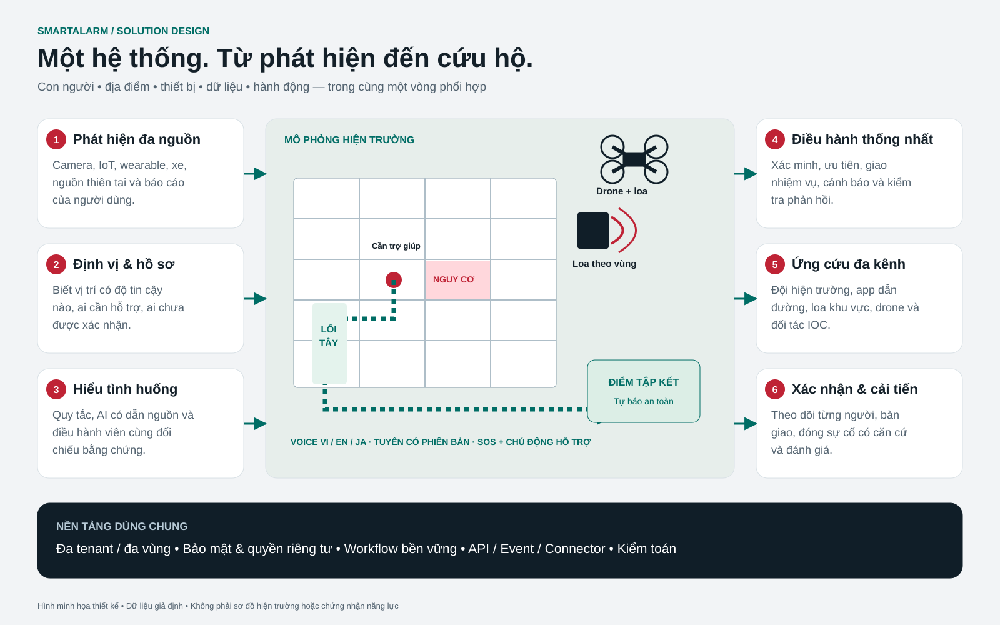

# SmartAlarm — UI/UX & Design System

Phiên bản 2.0 · Full product · Việt / English / 日本語. Xem [Prototype](Prototype.html), [danh mục màn hình](Screen-Catalog.csv), [đặc tả từng màn](Screen-Specifications.md) và [tokens](Design-Tokens.json).

## 1. V2 ưu tiên thị giác: việc gì, ở đâu, làm gì

**Thứ tự quyết định: nguy cơ → nơi ảnh hưởng → hành động tiếp → bất định.** Màn khẩn cho công dân là bề mặt chỉ dẫn, không phải bảng quản trị thu nhỏ. Biểu tượng nguy cơ có nhãn, hình theo nhiệm vụ và một hành động ngắn nằm ở lớp đầu. Đủ trường dữ liệu và quy tắc vẫn truy cập được qua mục mở rộng, trình kiểm tra thiết kế. Quy tắc triển khai nội bộ không làm phụ đề sản phẩm.

Bố cục chọn theo người và công việc trước loại layout cũ. Công dân thấy mốc và trợ giúp; cứu hộ thấy đích, nguy cơ, nhiệm vụ; chỉ huy thấy phạm vi sự cố, nhu cầu mở, bản đồ, năng lực đội; quản trị thấy đối tượng, phiên bản, tác động. Không vẽ bản đồ mọi màn: quyền dùng ma trận, bản dịch dùng đối chiếu, thực thi dùng dòng bằng chứng, hệ vật lý dùng sơ đồ điều khiển.

Dùng SVG có mục đích và biểu tượng kèm nhãn ngắn. Không ký hiệu chung khó hiểu, màu duy nhất, ảnh trang trí, nền kịch tính trên đường khẩn. Camera là bằng chứng có quyền, thời điểm, chú thích. Hình học prototype là minh họa, không phải mặt bằng khảo sát.

Chưa rõ, cũ, chờ phải rõ như đã xác nhận. Hiện thời điểm quan sát và nguồn, không cố định “cập nhật 8 giây trước”. Biên nhận khác con người tiếp nhận và khác tác động vật lý. Tự báo an phải ghi rõ; thiếu tín hiệu nguy cấp không là an toàn.

Bản này là hợp đồng thiết kế, đặc tả prototype; không tuyên bố thử người dùng xong hoặc đã đạt nhận biết ba giây. Xem [kiểm toán UX](UX-Redesign-Audit.md) và [ma trận 241 màn](UX-Redesign-Matrix.json).

## 2. Information architecture theo người dùng

| Surface | Công việc ưu tiên | Điều hướng và nguyên tắc |
|---|---|---|
| Companion | Nhận cảnh báo, thoát hiểm, SOS, hỗ trợ người thân | Home / SOS / Groups / Profile; trong incident ưu tiên guidance và receipt |
| Field | Nhận việc, đến nơi, ghi nhận, bàn giao | Shift / Assignments / Incident / Outbox; hiển thị owner và pending sync |
| Command | Triage, dispatch, accountability, warning, PA, AI | Scope site/region cố định trên header; incident workspace liên kết toàn bộ action |
| Site operations | Location, graph, device, detector, calibration | Edit → test → review → publish; phiên bản có trạng thái rõ |
| Connect / Developer | Adapter, schema, sandbox, health, DLQ | Capability trước enable; secret không hiển thị trong bảng/log |
| Care | Profile, consent, relationship, proactive cases | Tách functional needs khỏi medical notes; minimal view theo role |
| Platform | Cell, release, DR, security, support access | Metadata mặc định; tenant PII không mở chỉ vì là platform operator |
| Localization | VI/EN/JA, terms, templates, voice | Source version → translation → independent review → publication |

Screen IDs ổn định khi đổi tên/locale; các màn chung được dùng lại qua context, không duplicate logic theo ngành. Taxonomy/playbook/site profile xác định nội dung khác nhau. Map có floor/location context, list alternative và source timestamp.

## 3. Token V2 và mục tiêu trợ năng cần đo

Design-Tokens.json đã đồng bộ giá trị với prototype-v2.css. CSS hiện khai báo trực tiếp, không tuyên bố prototype tự nạp JSON. Bản sản xuất cần sinh cả hai từ một nguồn phiên bản. JSON giữ ba lớp primitive → semantic → component, ánh xạ biến CSS, breakpoint, phép tính tương phản tham chiếu và mục tiêu nghiệm thu.

| Thành phần | Giá trị, hành vi V2 |
|---|---|
| Nền / chữ / chữ phụ / đường chia | #F3F5F4 / #142B35 / #52666F / #D3DFDF |
| Khẩn / xác nhận / thông tin / chưa rõ | #B51E32 / #08745E / #155FA0 / #8B5B00 |
| Điều hướng / nền review | #192F39 / #E8EEEF |
| Chỉ dẫn xác minh / chưa rõ | #0A5F50 chữ trắng; #FFF1CD chữ #5F3E00 |
| Nội dung | 16 px, line-height 1,45 trong CSS; phóng chữ vẫn dùng được |
| Tiêu đề | h1 30 px; mobile 26 px; khẩn 27 px; h2 21 px; h3 17 px |
| Chỉ dẫn bước | 25 px; mobile 23 px |
| Font | Segoe UI, Arial, Yu Gothic, Meiryo, sans-serif |
| Điều khiển | Nút, input chính tối thiểu 48 px; chính mobile 56 px; chrome review, mở rộng 44 px; điều hướng phone 52 px |
| Chọn SOS | Tối thiểu 132 px; hàng “khác” 72 px; biểu tượng 44 px có nhãn |
| Focus | Viền xanh 3 px, cách 4 px; kiểm tra với nền sát thực |
| Bo góc | Nút, thẻ 8 px; cảnh 10 px; khung 12 px; khung xem mobile desktop 28 px |
| Chuyển động | Không định thời transition; giảm chuyển động tắt animation, transition, cuộn mượt |
| Responsive | Thu gọn 1120 px; mobile 720 px; khung mobile tối đa 444 px, focus 460 px |

Đường chia nhẹ không tự là ranh giới điều khiển đạt trợ năng. Đo ranh giới, chữ, focus trong ngữ cảnh thật. Mục tiêu chữ thường ≥ 4,5:1; chữ lớn, phi văn bản áp dụng ≥ 3:1. WCAG 2.2 tối thiểu mục tiêu 24 CSS px có ngoại lệ; dự án chủ động lớn hơn. Tương phản JSON chỉ là cặp màu phẳng, không chứng minh cả màn. Thêm nhãn, hình, họa tiết cạnh màu; chưa rõ không dùng xanh xác nhận. Thử reflow 320 CSS px, phóng chữ 200%, bàn phím, đọc màn hình, một tay, giảm chuyển động, VI/EN/JA dài.

## 4. Component specifications

| Component | Dữ liệu và hành vi | States |
|---|---|---|
| Incident badge | severity + state + source/freshness; click mở incident | new/active/contained/closed/unknown |
| Receipt card | ID, server time, process state; server receipt khác human ACK | local pending/received/acknowledged/failed |
| SOS action | CTA rõ, có lựa chọn Unknown; không buộc giữ nút nếu người dùng không thể | ready/confirming/sending/pending/received |
| Voice step | landmark, heading quality, step index, transcript, repeat/pause | playing/paused/replanning/stale/no verified route |
| Map/floor | version, floor, overlays, legend, accessible text list | loading/partial/offline/stale/no location |
| Priority case | person, exposure, functional need, presence quality, reasons | proposed/reviewed/assigned/contacted/resolved |
| Approval panel | exact digest, author, approver, target, effect, TTL | draft/pending/approved/expired/rejected/conflict |
| Device command | requested/accepted/completed riêng; capability-specific feedback | pending/accepted/executing/succeeded/unknown |
| Speaker receipt | device + broadcast version + playback + fault | buffering/playing/completed/preempted/unknown |
| AI answer | cutoff, evidence links, uncertain claims, human decision | generating/validated/unsupported/stale/unavailable |
| Data grid | sortable/searchable, stable row key, scoped export | loading/empty/filter-empty/denied/error |
| Health record | purpose, access reason, minimal fields, audit | limited view/authorized/break-glass/expired |

Approval actions dùng explicit verb, không chỉ “OK”. Delete/deactivate/revoke có impact explanation; destructive actions không đặt cùng màu/vị trí với safe primary action. Undo chỉ khi backend thật sự hỗ trợ đảo tác động; không hứa undo lệnh vật lý đã thực thi.

## 5. Luồng review có thể bấm thử

- Fire response: O03 → O05 → O06 → O04 → O08 → O09 → O10 → O11 → O12; citizen C02 → C03 → C05 → C06 → C07 → C08 → C11 → C12.
- Proactive rescue: H10 → H08 → H09 → O09 → R03 → R04 → R05 → R06 → R07 → R08. SOS đến sau liên kết case theo thiết kế backend.
- Voice route: C35 → C36; các liên kết phụ C37/C38 cho reroute và uncertainty; C40 cấu hình voice. S15 → S16 là graph validation; O35 → O36 phân phối version.
- PA: P01 → P02 → P03 → P04 → P05; P06 live session review; P07 nối mission drone; P09 arbitration policy.
- AI: Q06 → Q07 → Q05 → O36; evidence links tới H09/O05, không nút tự execute command.
- Integration: I01 → I02 → I03 → I04 → I05 → I06; D05 → D06 là adapter conformance.
- Localization: L01 → L02 → L03 → L01; L04 voice, L05 fallback, L06 terms.

Các màn còn lại có deep link riêng trong catalog. Prototype thực hiện navigation, search/filter, basic form validation, choice selection, local chat sample và speech sample nếu OS hỗ trợ. Không có backend hoặc điều khiển thật; trạng thái nghiệp vụ production được mô tả trong FRD/Detail Design. Một số giá trị nhập liệu mẫu giữ tiếng Anh như nội dung nguồn; labels/titles/navigation chuyển VI/EN/JA. Không coi dữ liệu mẫu tiếng Anh là bản dịch hoàn chỉnh của mẫu cảnh báo production.

## 6. Internationalization & accessibility

UI locale và content locale tách nhau: người Nhật có thể đọc nguyên văn thông báo do người dùng Việt nhập, kèm bản dịch hỗ trợ được gắn nhãn. Critical templates có approved vi/en/ja, text/audio parity và locale-specific reviewer. Không nối các từ để tạo câu; ICU placeholders có typed variables, chống mất/đảo biến giữa bản dịch. Field name, validation, empty/error và date/time đều phải localized. Japanese kiểm tra line break, full-width punctuation, IME; Vietnamese kiểm tra dấu với font và truncation. Không dùng uppercase/letter spacing quá mức cho Japanese.

Keyboard mọi hành động; focus trap đúng cho modal; trả focus về trigger khi đóng; live region thông báo receipt/error vừa đủ, không đọc liên tục telemetry. Screen reader có mô tả map và danh sách alternative. User zoom 200%, text scaling mobile, high contrast, reduced motion; không khóa orientation không cần thiết. App voice có transcript; người không nghe được dùng text/haptic; người không thấy rõ có screen reader và CTA labels. Direction không chỉ là một mũi tên; luôn có text/landmark.

## 7. Critical state matrix

| Tình huống | Hiển thị bắt buộc | Hành động thay thế |
|---|---|---|
| SOS chưa tới server | Local pending, timestamp, không biểu tượng success | Retry cùng request ID; configured local calling option |
| Vị trí/tầng chưa rõ | Method/age/uncertainty; không đặt pin chính xác giả | Nhập vị trí, quét anchor, SOS |
| Hazard cập nhật | Route withdrawn, stop old speech, version mới | Reviewed guidance / assistance |
| Không có tuyến | Nói rõ không xác minh được đường | Approved refuge/assisted evacuation, không tuyến giả |
| Không phản hồi welfare check | Unknown/no contact | Escalation theo policy |
| Health profile thiếu | No assistance information, không “healthy” | Chủ động hỏi nhu cầu khi liên hệ |
| PA ACK nhưng loa lỗi | Per-device unknown/fault, coverage gap | Team/portable speaker/other channel |
| AI stale/unsupported | Cutoff, sources, warning; action disabled | Manual review / deterministic services |
| Conflict update | Server version vs draft | Review/merge, không overwrite im lặng |
| Region degradation | Scope impacted và freshness | Approved failover, cached approved content |

## 8. Responsive V2 và kiến trúc bố cục

CSS hiện dùng breakpoint 1120 px và 720 px. Desktop có cảnh, không gian nghiệp vụ và vùng quyết định cạnh bên. Tại 1120 px, vùng quyết định chỉ huy và khung chia xuống dưới; tại 720 px, shell review thu gọn, nội dung một cột nhiệm vụ. Hành động mobile xếp dọc hoặc hai nút có chủ đích, không được biến mất. Nút chính mobile cao 56 px. Hiện chưa bảo đảm thanh hành động dính: phải kiểm chứng tìm được nút cùng lựa chọn thay thế mà không che cảnh, nội dung.

Danh mục review, inspector đặc tả tách nội dung sản phẩm; focus mode bỏ chúng. Trường gốc có thể mở dần, nhưng ràng buộc khẩn và khôi phục luôn hiện. Bố cục riêng nằm trong từng đặc tả 233 màn, không suy từ loại layout cũ. Wallboard chỉ đọc, không có y tế hạn chế.

Cảnh có tên, mô tả và dạng chữ tương đương. Mũi tên cần hướng, phiên bản tuyến, bằng chứng nguy cơ hợp lệ. Thiếu thì bỏ hướng ngụ ý và mở nhập tay, nơi lánh nạn xác minh hoặc trợ giúp phù hợp. Các bậc biên nhận tách cục bộ, máy chủ, người, vật lý; không tăng bậc chỉ vì chuyển màn.

## 9. Kế hoạch kiểm chứng V2 — chưa thực hiện

Mục tiêu nhận nguy cơ, nơi, hành động trong ba giây là giả thuyết. Thử cũ, V2 cân bằng thứ tự với công dân, cứu hộ, chỉ huy, vận hành vật lý; gồm lớn tuổi, thị lực yếu, nhu cầu nhận thức, một tay, đa ngôn ngữ. Dùng mô phỏng an toàn, đồng ý, quyền dừng. Đo hiểu đúng, thời gian hành động đúng đầu, hoàn tất, hiểu sai chờ, chưa rõ, bấm nhầm, phục hồi mất nối, hướng hoặc duyệt tuyến. Báo lỗi và phân bố từng vai trò, không chỉ trung bình.

Thử biểu tượng nhỏ lạ riêng, kèm nhãn; chữ VI/EN/JA dài; giảm chuyển động, khiếm sắc, công nghệ hỗ trợ. Chốt tiêu chí trước thử; nhanh mà sai là thất bại. Kiểm ảnh và cấu trúc không phải nghiên cứu người dùng hoặc chứng nhận trợ năng. Kiểm toán có phương pháp nghiên cứu và ca lỗi nghiệp vụ.

## 10. Tham chiếu

[WCAG 2.2](https://www.w3.org/TR/WCAG22/) là tiêu chuẩn web mục tiêu. Thiết kế tham khảo hệ thống component hiện đại và thông lệ native nhưng giữ domain semantics của emergency response. Chưa tuyên bố chứng nhận hoặc đo usability thật.

<!-- PHYSICAL_DESIGN_1_0 -->

## 11. Baseline 1.0 — giao diện hệ thống chữa cháy/cứu hộ vật lý

Phạm vi toàn sản phẩm là **233 màn hình, 33 workflow**. Nhóm PhysicalSystems F01–F20 bổ sung onboarding/controller/point/zone/cause-and-effect (WF-28), giám sát vật lý (WF-29), điều khiển có điều kiện (WF-30), suy giảm/bảo trì (WF-31), FAT/SAT/chứng nhận (WF-32), nhiệm vụ thiết bị cứu hộ (WF-33). Màn hình hiện hữu giữ nguyên định danh. Không dùng một nút “chữa cháy” chung cho các thiết bị có hậu quả khác nhau.

F01/F07/F08 đặt nguồn, observed_at, quality, trạng thái test/impairment/local override cạnh từng tín hiệu. Bơm chạy, áp suất, van mở và flow hiển thị riêng; “ACK controller” không có màu/nhãn “đã dập cháy”. Unknown, fault, stale và mất điện không dùng cùng icon xanh. Dashboard không gộp vùng suy giảm thành all-clear. Bản đồ vật lý phải chỉ rõ tầng, nguồn point, revision ánh xạ và ranh giới vùng.

F09→F10→F11 là chuỗi review → authorize → feedback, không phải ba lần bấm đồng nghĩa lệnh đã chạy. Review hiển thị exact target/operation/parameters/zone/version/expiry, hệ quả và local authority. Khi capability/certificate/interlock chưa xác minh, CTA thực thi bị khóa kèm lý do và đường sang F17; prototype chỉ điều hướng màn review. Requester và approver độc lập; sửa bất kỳ payload nào hủy duyệt. Không nhận Enter mặc định, bulk select ẩn vùng, hoặc gesture dễ nhầm làm kích hoạt release. Xác nhận hai người không thay thế interlock của controller.

F11 tách accepted, controller execution report và independent physical feedback. F12 dành riêng đối soát unknown bằng readback/quan sát đủ năng lực; không có nút retry release để đoán kết quả. F13 hiện local override nổi bật và thu hồi remote lease; trở lại remote cần hành động rõ của người có thẩm quyền, không tự phục hồi khi reconnect.

F14/F18 dùng permit, scope, compensating measure, owner, expiry, overdue escalation và witnessed restoration. Hết hạn impairment permit không biến thiết bị thành healthy. F15–F17 khóa BOM/firmware/mapping/cause-effect/test plan; ô expected và observed riêng, không tự điền pass. Dossier thiếu giới hạn chứng nhận làm trạng thái blocked. F19 hiển thị nhiệm vụ robot/drone, operator đủ năng lực, water supply, access/load limits, local stop và casualty procedure; public API chưa rõ thì chỉ giao nhiệm vụ, không render joystick/phun giả.

Kiểm thử usability bổ sung: phân biệt flow với valve contact; phát hiện ACK chưa đủ; nhận biết vùng test; xử lý quyền cục bộ; giao nhiệm vụ robot với mất link; tìm bằng chứng SAT còn thiếu. Bàn phím/screen reader đọc đủ lý do khóa và nguồn/freshness, không chỉ màu. Chuỗi trạng thái phải giữ khả năng gọi đội tại chỗ khi cloud gián đoạn. Xem [đặc tả màn hình](Screen-Specifications.md), [danh mục thiết bị](Rescue-IoT-Device-Catalog.md).

## BMS integration revision 2.1

Danh mục đầy đủ có **241 màn hình và37workflow**: giữ233ID hiện hữu, thêm BMS01–BMS08 vào WF-34..37. FR-BMS01..08 là hợp đồng màn hình; FR-BMS-01..40 là yêu cầu miền nghiệp vụ, không phải ID trùng. Tám màn mới dùng cùng prototype/gallery Việt–Anh–Nhật.

Workspace BMS phục vụ kỹ sư và điều hành sự cố. Topology, đối chiếu trạng thái, độ mới nguồn và quyền điều khiển đứng trước form tác động. Định danh protocol/unit gốc giữ nguyên cạnh nhãn dịch. Màu đi cùng nhãn, hatch và bố cục khác biệt. Không dùng receipt vận chuyển màu xanh thay bằng chứng hiệu ứng vật lý.

| Screen | Hình chính | Quyết định chính | Workflow |
|---|---|---|---|
| [BMS01](Prototype.html?lang=vi#BMS01) | Chuỗi BMS → edge → SmartAlarm; ma trận khả năng nằm cạnh hồ sơ định danh. | Đang kết nối đúng sản phẩm/build/site và thao tác nào đã đủ bằng chứng? | WF-34 |
| [BMS02](Prototype.html?lang=vi#BMS02) | Topology native point → equipment → served zone → route edge, bảng ánh xạ và bằng chứng riêng. | Quan hệ này là phục vụ, chứa trong phòng hay thuộc khoang cháy, và bằng chứng nào xác lập nó? | WF-34 |
| [BMS03](Prototype.html?lang=vi#BMS03) | So sánh native condition và incident trên cùng màn; timeline nhận → liên kết → native ACK → kết thúc cứu hộ tách riêng. | Đây là occurrence nào, ai đã ACK ở đâu, và phần nào còn chưa biết? | WF-35 |
| [BMS04](Prototype.html?lang=vi#BMS04) | Priority ladder, nguồn đang thắng, demand/controller report/physical feedback thành ba khối; local override nổi bật. | Ai đang điều khiển thiết bị và yêu cầu này có được phép tác động không? | WF-36 |
| [BMS05](Prototype.html?lang=vi#BMS05) | Diff trước/sau đặt cạnh nhau; unit/type thay đổi tô cảnh báo; graph phụ thuộc rule và route phía dưới. | Điểm có cùng ID nhưng nghĩa đã đổi gì, tác động đến rule/tuyến nào? | WF-37 |
| [BMS06](Prototype.html?lang=vi#BMS06) | Heatmap chất lượng theo zone có hatch stale, ba queue alarm/telemetry/history và phép tính request budget. | Nguồn nào cũ và tài nguyên nào có thể giảm để bảo vệ kênh alarm? | WF-37 |
| [BMS07](Prototype.html?lang=vi#BMS07) | Swimlane edge cũ → journal/cursor → edge dự phòng; checklist bằng chứng và khóa writer hiển thị riêng. | Writer cũ đã bị chặn thực sự chưa, còn alarm/command nào chưa đối soát? | WF-37 |
| [BMS08](Prototype.html?lang=vi#BMS08) | Đường causation panel → BMS → SmartAlarm → object writeback; đoạn echo có màu/nhãn khác, raw receipts giữ nguyên. | Sự kiện này là nguồn mới, bản sao hay echo do chính mình tạo ra? | WF-35 |

### Hợp đồng trạng thái, tương tác và quyền

Dùng trạng thái connection do server chiếu ra: draft/validating/qualified/active_read/active_control/degraded/draining/suspended/retired; không suy từ socket đang kết nối. Mutation có projection receipt riêng, liên kết PhysicalCommand khi phù hợp. Giữ unknown và superseded. Khi đổi target, occurrence, profile, unit, revision, approval hoặc source epoch, bỏ preview cũ và yêu cầu bằng chứng server mới.

Mọi thao tác có quyền phải đồng thời có quyền người dùng và capability connector đã được phép. Nút khóa có lý do hiện rõ, không chỉ tooltip. Người chỉ đọc xem đúng scope nhưng không được tự duyệt yêu cầu của mình. Focus chuyển tới kết quả preview; đổi input làm mất hiệu lực kết quả cũ. Kết quả dùng aria-live, tránh cướp focus ngoài luồng. Ở390px, panel xếp dọc, bảng xuống dòng, topology chuyển đứng; sơ đồ có nhãn mô tả và không phải nguồn thông tin chữ duy nhất.

Phạm vi prototype: đã có chọn tình huống, preview validation, mô phỏng queue, checklist bàn giao và preview quarantine tại trình duyệt. Prototype không gọi API, native ACK hoặc lệnh thiết bị. Persistence, authorization và hành vi hãng thực tế được đặc tả trong API contract, FRD và Detail Design, còn phải triển khai và FAT/SAT. Không coi kiểm tra này là nghiên cứu khả dụng với người dùng thật.

[Screen contracts](Screen-Specifications.html) · [API contract](API-Contract.json) · [BMS UI QA](verification/BMS-UI-QA.json) · [UX acceptance matrix](UX-Acceptance-Matrix.csv)
