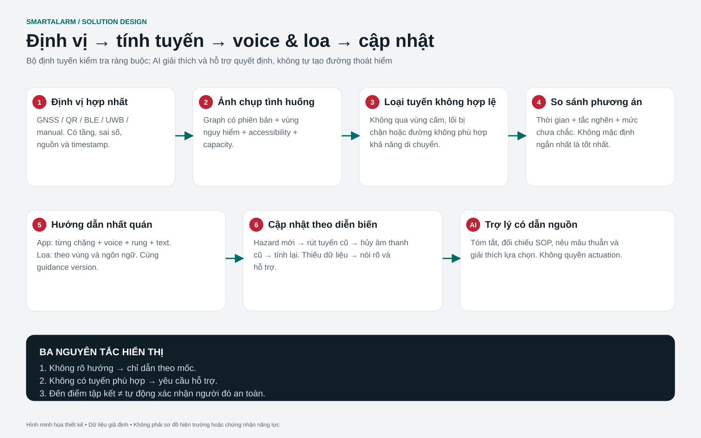

# SmartAlarm — Loa cứu hộ, dẫn đường bằng voice và tránh vùng nguy hiểm

Baseline production 1.0 · yêu cầu bổ sung ngày 23/10/2026. Tài liệu này là phần mở rộng bắt buộc của BRD/FRD/Basic/Detail Design, không phải ý tưởng giai đoạn sau.

## 1. Business requirement BR-09

Hỗ trợ người không có smartphone bằng hệ thống loa và hỗ trợ người dùng smartphone di chuyển bằng hướng dẫn giọng nói theo từng chặng. Cùng một incident phải tạo ra nội dung nhất quán giữa app, loa khu vực, màn hình và đội ứng cứu. Mục tiêu là đưa hướng dẫn đã được phê duyệt tới đúng người, đúng vùng, đồng thời thể hiện các giới hạn của dữ liệu. Không gọi tuyến là “an toàn tuyệt đối”; thiết bị và dữ liệu không quan sát được mọi nguy hiểm thực địa.

## 2. WF-21 — Public address / loa cứu hộ

Actor: PA author, approver, live announcer, device admin và local controller. Thiết bị: PA amplifier/controller, IP speaker, SIP audio endpoint khi có adapter hỗ trợ, loa gateway tại site, payload loa drone và phương tiện. Mỗi thiết bị khai báo zone coverage polygon/indoor zone, priority capabilities, audio formats, playback feedback, mic streaming support, local override, battery/power/network và health.

Luồng chuẩn: chọn incident → chọn vùng → preview coverage gaps → chọn bản ghi/TTS approved vi/en/ja → priority/repetition/expiry → duyệt exact message+zone digest → dispatch → controller ACK → per-speaker playback state → reconcile lỗi. Chọn “toàn khu vực” phải hiển thị số loa và vùng trước khi duyệt. Có thể dùng template emergency đã được duyệt trước theo local policy cho phản ứng nhanh, vẫn giữ actor/audit và scope.

Playback model: queued → accepted_by_controller → buffering → playing → completed, hoặc rejected/failed/unknown/preempted/expired. “Completed” nghĩa thiết bị báo đã phát hết nội dung, không đồng nghĩa mọi người đã nghe hoặc hiểu. Acoustic feedback nếu được trang bị phải là bằng chứng riêng; không suy ra từ network heartbeat. Loa lỗi tạo coverage gap và fallback task tới đội tuần tra/loa di động/app/SMS theo policy.

Priority arbitration ưu tiên đường báo động cục bộ được site authority chấp thuận; cloud không được tắt hoặc lấn quyền hệ thống fire alarm bắt buộc. Routine audio có thể preempt; emergency content tương đương cần arbiter/zone lease để tránh hai nội dung chồng nhau. Stop command chỉ dừng broadcast instance được chỉ định nếu capability hỗ trợ; không tự tắt toàn bộ báo cháy. Reconnect không phát lại thông báo hết hạn. Recording/microphone/live speech có quyền riêng, push-to-talk hoặc explicit start/stop; mic không bật khi chỉ mở màn hình.

Live rescue: xin microphone permission sau thao tác rõ; approve session zones; short-lived media token; indicators local + remote; max duration; lease heartbeat; timeout tự ngừng live channel theo controller policy. Không giả định mọi PA có two-way audio. Audio transport đề xuất WebRTC giữa announcer và regional media gateway; gateway chuyển SIP/RTP/vendor protocol theo capability, TLS/SRTP khi thiết bị hỗ trợ, mạng OT tách biệt. Recorded/TTS assets cache tại edge theo checksum/version để vẫn phát được local approved procedure khi WAN mất.

## 3. WF-22 — Smartphone voice navigation

Actor: citizen/responder; inputs gồm location report, floor anchor, heading quality, route graph version, hazard restrictions, accessibility profile, destination capacity và instruction template locale. Outputs: ordered steps có landmark, direction nếu đáng tin, distance estimate, expected node, voice text, expiry, route version và reason for replan. App có play/pause/repeat, text transcript, speech rate, haptic cues và fallback offline. Discreet mode không bị voice tự bật làm lộ vị trí.

Luồng: nhận alert → xác nhận tầng/vị trí (GPS ngoài trời; QR/BLE/UWB/manual trong nhà tùy triển khai) → chọn nhu cầu mobility → request route → kiểm tra freshness/authorization → hiển thị tuyến và lý do chọn → phát từng step → cập nhật vị trí → advance/replan → đến điểm tập kết → user tự báo an toàn. Đến geofence không tự xác nhận safe. Hướng cầm máy không đồng nghĩa hướng di chuyển; nếu heading quality thấp, chỉ dẫn theo mốc “đến biển CẦU THANG TÂY”, không trái/phải. Nếu floor không xác định hoặc map registration sai thì không turn-by-turn; hướng dẫn tìm mã vị trí hoặc SOS.

App tránh nguy hiểm bằng route graph có constraints, không đơn giản chọn vector ngược tâm polygon. Một tuyến càng xa đám cháy vẫn có thể đi vào ngõ cụt, vùng ngập hoặc tầng không phù hợp. Outdoor route kiểm tra network walkability, closures, polygon/hazard evolution và destination status; indoor route dùng cửa, cầu thang, refuge, exit và directional constraints được site review. Elevator không mặc định được dùng, chỉ khi approved evacuation plan rõ ràng cho capability cụ thể. Accessibility profile loại stairs nếu người dùng không thể dùng; nếu không có đường phù hợp, đề xuất assistance/refuge theo site plan, không tạo tuyến giả.

## 4. Services bổ sung và ownership

| Service | Owner data | API/events |
|---|---|---|
| Hazard & route guidance | Hazard polygons/restrictions, route request, route version, graph validation | POST /guidance/routes; guidance.updated/withdrawn |
| PA orchestration | Broadcast instance, zone lease, language sequence, repetition, device receipts | POST /broadcasts; broadcast.playback.changed |
| Speech content | Reviewed audio/TTS text, voice config, pronunciation lexicon, locale versions | POST /speech/previews; speech.asset.approved |
| Real-time media gateway | Short-lived live session/transport state, no business authority | POST /broadcasts/{id}/live-session; media.session.closed |

Mapping sở hữu graph/plan, Incident sở hữu restrictions approval references, Command service thực thi approved PA intent qua adapter. PA không được bypass command policy; Guidance không được tự sửa incident severity. Service additions áp dụng production cell deployment, HA và observability như các service lõi.

## 5. Data design và route algorithm

RouteNode(id,tenant,plan_revision,level,geometry,type,landmark_i18n); RouteEdge(id,from,to,direction,width_m,stairs,accessible,door_state,approval_ref). HazardRestriction(id,incident_ref,geometry/zone,level_range,source,certainty,severity,observed_at,valid_until,approved_by,version). RoutePlan(id,person_session,graph_revision,hazard_version,profile,destination,steps,issued_at,expires_at,state). Broadcast(id,incident,scope_digest,content_version,locale_order,priority,repeat_count,expires_at,state). PlaybackReceipt(broadcast,device,sequence,state,device_at,received_at,evidence_type).

Algorithm baseline: validate location/floor confidence → snapshot graph+restrictions+profile → remove forbidden/blocked/unknown-critical edges and destinations expired/closed → apply accessibility constraints → find feasible paths using Dijkstra/A* with distance, congestion estimate and exposure penalties → choose path only if hard safety constraints pass → produce landmark steps with localized templates → sign/cache route version with expiry. Exposure penalty không cho phép vượt hard exclusion bằng cách chọn “ngắn hơn”. Unknown edges xử lý conservative theo policy, không coi unknown là clear. Dynamic predictive hazard models chỉ advisory cho operator trừ khi được validated riêng; không tự forecast fire spread như bằng chứng chắc chắn.

Replan triggers: hazard version changed, new closure, destination closes, deviation vượt threshold, location/heading quality degrades, route TTL expires. Debounce và hysteresis chống xoay hướng liên tục; nguy hiểm mới cắt tuyến thì withdraw ngay không chờ debounce. Client phải cancel queued TTS của route cũ trước khi phát hướng dẫn mới. Khi chưa có route mới hợp lệ, phát thông báo không xác minh được tuyến và hiển thị SOS/approved local instructions; không phát lại turn cũ vì đang offline.

Các thresholds như location age ≤ 10 s cho step guidance, hazard recheck ≤ 30 s, route TTL ≤ 60 s là giả định thiết kế cần site trials; không dùng chung cho mọi hazard/indoor technology. Rule theo hazard có max age, source reliability và fallback được approved.

## 6. I18n, audio và intelligibility

Ba locale vi-VN/en/ja-JP có bản text và voice riêng, giữ nguyên semantics và variables. App chọn ngôn ngữ cá nhân; loa có language order theo audience/site policy. Không dùng một chu kỳ quá dài làm chậm chỉ dẫn chính: thiết kế primary-language immediate message và các bản tiếp theo có giới hạn, do operator preview tổng duration. TTS critical phrase được review pronunciation; tên địa điểm có lexicon và approved recording khi TTS không ổn định. Ngắt câu/đơn vị/cách đọc tầng phải phù hợp ngôn ngữ. Không nâng volume cực đại như giải pháp mặc định: coverage/intelligibility cần khảo sát acoustics và acceptance tại site.

Offline: cached graph/audio/instructions có revision và expiry. Khi hazard data quá cũ, chỉ dùng offline approved site procedure với nhãn dữ liệu cũ, không tiếp tục khẳng định tuyến động tránh nguy hiểm. Bluetooth/headphones, silent mode, permission và OS interruption làm delivery audio không chắc chắn; UI có visual/haptic alternative. Voice bắt đầu theo interaction/permission và policy đã consent; critical alert entitlement của OS là integration task riêng, không giả định app luôn bật loa được.

## 7. API details

POST /v1/guidance/routes: location{method,accuracy_m,observed_at,floor_ref,heading,heading_accuracy}, incident_id, mobility_profile, locale; response route_id/version, graph_revision,hazard_revision,expires_at,quality,steps[]. Mỗi step có landmark_i18n_key, direction enum optional, distance_m optional, speech_template_ref và prohibited-actions. Không đủ data trả 422 LOCATION_UNCERTAIN hoặc 409 NO_VERIFIED_ROUTE kèm safe fallback object, không HTTP success với đường rỗng.

POST /v1/broadcasts: incident_id,zone_refs[],content_versions[],priority,repeat_count,expires_at,idempotency_key; 201 draft. POST /{id}/approve: exact digest + version; POST /{id}/start: command intent sau policy, 202 chưa playback. GET /{id}/receipts: per-device accepted/playing/completed/unknown. POST /{id}/stop: instance-scoped, permission, controller capability. POST /{id}/live-session: session TTL, approved zones, media endpoint token; UI không hiển thị credential. Device telemetry ingestion source-bound và monotonically sequenced để receipt trễ không rollback state.

## 8. Acceptance scenarios bắt buộc

### Bổ sung v2: hình, lời đọc và hiệu lực cùng một quyết định

C35/C36 đặt mốc đã xác minh và một việc tiếp theo trước trường kỹ thuật; C03 là mặt bằng, không mặc nhiên là tuyến khả dụng. C37 thể hiện tuyến cũ bị thu hồi; C38 thể hiện vị trí/tầng/hướng chưa đủ; C39 cần chuyển đúng bối cảnh ngoài nhà. Không hiển thị mũi tên rẽ khi heading chưa rõ. Nhận biết mốc không được diễn đạt thành cam kết đoạn đường an toàn.

| Ca kiểm thử | Kết quả bắt buộc |
|---|---|
| Thu hồi tuyến trong lúc đọc C35 | Ngắt âm và xóa hàng đợi chứa revision cũ; đồng thời xóa overlay và câu hướng dẫn. C37 chỉ mở tuyến thay thế khi có bản duyệt mới; nếu chưa có, cung cấp trợ giúp. |
| QR đúng tầng nhưng không có heading | Hiện nguồn vị trí, mốc và hướng chưa rõ; không đọc “rẽ trái/phải”. C38 cho nhập tay hoặc nhờ hướng dẫn. |
| Người dùng dừng / đổi ngôn ngữ / chuyển màn | Âm cũ dừng; nghe lại chỉ đọc bản hiện còn hợp lệ. Có bản chữ tương đương, không phụ thuộc TTS hoặc biểu tượng loa. |
| Chế độ riêng C27 | Không phát âm/rung tự động; nút thoát nhanh không kích hoạt speech; trở lại không phát tiếp âm trước đó. |
| P04/P09 nhận ACK gateway nhưng chưa có playback | Hiện riêng nhận lệnh, trạng thái phát, vùng chưa rõ và kiểm chứng nghe tại chỗ; không ghi “mọi người đã nghe”. |

Prototype có nút nghe/dừng chủ động bằng Web Speech và nội dung mẫu; không phải bản tin được phê duyệt cho tình huống thật. Việc nghe được trên máy reviewer không chứng minh đúng voice, phát âm địa danh, khả năng nghe rõ hiện trường hoặc coverage loa. Chấp nhận production cần kiểm tra bản chữ/âm theo revision, biến template, VI/EN/JA, ưu tiên tủ cục bộ và mất nối. Âm cảnh báo trên loa công cộng và âm điện thoại kín đáo là hai chính sách riêng; không dùng một toggle để điều khiển cả hai.

PA-01 đúng 8 loa đã chọn, không phát sang site khác. PA-02 một loa network online nhưng amplifier fault vẫn báo coverage gap. PA-03 controller ACK không hiện “mọi người đã nghe”. PA-04 reconnect sau expiry không phát thông điệp cũ. PA-05 local fire controller priority không bị cloud override. PA-06 hai announcer tranh cùng zone chỉ một lease hợp lệ; người còn lại thấy conflict. PA-07 mic chỉ mở sau user action và tắt khi session hết hạn. PA-08 drone payload không feedback hiển thị unknown, không complete giả.

NAV-01 vị trí tầng chưa xác định không đưa rẽ trái/phải. NAV-02 hazard cắt route đang đi thì rút route và hủy TTS cũ. NAV-03 người dùng wheelchair không được route qua cầu thang. NAV-04 no feasible path chuyển assistance/refuge theo approved plan. NAV-05 mất mạng và hazard TTL hết hạn không giữ nhãn route current. NAV-06 vi/en/ja đọc đúng landmark, đơn vị và hướng; text/audio parity. NAV-07 route app và PA dùng cùng guidance version hoặc hiện mismatch cần operator xử lý. NAV-08 arrival không tự safe. NAV-09 emergency navigation không yêu cầu tác vụ nhập liệu dài. NAV-10 heading không đáng tin sử dụng landmark, không hướng tương đối.

## 9. Mockup coverage

C35–C40: navigation từng chặng, uncertainty, reroute, outdoor, voice settings. P01–P09: zone/coverage, author/approve, playback, health, live mic, mobile speaker, content và priority. S15–S16: graph editor/test/approval. O35–O36: hazard restriction và consistency/receipt. Các trạng thái offline/error/accessibility dùng chung X01–X10 cùng state selector. Tất cả là màn baseline bắt buộc của full product.

<!-- PHYSICAL_DESIGN_1_0 -->

## 10. Baseline 1.0 — phối hợp loa với chữa cháy và cứu hộ vật lý

WF-28–WF-33 bổ sung thiết bị vật lý trong cùng incident, nhưng PA, release chữa cháy và điều khiển phương tiện là ba miền capability riêng. PA nhận hazard/guidance version và trạng thái site đã được phê duyệt; không coi flow switch, pump run hoặc valve open là bằng chứng đám cháy đã tắt để tự phát “an toàn”. Thay đổi cause-and-effect tại controller phải qua engineering review/FAT/SAT, không do TTS hoặc AI tạo ra.

Hệ thống voice alarm được chứng nhận và đường báo cháy cục bộ giữ ưu tiên; adapter SmartAlarm phải tuân phạm vi chứng nhận của cấu hình lắp đặt. Unknown/failed PA receipt sinh coverage gap và nhiệm vụ đội hiện trường. Test/impairment của loa phải thể hiện phạm vi, biện pháp bù và thời hạn; không kết thúc fire watch chỉ vì cloud kết nối lại. Local takeover thu hồi lease live, giữ recording/audit theo policy và không bật mic lại tự động.

Loa drone dùng đúng cặp thiết bị được xác minh: Matrice 4T+AS1 là workflow operator khi API cụ thể chưa xác minh; Matrice 400+V1 có hướng SDK được tài liệu hãng công bố, vẫn cần kiểm chứng từng thao tác trên firmware chọn. Không suy native TTS tiếng Việt từ việc hỗ trợ tiếng Anh/Nhật; dùng bản ghi đã review nếu cần. F19 ghi pilot, mission authority, vùng phát, expiry, local abort và trạng thái âm thanh; phát loa không cấp quyền tự bay. Robot Colossus có nhiệm vụ phun/vận chuyển nhưng API công khai chưa rõ: chỉ dispatch tới console operator đủ năng lực, không chuyển message thành lệnh di chuyển/phun.

Acceptance bổ sung: PA-PHY-01 local fire priority không bị live cloud lấn; PA-PHY-02 telemetry suppression chưa xác minh không đổi nội dung thành all-clear; PA-PHY-03 local override chấm dứt quyền remote, reconnect không phát lại; PA-PHY-04 test zone không phát tới actual audience; PA-PHY-05 expired drone message không phát sau recovery; PA-PHY-06 thiếu SDK playback feedback giữ unknown và yêu cầu operator evidence. Các bài thử có nghe hiểu hiện trường và chứng kiến của site; prototype không thay nghiệm thu. Xem [danh mục thiết bị](Rescue-IoT-Device-Catalog.md), F09–F19 trong [đặc tả màn hình](Screen-Specifications.md).
